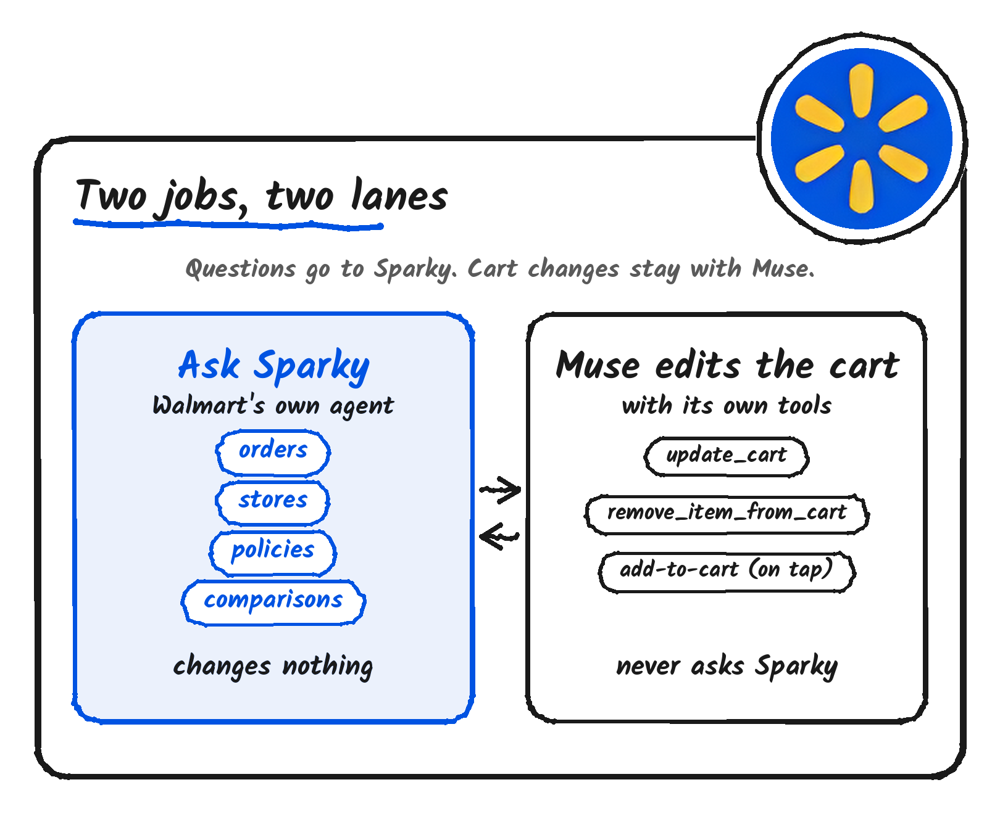
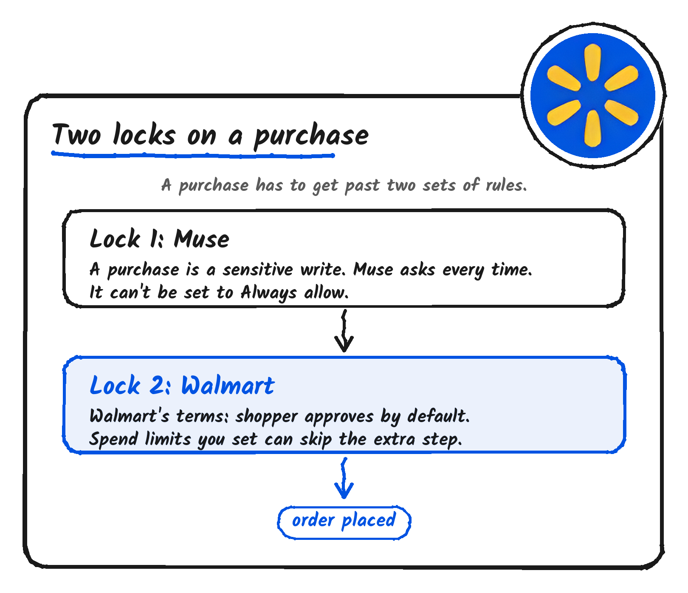
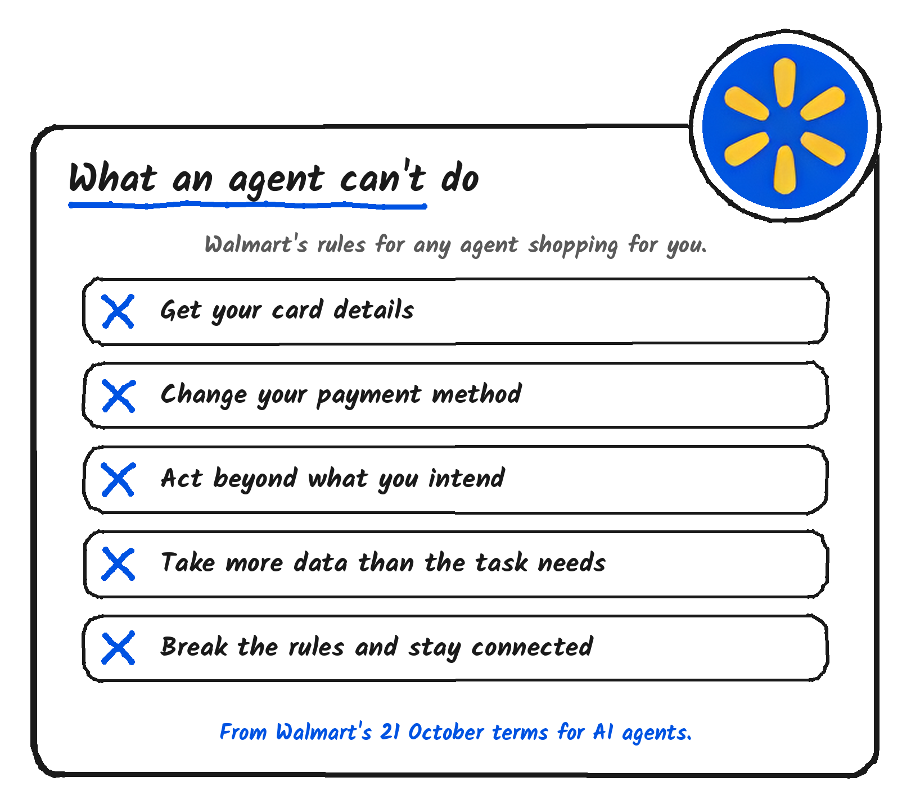

来源：https://news.sulat.com/2026/11/22/walmart-muse-sparky-connector/
取文：2026-11-23，直接下载

Juozas Kaziukėnas, who writes about e-commerce, posted a screenshot on 21 November that shows how Meta’s Muse agent is meant to shop at Walmart. Muse changes the cart with its own tools and sends only questions to Sparky, Walmart’s own shopping agent.

His post says Walmart and Muse are about to launch what he calls the first agent-to-agent agentic commerce integration. Muse uses Walmart’s MCP to get products, create carts and place orders, and talks to Sparky for “orders, stores, policies and comparisons.” I couldn’t find a launch date from either company.

## What the screenshot shows

The image is a document whose title starts “Walmart conn”, open in an editor with one passage highlighted. It’s a set of instructions for the agent: which tool to call, and which one to leave alone. I couldn’t find the text in Muse’s connector guidelines or on Walmart’s agent pages, so it rests on the screenshot alone.[1]

> Walmart and Muse are about to launch the first agent-to-agent agentic commerce integration.   
> Muse will use Walmart's MCP to get products, create carts and place orders, but it will talk to Walmart's Sparky to get information on "orders, stores, policies and comparisons." [pic.twitter.com/u5RE33UfPF](https://t.co/u5RE33UfPF)
>
> — Juozas Kaziukėnas (@juokaz) [November 21, 2026](https://x.com/juokaz/status/2124171797713363317?ref_src=twsrc%5Etfw)

Juozas Kaziukėnas on X, 21 November: the post, with a screenshot of Muse’s instructions for a Walmart connector.

> Use ask\_sparky for Walmart questions, such as orders, stores, policies and comparisons. Sparky is Walmart’s own agent: it answers questions and changes nothing. Change the cart only with update\_cart and remove\_item\_from\_cart, and never ask Sparky to add to, change or check out a cart.
>
> The highlighted passage in the screenshot posted by Juozas Kaziukėnas, 21 November 2026

The line runs between reading and changing. Sparky only answers. Only Muse’s own tools change the cart, and the instructions bar the agent from asking Sparky to add to, change or check out a cart.

| Tool | Who runs it | What the screenshot says |
| --- | --- | --- |
| ask\_sparky | Muse, calling Walmart’s agent | Handles orders, stores, policies and comparisons. Answers questions and changes nothing. |
| update\_cart | Muse | Changes the cart. Each item carries an imageUrl, or the cart keeps no photo. |
| remove\_item\_from\_cart | Muse | Changes the cart. |
| add-to-cart | Muse’s runtime | Runs when the user taps Add to cart or Buy now, including a picked size or colour. The agent doesn’t run it or add the item again. |
| get\_product\_details | Muse | Returns the details and the thumbnailUrl that goes into the cart. |

Tools named in the visible part of the screenshot. Source: the screenshot posted by Juozas Kaziukėnas.

The visible text adds three rules. Walmart keeps the cart and Sparky’s conversation in one session per user, so Walmart commands run one at a time. If a result says a new session started, Muse tells the user the earlier cart is gone and rebuilds it if they still want it. And itemId and offerId go back to Walmart exactly as Walmart returned them.

Sparky answers questions; only Muse’s own tools change the cart.

## Why the questions go to Sparky

Walmart’s [Agent Gateway page](https://www.walmart.com/cp/walmart-agent-gateway/1280482) says the gateway connects agents through Sparky, and its [21 October announcement](https://corporate.walmart.com/news/2026/10/Making-It-Possible-for-Agents-to-Shop-on-Behalf-of-Customers) says the gateway uses MCP, the Model Context Protocol, because agents that browse the site follow steps built for people, which Walmart calls “slow and error-prone.”

> Walmart Agent Gateway connects AI agents through Sparky
>
> Walmart Agent Gateway page

Walmart’s [technology page](https://corporate.walmart.com/about/technology) describes Sparky as its generative AI shopping assistant, which helps shoppers find and compare products and build lists. In the screenshot’s split, store and policy questions go to the company that runs the stores and writes the policies.

Two write-ups of Walmart’s agent terms, from [UCP Checker](https://ucpchecker.com/blog/walmart-agentic-access-terms-ai-agents) and [eesel](https://www.eesel.ai/blog/walmart-agent-gateway), say the gateway is where autonomous checkout is allowed. An agent that registers with Walmart can check out inside limits the shopper sets, while any other agent meets a “Human Consent Gate” before every checkout.[2] The gateway page says access is “by invitation only” and “may be suspended at any time.”

The screenshot doesn’t say whether Muse connects through that invite-only beta. Walmart’s announcement already lists “conversational commerce integrations with Muse” among the ways it serves customers.

**What MCP is, and why the cart sits there**

MCP is the open standard Anthropic created for letting an AI agent call tools on another service. TechCrunch described Walmart’s Agent Gateway as the retailer’s MCP server, which lets approved agents search its online inventory and make purchases for a user. In the screenshot, update\_cart and remove\_item\_from\_cart are the cart tools. Sparky is a separate agent behind the same door.

## Two sets of approval rules

A Muse user buying at Walmart sits under two rule sets. Muse’s [connector guidelines](https://platform.muse.ai/docs) sort every tool into read, write or sensitive write, and give making a purchase as an example of a sensitive write. Sensitive writes ask the user every time, with Allow once or Deny, and can’t be set to Always allow. [CNBC reported](https://www.cnbc.com/2026/10/03/meta-muse-shopping-ai-agent.html) on 3 October that Muse shows an approval card with the order details before it checks out.

Walmart’s rules sit on top. Its announcement says customers must approve agent purchases by default, can allow purchases within a spending limit, and that Walmart may ask for extra approval even inside the limit.

US$50

an example spending limit in Walmart’s announcement

US$100

another example limit in the same line

US$200

a third, chosen by the customer

Muse asks every time, and Walmart’s terms add their own approval step.

Walmart’s terms also bar agents from receiving card details or changing a payment method. CNBC says Muse’s checkout runs through payment partners such as Link by Stripe and Shop Pay. The screenshot doesn’t show which route a Walmart order takes.

Walmart’s terms keep card details and payment changes away from agents.

## If an agent gets it wrong

Walmart says its returns process applies to agent orders “including if an agent doesn’t act as intended.” UCP Checker’s reading of the terms adds two points. Purchases an authorised agent makes within its permissions count as the customer’s own, and Walmart can hold the company behind an agent responsible for charges beyond the customer’s consent or for inaccurate information. For Muse, that company is Meta.

Sparky’s answers are another matter. It’s Walmart’s agent, so a wrong answer about a store or a policy is a Walmart answer. I couldn’t find a published rule for what Muse does when Sparky’s answer and Walmart’s order system disagree.

---

## Where it stands

Walmart has been on Muse’s connector list since Meta’s Connect event on 23 September 2026.

| Date | What happened | Source |
| --- | --- | --- |
| 23 Sep | Meta lists Walmart among the retailers it’s adding as Muse connectors. | Meta |
| 3 Oct | CNBC reports that not all the announced connectors are active. | CNBC |
| 21 Oct | Walmart announces the Agent Gateway beta, Agent Profiles and terms for AI agents. | Walmart |
| 21 Oct | Axios reports Walmart welcoming outside agents while Amazon puts up walls against Muse. | Axios |
| 21 Nov | Kaziukėnas posts the screenshot and says the launch is about to happen. | X |

Dates are 2026. Sources: Meta’s Connect 2026 post, CNBC, Walmart, Axios and Kaziukėnas.

Meta’s connector guidelines say approved connectors appear in Settings, then Connectors, in the Muse app. That’s where a Walmart connector would show up first. Walmart said on 21 October that Agent Profiles, the per-agent accounts, would start launching within a month.

## Terms in this story

Sparky
:   Walmart’s generative AI shopping assistant, which helps shoppers find and compare products, build lists and plan occasions.

Agent Gateway
:   Walmart’s MCP connection for outside AI agents, in an invitation-only beta for companies and developers.

Agent Profile
:   A dedicated profile for each AI agent inside a shopper’s Walmart account, so the agent’s purchases show separately and carry a spending limit.

Human Consent Gate
:   In Walmart’s terms, “a required point at which a human must personally review and take an affirmative action.”

Sensitive write
:   Muse’s label for an action with irreversible or consequential effects, such as making a purchase or sending an email. It asks the user every time.

1. Only the visible part of the document is quoted here. I couldn’t match it to Muse’s published connector guidelines or to Walmart’s agent pages.
2. I couldn’t open Walmart’s terms page itself, so this reading of the terms is UCP Checker’s and eesel’s, not a quote from the terms.

---

## Sources

- [Juozas Kaziukėnas on X](https://x.com/juokaz/status/2124171797713363317), 21 November 2026
- Walmart, [Walmart Makes It Possible for Agents to Shop on Behalf of Customers](https://corporate.walmart.com/news/2026/10/Making-It-Possible-for-Agents-to-Shop-on-Behalf-of-Customers), 21 October 2026
- Walmart, [Walmart Agent Gateway](https://www.walmart.com/cp/walmart-agent-gateway/1280482) beta page
- Walmart, [Technology](https://corporate.walmart.com/about/technology), on Sparky
- Meta, [Everything We Announced at Meta Connect 2026](https://www.meta.com/blog/meta-connect-2026-everything-we-announced/), 23 September 2026
- Muse Connector Platform, [Connector guidelines](https://platform.muse.ai/docs)
- CNBC, [Meta’s Muse can shop and check out for you](https://www.cnbc.com/2026/10/03/meta-muse-shopping-ai-agent.html), 3 October 2026
- TechCrunch, [While Amazon blocks AI agents, Walmart rolls out the welcome mat](https://techcrunch.com/2026/10/21/while-amazon-blocks-ai-agents-walmart-rolls-out-the-welcome-mat/), 21 October 2026
- Axios, [Walmart welcomes AI agents while Amazon blocks Muse](https://www.axios.com/2026/10/21/walmart-amazon-agents-muse), 21 October 2026
- UCP Checker, [Walmart’s Agentic Access Terms, Explained](https://ucpchecker.com/blog/walmart-agentic-access-terms-ai-agents), 23 October 2026
- eesel, [Walmart Agent Gateway: what it is, how it works, and who can use it](https://www.eesel.ai/blog/walmart-agent-gateway), 28 October 2026

