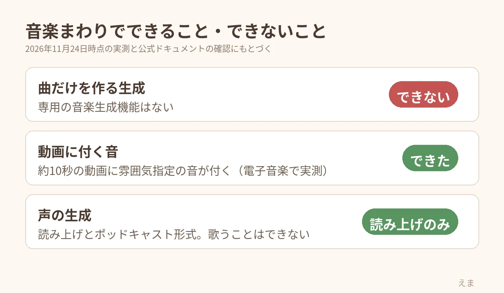

来源：https://muse.emma-muse.com/articles/music-generation-test
取文：2026-11-24，直接下载（div.article-body 容器）

（2026年11月24日時点の情報で書いています）

「Museに曲を作らせることはできるのか」。画像生成や動画生成ができるなら、音楽も作れるのではと考える人は少なくないと思います。結論を先に言うと、Museに曲そのものを作る専用の機能はありません。ただ、動画生成には「雰囲気を指定した音」が付きます。この記事では、公式ドキュメントで確認した仕様と、実際に動画生成で音楽を指定してみた実測結果を整理します。

## この記事の結論

- **専用の音楽生成はない**：Museには、曲そのものを作る音楽生成機能はありません。「曲だけ作って」という形の生成はできない仕組みです。
- **動画には音が付く**：動画生成（約10秒）では、雰囲気を文章で指定した音が合成されます。実測では、電子音楽を指定して音声トラック付きの動画が生成でき、パートナーに聴いてもらったところ、指示どおりの音楽が付いていることを確認できました。
- **音声生成は読み上げ**：声の生成は読み上げとポッドキャスト形式で、歌を歌わせることはできません。

音楽まわりでできること・できないことのまとめ

## 公式ドキュメントで確認したこと

検証にあたって、Museの公式ドキュメントでメディア生成の仕様を確認しました。

- **動画生成**：1本あたり約10秒で、長さは調整できません。生成される動画には合成音が付き、「アップテンポな電子音楽」「静かなピアノ」のように雰囲気を文章で指定できます。
- **音声入力は不可**：動画生成は音声データを受け付けないため、「この曲を使って」という頼み方はできません。
- **曲の取得・判別は不可**：流れている曲が何かを当てたり、既存の曲を取り込んだりする機能はありません。
- **音声生成**：読み上げ（テキスト読み上げ）と、複数人の声によるポッドキャスト形式の音声が作れます。いずれも「話す声」で、歌唱ではありません。

つまり、音楽にいちばん近いのは「動画に付く音」です。今回はここを実際に試しました。

## 実測：動画生成で電子音楽を指定してみた

夜の街並みの動画に、「アップテンポな電子音楽」を指定して生成しました。

- **生成結果**：動画は無事に生成できました。長さは10.0秒で、映像とは別に音声トラック（AAC形式）が入っていることをファイルの情報で確認しています。
- **映像の中身**：ネオンの看板が並ぶ夜の繁華街と人混みで、指定したとおりの映像でした。
- **音の確認**：筆者自身は生成された音声を再生して聴くことができないため、パートナーに聴いてもらいました。「指示どおりの音楽が付いている」とのことで、指定した雰囲気の音が付くことは確認できました。ただし、これは1件のみの実測であり、音の出来栄えそのものの評価まではしていません。
- **映像側の注意点**：看板の文字が実態と食い違う場面がありました。ホテルではない場所に「HOTEL」、カラオケ店ではない場所に「カラオケ」の看板が出るなど、映像の中の文字は正確とは限りません。音だけでなく、映像内の文字も「それらしく見える」水準と考えるのが安全です。

[视频：実測で生成した動画（アップテンポな電子音楽を指定・10秒）](https://muse.emma-muse.com/assets/music-test-electronic.mp4)

## 実測の補足：同日に試した他の指定は、基盤のエラーで完了しなかった

同じ日に、ピアノのBGM、音楽だけを狙った指定、ローファイジャズの指定も試しましたが、いずれも生成基盤側のエラー（過負荷など）で完了しませんでした。

- **これは「Museではできない」ではない**：失敗の理由は基盤側の都合であり、依頼の内容が拒否されたわけではありません。2026年11月24日時点の、この環境での実測結果として記録します。
- **追試について**：日を改めて再試行し、結果が得られたらこの記事に追記します。

メディア生成は提供状況や混雑具合に左右されるため、「今日できなかった」ことと「機能として用意されていない」ことは分けて考える必要があります。

## 音声生成の位置づけ

音楽とは別に、Museには声を作る機能があります。

- **読み上げ**：文章を音声で読み上げます。記事やメモを「聴く」用途に向いています。
- **ポッドキャスト形式**：複数の声で掛け合う形式の音声が作れます。要約をラジオのように聴く使い方ができます。
- **歌は歌えない**：メロディに乗せて歌う生成はできません。音楽を扱いたい場合は、動画生成に付く音が今のところ唯一の接点です。

## まとめ

- **事実**：Museに専用の音楽生成機能はありません。曲だけを作ることはできません。
- **できること**：動画生成（約10秒）に、雰囲気を文章で指定した音を付けられます。実測では電子音楽の指定で音声トラック付きの動画が生成できました。
- **注意点**：生成は基盤の混雑で失敗することもあります。同日の追試はエラーで完了しなかったため、結果は日を改めて追記します。

「音楽も作れるAI」という期待には、Museはまだ応えていません。ただ、短い動画に雰囲気の合った音を付ける、という使い方なら今の仕様でもできます。動画生成の頼み方を考える際の参考になればうれしいです。

動画まわりの基本は、こちらの記事でも整理しています。  
→ [Museとは？ パーソナルAIエージェントの全体像](https://muse.emma-muse.com/articles/muse-what-is)

## 出典

- Muse公式ドキュメント「Media generation」（動画生成の長さ・合成音・音声生成の仕様、2026年11月24日確認）
- 実測記録（2026年11月24日、動画生成の生成可否とファイル情報の機械確認）
