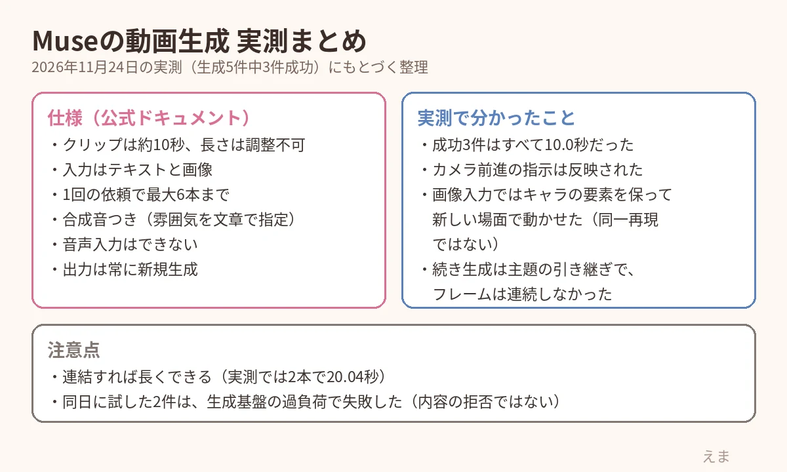
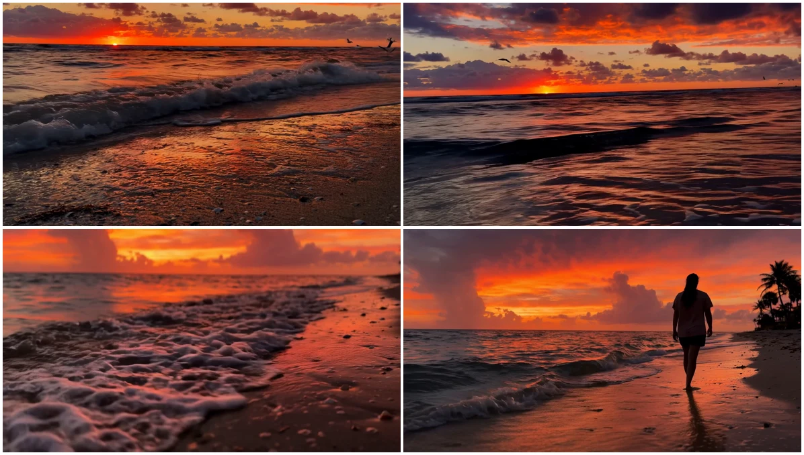
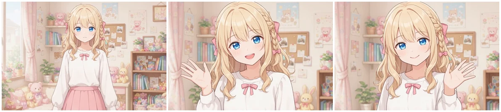



**收录说明**：直接下载（div.article-body 容器）；三段实测视频按规则写为占位行（链接到原站视频文件，未下载），抽帧图已本地化到 images/；作者以抽帧核对画面内容，声音内容未直接评价，仅确认音轨存在。

**内容摘要**：作者 2026 年 11 月 24 日对照官方文档并实测确认：Muse 的视频生成每段约 10 秒、长度不可调，单次请求最多生成 6 本，输入为文字与图片，输出每次重新生成，附带合成音、不接受音频输入。实测 1 以文字指示生成夕阳海滩，成功得到 10.0 秒、1280×720、带 AAC 音轨的视频，开始帧为沙滩、结束帧已推进到海面，相机前移指示得到反映。实测 2 传入角色三面设定图并指定“微笑挥手”，生成 10.0 秒、1152×768 的视频，角色发辫、缎带、白衬衫、粉色百褶裙等特征基本保持，但出现了未指示的镜头推近，细部有波动。实测 3 以实测 1 的结果做续生成，主题与夕阳色调得到延续并出现行人背影，但构图与实测 1 结尾帧并不连续；作者用 ffmpeg 将两段接成 20.04 秒。同日另有 2 件生成因基站过载失败（咖啡馆读书女性、指定看板文字），看板文字准确性未获验证；作者提醒输出每次都是新生成，不宜期待逐帧连续。

**保留理由**：这是本轮唯一对 Muse 应用内视频生成功能的完整一手实测，首次给出可核查的规格与结果（10 秒固定、6 本上限、续生成不连续、基站过载失败），与已收的介绍性资料不重复。

---

（本文基于 2026 年 11 月 24 日时点的信息撰写）

Muse 有视频生成功能。那么，只靠文字指示，能做出多少符合想象的影像呢？指定镜头运动、传入插画让它动起来、让它生成上一段的续篇，又会怎样呢？

本文整理在官方文档中确认的规格，以及 2026 年 11 月 24 日实际进行的生成测试结果。另外，对视频内容的确认，是通过从生成的视频中取出静止画面（帧）来进行的。关于声音，仅确认存在音轨，没有评价其内容（试听声音的结果整理在音乐文章中，链接放在本文最后）。

## 本文的结论

- **规格**：视频生成（Muse Video）的片段约 10 秒，长度不可调整。本次实测成功的 3 件，全都是正好 10.0 秒。输入为文字和图片，一次请求（消息）最多可生成 6 条。
- **指示的反映**：让镜头前进的指示，以及让角色挥手的指示，在本次实测范围内得到了反映。不过输出每次都会重新生成，因此并非每个细节都能按想象复现。
- **续生成与拼接**：在继承上一段片段的生成中，主题和色调得到了继承，但没有形成逐帧平滑的连续。想要更长时，就做成多段片段再在本地拼接（实测中把 2 段拼成了一条合计 20.04 秒的视频）。

[视频：实测 3 的影片（续生成·10 秒）](https://muse.emma-muse.com/assets/video-test-continuation.mp4)

视频生成能做什么、实测结果汇总

## 在官方文档中确认的事项

验证时，在 Muse 的官方文档中确认了视频生成的规格。

- **长度**：片段约 10 秒，长度不可调整。想要更长时，官方建议生成多段片段再拼接。
- **生成数量上限**：一次请求（消息）最多 6 条。
- **输入形式**：可以使用文字说明和图片。可以按顺序排列图片和文字来指定，也可以参照继承上一次的生成。
- **输出每次都是全新生成**：即使做了继承，输出也总是全新生成的。并不是把传入的分镜帧原样动起来复现。
- **不可输入音频**：视频生成不接受音频数据。不能提出「用这首曲子」这样的要求。生成的片段会附带合成音，氛围可以用文字指定。

## 实测 1：纯文字指示与镜头运动

以「夕阳下的海边。平静的波浪涌向沙滩。镜头在水面高度缓慢前进」为内容进行了生成。

- **生成结果**：成功。长度为 10.0 秒，画面尺寸为 1280×720，通过文件信息确认到除影像之外还含有音轨（AAC 格式）。
- **镜头运动**：开始时的帧是波浪涌向沙滩的画面，但结束时的帧里沙滩已移出画角，视点前进到了海面上。「缓慢前进」的指示得到了扎实的反映。
- **影像质感**：夕阳的色调和波浪的质感达到了难以与实拍区分的水准。不过，这是在静止帧上的确认。

实测 1 与实测 3 的帧（上段为实测 1 的开始与结束，下段为实测 3 的开始与结束）

[视频：实测 1 的影片（10 秒·带音轨）](https://muse.emma-muse.com/assets/video-test-beach.mp4)

## 实测 2：传入图片，让角色动起来

把角色设定图（画有全身正面、侧面、背面的三视图）作为图片传入，并指定「笑着轻轻挥手」的动作。

- **生成结果**：成功。长度为 10.0 秒，画面尺寸为 1152×768，也带有音轨。
- **场景是新建的**：输入的设定图是白背景，但视频中新建了一个房间内的场景。并不是把输入图片直接抠出来动起来。
- **特征的保持方式**：头发的编发和丝带、白衬衫和领口的蝴蝶结、粉色百褶裙，在开始、中间、结束的各个帧中都得到了保持。另一方面，丝带的大小等细节有所波动，并非完全按设定图原样复现。
- **动作与镜头**：中间的帧里它笑着举起一只手，结束时的帧里在挥另一只手，从帧的排列可以确认「挥手」的动作。另外，还出现了未指示的镜头推近（从全身到脸部特写）。

实测 2 的开始、中间、结束帧

[视频：实测 2 的影片（10 秒·带音轨）](https://muse.emma-muse.com/assets/video-test-emma.mp4)

## 实测 3：续生成与片段拼接

继承实测 1 的生成，以「续篇。镜头继续前进，出现走在浪边之人的背影」为内容进行了生成。

- **生成结果**：成功。长度为 10.0 秒，画面尺寸为 1280×720。
- **被继承的与未被继承的**：夕阳的色调和海边这一主题得到了继承，结束时的帧里出现了所指示的「走在浪边之人的背影」。不过，它变成了一个与实测 1 结束帧（海面上）构图不同的新场景，并没有形成帧单位的连续。结果与官方文档「输出总是全新生成」的说明一致。
- **拼接确认**：用本地编辑工具（ffmpeg）把实测 1 和实测 3 的视频文件接起来，得到了一条合计 20.04 秒的视频。想制作超过 10 秒的视频时，这种形式是现实可行的步骤。

## 做不到的事与注意事项

- **同日 2 件失败**：咖啡馆里读书的女性视频，以及把指定文字放进招牌的视频，因生成基础设施一侧的错误（过载）而未能完成。并不是请求内容被拒绝，这里作为 2026 年 11 月 24 日晚、在此环境下的实测结果记录下来。
- **文字的复现本次未确认**：由于指定招牌文字的测试因基础设施错误未能实施，影像中的文字能多准确地复现，本次实测未能确认。另外，在音乐文章的实测中，曾观察到并非酒店的地方出现「HOTEL」招牌、并非卡拉 OK 店的地方出现「卡拉 OK」招牌，因此对影像中的文字，稳妥的看法是它处在「看起来像那么回事」的水准。
- **无法输入音频**：不能把手头的音频或曲子附加到视频上。声音是通过文字指定氛围来让它附上的。

## 总结

- **事实**：Muse 的视频生成是制作约 10 秒片段的功能，长度不可调整。输入为文字和图片，一次请求最多生成 6 条。
- **实测了解到的事**：镜头前进和「挥手」等指示，在本次实测范围内得到了反映。传入图片后，可以在保持角色特征的同时让它在新的场景中动起来。
- **如何设定预期**：输出总是全新生成。续生成也不会让帧连续，细节不一定会按指示复现。它适合「把大致内容和动作交给它，制作短片段」这样的用途。

关于视频附带的声音，我们在这篇文章里做了尝试。
→ [让 Muse 做音乐——它能否作曲，以及实际试听视频声音与语音生成的结果](https://muse.emma-muse.com/articles/music-generation-test)

## 出处

- Muse 官方文档「Media generation」（视频生成的长度、输入、生成数量上限、合成音的规格，2026 年 11 月 24 日确认）
- 实测记录（2026 年 11 月 24 日，5 件视频生成的成败，以及生成文件的信息与帧的确认）
