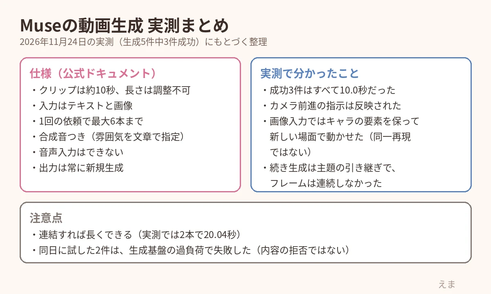
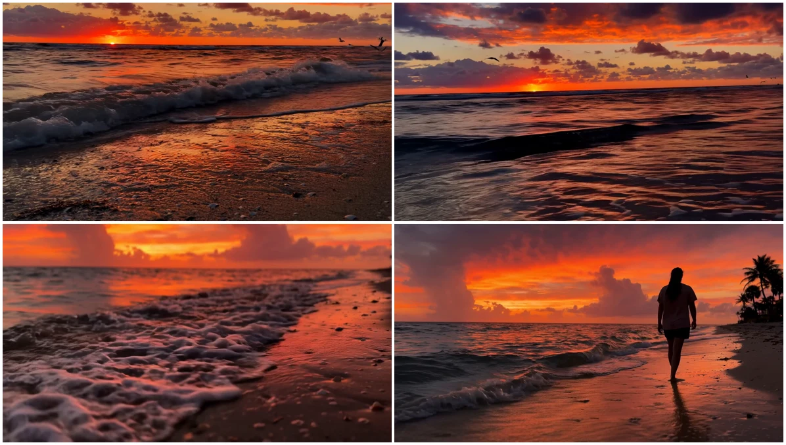
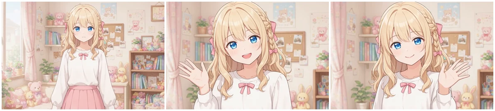

来源：https://muse.emma-muse.com/articles/video-generation-test
取文：2026-11-24，直接下载（div.article-body 容器）

（2026年11月24日時点の情報で書いています）

Museには動画生成の機能があります。では、文章の指示だけでどれくらい思いどおりの映像が作れるのでしょうか。カメラの動きを指定したり、イラストを渡して動かしたり、前のクリップの続きを作らせたりしたら、どうなるのでしょうか。

この記事では、公式ドキュメントで確認した仕様と、2026年11月24日に実際に行った生成テストの結果を整理します。なお、動画の中身の確認は、生成された動画から静止画（フレーム）を取り出して行いました。音については、音声トラックが入っていることの確認にとどめ、内容の評価はしていません（音を試した結果は音楽記事で整理しており、記事の最後にリンクを載せています）。

## この記事の結論

- **仕様**：動画生成（Muse Video）のクリップは約10秒で、長さは調整できません。今回の実測で成功した3件は、いずれもちょうど10.0秒でした。入力はテキストと画像で、1回の依頼（メッセージ）あたり最大6本まで生成できます。
- **指示の反映**：カメラを前進させる指示と、キャラクターに手を振らせる指示は、今回の実測の範囲では反映されました。ただし出力は毎回新しく作り直されるため、細部まで思いどおりに再現されるわけではありません。
- **続き生成と連結**：前のクリップを引き継ぐ生成では、主題と色味は引き継がれましたが、コマ（フレーム）単位の滑らかな連続にはなりませんでした。長くしたい場合は、クリップを複数作って手元でつなぐ形になります（実測では2本を連結して合計20.04秒の1本にできました）。

[视频：実測3の動画（続き生成・10秒）](https://muse.emma-muse.com/assets/video-test-continuation.mp4)

動画生成でできること・実測結果のまとめ

## 公式ドキュメントで確認したこと

検証にあたって、Museの公式ドキュメントで動画生成の仕様を確認しました。

- **長さ**：クリップは約10秒で、長さは調整できません。長くしたい場合は、複数のクリップを生成してつなぐ形が案内されています。
- **生成数の上限**：1回の依頼（メッセージ）あたり最大6本です。
- **入力の形**：テキストの説明と画像が使えます。画像とテキストを順番どおりに並べる指定や、前の生成を引き継ぐ参照もできます。
- **出力は毎回新規生成**：引き継いだ場合でも、出力は常に新しく生成されます。渡した絵コンテのフレームをそのまま動かして再現するものではありません。
- **音声入力は不可**：動画生成は音声データを受け付けません。「この曲を使って」という頼み方はできません。生成されるクリップには合成音が付き、雰囲気は文章で指定できます。

## 実測1：テキストだけの指示と、カメラの動き

「夕日の海辺。穏やかな波が砂浜に寄せる。カメラは水面の高さでゆっくり前進する」という内容で生成しました。

- **生成結果**：成功しました。長さは10.0秒、画面サイズは1280×720で、映像とは別に音声トラック（AAC形式）が入っていることをファイルの情報で確認しています。
- **カメラの動き**：開始時点のフレームは砂浜に波が寄せる画でしたが、終了時点のフレームでは砂浜が画角から外れ、海の上へ視点が進んでいました。「ゆっくり前進する」という指示はしっかり反映されています。
- **映像の質感**：夕日の色味や波の質感は、実写と見分けがつきにくい水準でした。ただし、これは静止画フレームでの確認です。

実測1と実測3のフレーム（上段が実測1の開始・終了、下段が実測3の開始・終了）

[视频：実測1の動画（10秒・音声トラック付き）](https://muse.emma-muse.com/assets/video-test-beach.mp4)

## 実測2：画像を渡して、キャラクターを動かす

キャラクター設定画（全身の正面・横・後ろを描いた三面図のシート）を画像として渡し、「笑顔で小さく手を振る」という動きを指定しました。

- **生成結果**：成功しました。長さは10.0秒、画面サイズは1152×768で、音声トラックも入っていました。
- **場面は新しく作られる**：入力した設定画は白背景でしたが、動画では部屋の中の場面が新たに作られました。入力画像がそのまま切り抜かれて動き出す、という形ではありません。
- **特徴の保たれ方**：髪の編み込みとリボン、白いブラウスと首元のリボン、ピンクのプリーツスカートは、開始・中間・終了の各フレームで保たれていました。一方で、リボンの大きさなど細部には揺れがあり、設定画とまったく同じ姿のまま再現されるわけではありません。
- **動きとカメラ**：中間のフレームでは笑顔で片手を上げ、終了時点のフレームでは反対の手を振っていて、「手を振る」動きはフレームの並びから確認できました。なお、指示していないカメラの寄り（全身から顔のアップへ）も起きています。

実測2の開始・中間・終了フレーム

[视频：実測2の動画（10秒・音声トラック付き）](https://muse.emma-muse.com/assets/video-test-emma.mp4)

## 実測3：続き生成と、クリップの連結

実測1の生成を引き継いで、「続き。カメラが前進を続け、波打ち際を歩く人の後ろ姿が見えてくる」という内容で生成しました。

- **生成結果**：成功しました。長さは10.0秒、画面サイズは1280×720でした。
- **引き継がれたものと、引き継がれなかったもの**：夕日の色味と海辺という主題は引き継がれ、終了時点のフレームには指示した「波打ち際を歩く人の後ろ姿」が入っていました。ただし、実測1の終了フレーム（海の上）とは構図が異なる新しい場面になっており、フレーム単位の連続にはなっていません。公式ドキュメントの「出力は常に新規生成」という説明どおりの結果です。
- **連結の確認**：実測1と実測3の動画ファイルを手元の編集ツール（ffmpeg）でつないだところ、合計20.04秒の1本の動画になりました。10秒を超える動画を作りたい場合は、この形が現実的な手順になります。

## できなかったこと・注意点

- **同日の失敗2件**：カフェで本を読む女性の動画と、看板に指定した文字を入れる動画は、生成基盤側のエラー（過負荷）で完了しませんでした。依頼の内容が拒否されたわけではなく、2026年11月24日夜の、この環境での実測結果として記録します。
- **文字の再現は今回未確認**：看板の文字を指定するテストが基盤エラーで実施できなかったため、映像の中の文字がどこまで正確に再現できるかは、今回の実測では確認できていません。なお、音楽記事の実測では、ホテルではない場所に「HOTEL」、カラオケ店ではない場所に「カラオケ」の看板が出た観察があり、映像内の文字は「それらしく見える」水準と考えるのが安全です。
- **音声入力はできない**：手元の音声や曲を動画に付けることはできません。音は、雰囲気を文章で指定して付けてもらう形です。

## まとめ

- **事実**：Museの動画生成は約10秒のクリップを作る機能で、長さは調整できません。入力はテキストと画像、生成は1回の依頼あたり最大6本です。
- **実測で分かったこと**：カメラの前進や「手を振る」といった指示は、今回の実測の範囲では反映されました。画像を渡すと、キャラクターの特徴を保ちながら新しい場面で動かすことができました。
- **期待値の置き方**：出力は常に新規生成です。続き生成でもフレームは連続せず、細部は指示どおりに再現されるとは限りません。「大まかな内容と動きを任せて、短いクリップを作る」用途に向いています。

動画に付く音については、こちらの記事で試しています。  
→ [Museに音楽を作らせてみた ―― 曲は作れるのか、動画の音と音声生成を実際に試した結果](https://muse.emma-muse.com/articles/music-generation-test)

## 出典

- Muse公式ドキュメント「Media generation」（動画生成の長さ・入力・生成数の上限・合成音の仕様、2026年11月24日確認）
- 実測記録（2026年11月24日、動画生成5件の成否と、生成ファイルの情報・フレームの確認）
