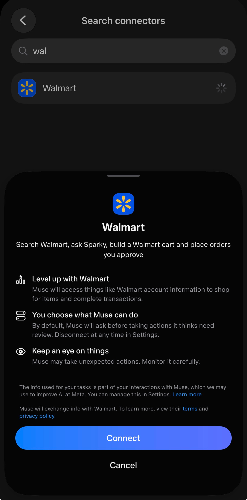
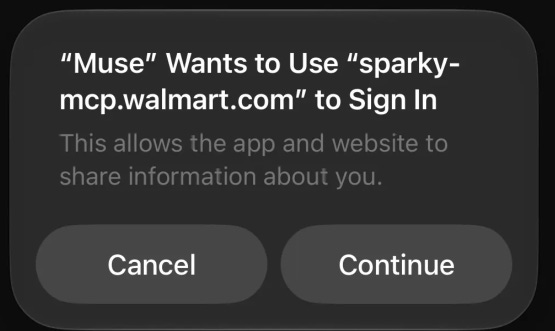
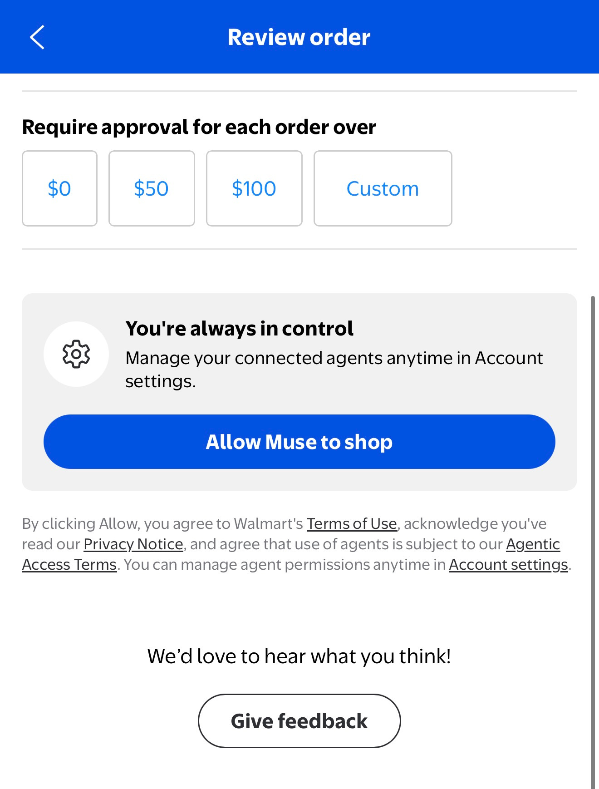
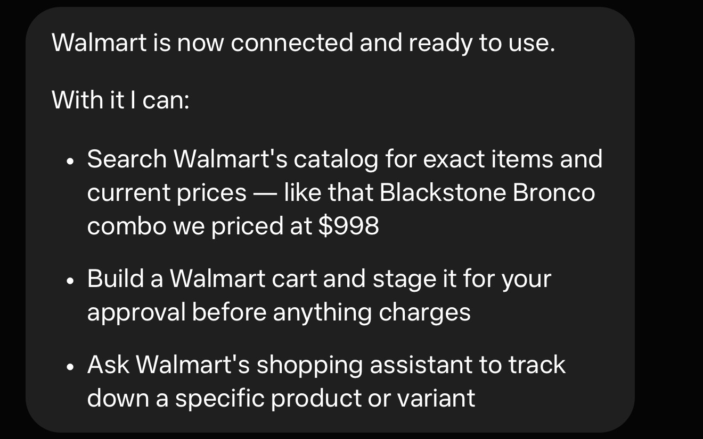
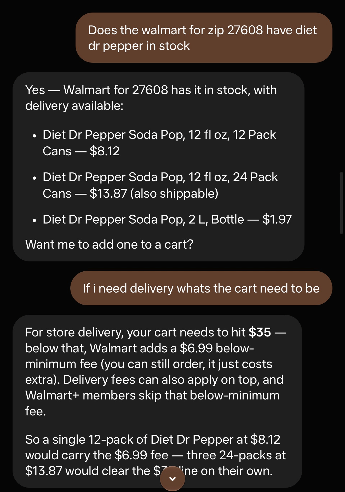
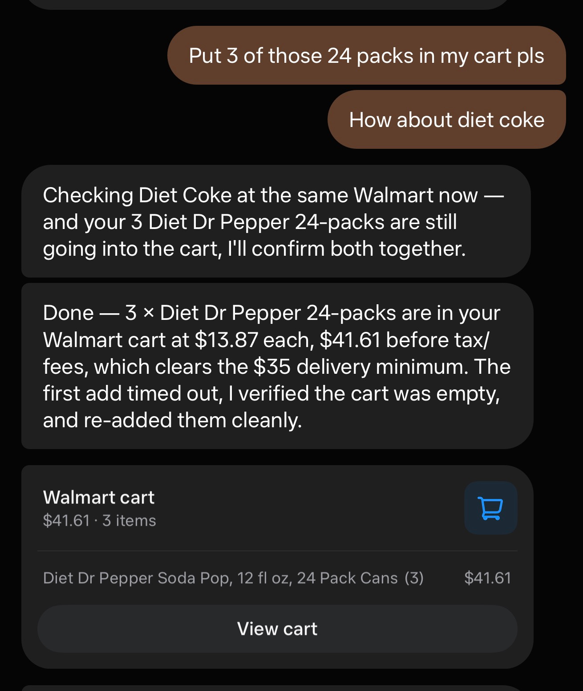
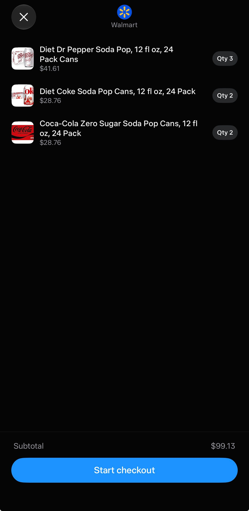
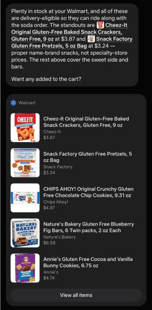



**收录说明**：直接下载。原文全文存于本目录的 original.md，网站上不显示，已翻译。标题含 emoji 照录；正文标题层级已按规范降级；作者头像为装饰图，未收录；9 张实测截图已本地化到 images/。

**内容摘要**：沃尔玛于 10 月 21 日宣布了第二波拥抱 Agentic Commerce 的举措；赶在 BFCM 前，Walmart Connector 已在 Muse 上线，作者做了首次实测。这是首个同时包含消费者购买智能体（Muse）与卖家智能体（Sparky）的连接器；连接时出现的权限对话框显示，该连接器底层使用了 MCP，而非仅用 UCP。连接后可配置默认账单地址、收货地址、支付方式、「agent budget」及「Allow Muse to shop」开关；作者在实测中把 Diet Dr. Pepper 的 24 装加了 3 件进购物车，订单超过 35 美元的 Walmart+ 免运费门槛，且因低于其为 Muse 设定的 100 美元上限，核对地址与卡片后直接下单。作者称这是在飞机上用老式低速 Wi-Fi 完成的他体验过的最快的智能体购物，全程接近实时。文末还提到作者团队近期的一项亚马逊研究：所查 1,000 个亚马逊商品页中有 81% 至少有一处细节与同一页面的另一部分相矛盾，来源为 ReFiBuy 对 100 个品牌亚马逊商品页的审计（2026 年 10 月 30 日至 11 月 3 日），并以一次无麸质搜索展示了 Muse/Walmart 连接器中 Walmart/Sparky 的回答。

**保留理由**：这是 Muse 与沃尔玛 Sparky 智能体对智能体购物闭环的首次一手实测记录，展示了官方公告中未公开的连接设置细节（MCP 底层、agent budget、「Allow Muse to shop」开关）与真实下单全过程。文末的 ReFiBuy 亚马逊审计为商品数据质量问题提供了 2026 年 10 月 30 日至 11 月 3 日的时间线证据。

---

#### 赶上 BFCM，Walmart 连接器已在 Muse 上线，我们为你带来一份 Retailgentic 的首次实测，趁热奉上！

## 欢迎来到代理式商务的未来：Muse 与 Walmart 连接器

早在 10 月 21 日，Walmart [宣布](https://corporate.walmart.com/news/2026/10/Making-It-Possible-for-Agents-to-Shop-on-Behalf-of-Customers)了其拥抱代理式商务（Agentic Commerce）的第二波举措。那份发布很有意思，但足够含糊，我们很想真正看到它在实践中是什么样。他们提到你的 walmart 账户会有一套独立的智能体属性，比如限额、可使用的卡、默认地址。最重要的是，他们暗示这个智能体不会只是「UCP 进来」，而是会与 Sparky「对话」。

今天我们终于能看到它在真实世界的体验中上线是什么样，我们在 Retailgentic 为你呈现。

### 智能体对智能体的代理式商务

这是第一个同时包含消费者购买智能体（一侧是 Muse）和卖家智能体（另一侧是 Sparky）的连接器。结果是极为干净、水准更高的用户体验。

## Muse Walmart 连接器设置

**第 1 步：添加连接器：**

开始之前，启动你的 Muse，进入设置，点「添加连接器」。Walmart 连接器会弹出来，详细描述它做什么、如何工作→

当我点连接时，得到这个权限对话框，它告诉我们这不只是 UCP——这个连接器在底层使用了 MCP（大概是为了那个动态购物车 UI，你马上会看到）→

在我点继续之后，进入这个第 2 步（标为「review order」，一开始有点让人困惑，但这是首次实测，所以我们看到了一些粗糙的边缘）

**第 2 步：配置你的 Muse/Walmart 智能体设置**

在这里你可以配置默认的 Muse 账单地址、收货地址、支付方式、一个「agent budget」（智能体预算），以及最后的「Allow Muse to shop」（允许 Muse 购物）——我喜欢这个，因为它建立了信心：交易两边都有护栏。这个连接器能访问我的账户，我想知道 Muse 在做什么、不做什么。

最后这一步给我们这个最终的确认窗口，带更多说明→

## Muse Walmart 购物体验

准备好了，我们去 Walmart 购物吧！在这个用例里，我们办公室只用代理式商务来补零食，而我们现在正缺那种气泡冷咖啡因来驱动我们的 AI 原生大楼。最近 Diet Dr. Pepper 出现了不寻常的短缺，所以看看 Muse 和 Sparky 能不能联手帮我们度过这场危机→

回到「旧时光」——最初那个 Walmart/ChatGPT 连接器是基于数据馈送（datafeed）的。像这种超本地库存的数据馈送几分钟内就可能不同步，但 Sparky 直接住在 Walmart 库存系统之上，给我们实时的库存视图，而且有好消息——他们有 DDP 现货！我从来记不住 Walmart+ 的免运费门槛是多少，于是又问了一次（35 美元，没问题）。

我把 3 个 24 装丢进购物车，然后转向健怡可乐等等→

注意，我在这里得到了购物车的小小可视化。我继续往车里加东西，而你随时点「view cart」，都能留在 Muse 里看到这个顺手的 UI→

我显然超过了 35 美元门槛，所以下了单。它只是走了一遍地址和卡的验证，又因为我低于为 Muse 设定的 100 美元上限，就直接放行了。

### 对这次体验的看法

我做这件事时在飞机上，用的是老式糟糕的机上 Wi-Fi，而这是我体验过的最快的智能体购物——一切几乎都是实时的，灵敏又轻松。我真的很喜欢这次体验。它有购物车，有你会期待的所有 Level 4 特性。事实上，我现在要把 Muse 升到 Level 4——高级购买（Advanced Buy）——缺购物车曾是关键，而他们在这里真的把购物车做绝了——A+！

正如他们的口号所说：「Muse Gets it Done ✅」——它确实做到了！

## 品牌和零售商该做什么。

**零售商：**

这是一个有趣的新模式，但要提供它，你需要很多：

1. 店铺层面真正强大的商品目录和底层库存系统
2. 一个非常出色的 v2/v3 智能体，达到今天 Sparky（译注：原文作 "Spary"，应为 Sparky）和 AFS 的水平。
3. 扩展客户账户，加入智能体设置。
4. 一个能在你的智能体和 Muse 之间构建连接器的团队

**品牌：**

我们看到消费者感到沮丧的地方，是购物智能体跑在了商品目录质量与细节的前面——我们在 Retailgentic 早就预见到了这一点，现在所有人都在真切感受到。例如，我们看到零售商一侧的智能体会错误地说产品是纯素或无麸质的，或者干脆完全漏掉确实具备这些特征的产品。发生这种情况的原因是零售商一侧的智能体没有这些信息，或者更糟，有相互冲突的信息。

我们最近就此做了一项 Amazon 研究，发现我们检查的 1,000 个 Amazon 商品页中有 81% 至少有一处细节与同一页面的另一部分相矛盾。来源：ReFiBuy 对 100 个品牌 Amazon 商品页的审计，2026 年 10 月 30 日至 11 月 3 日。

这里是在 Muse/Walmart 连接器上做的一次无麸质搜索，向你展示消费者会怎么做，以及 Walmart/Sparky 的回答。

品牌应当着手把内容升级到第 3 级丰富度，并与你的零售伙伴紧密合作，确保所有那些额外内容都能在零售网站上、并能被各类需要访问它们的智能体获取——无论是答案引擎、站内零售智能体，还是像 Muse 这样的个人智能体。
