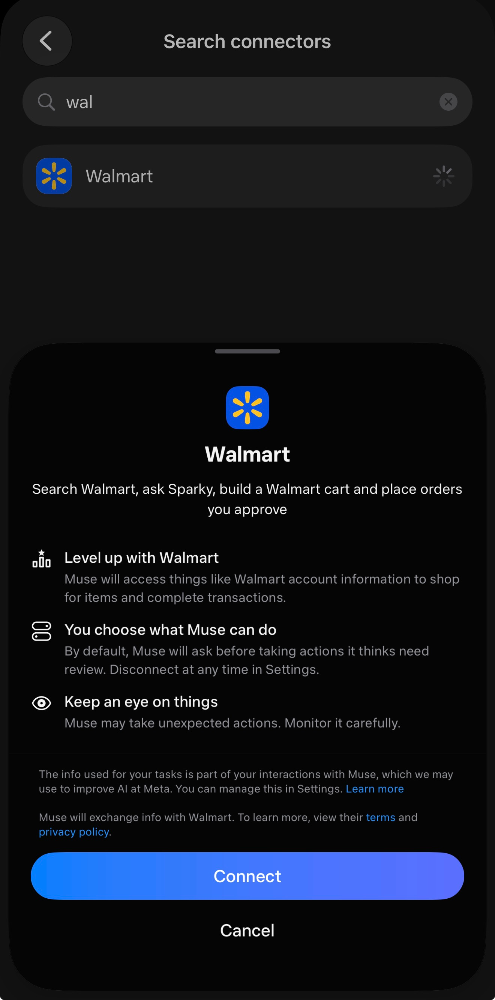
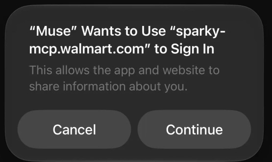
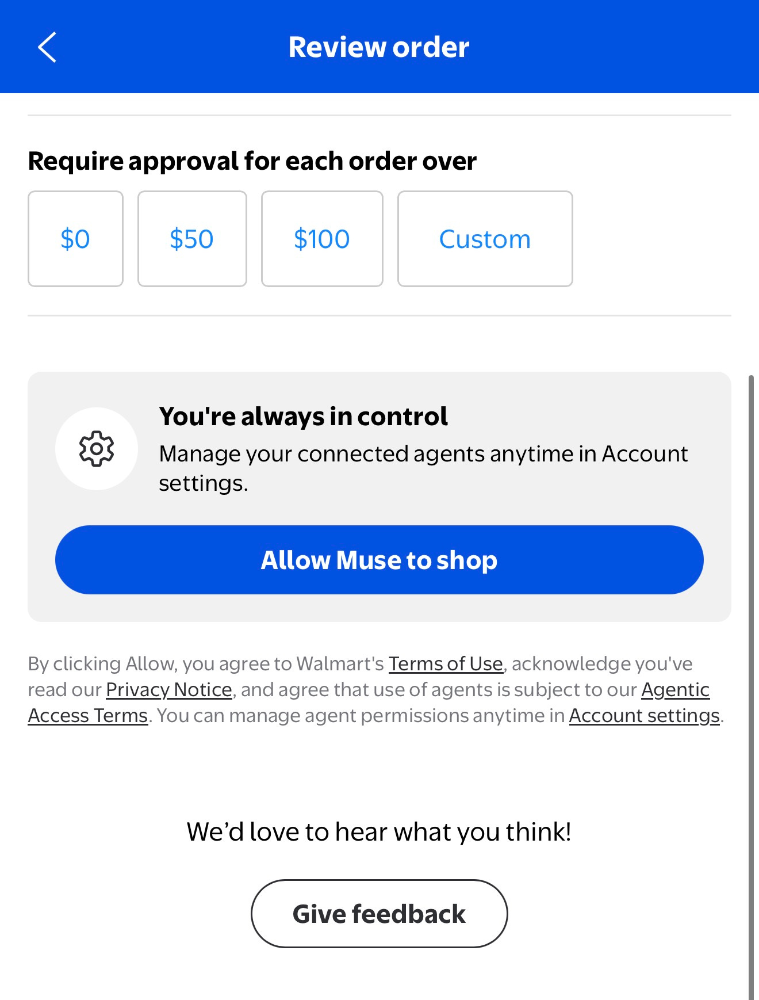
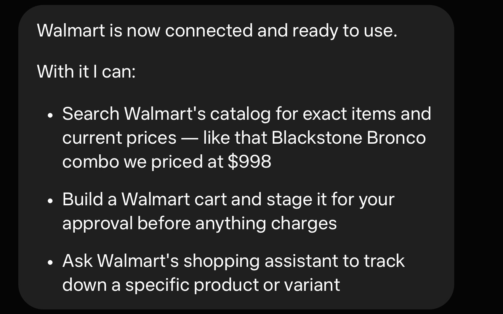
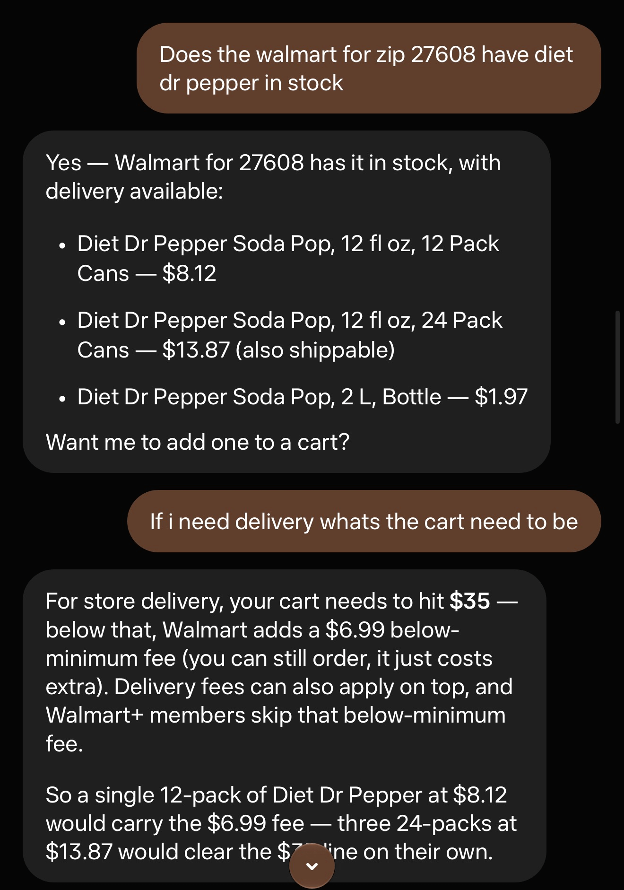
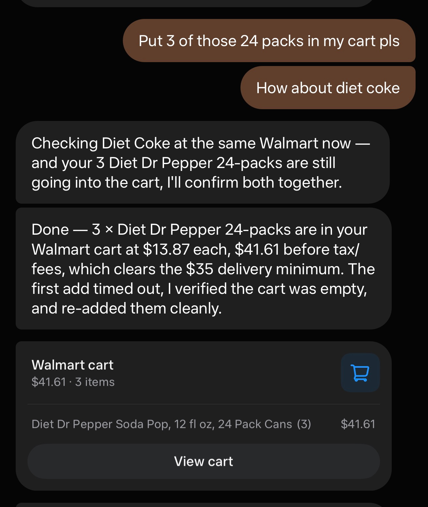
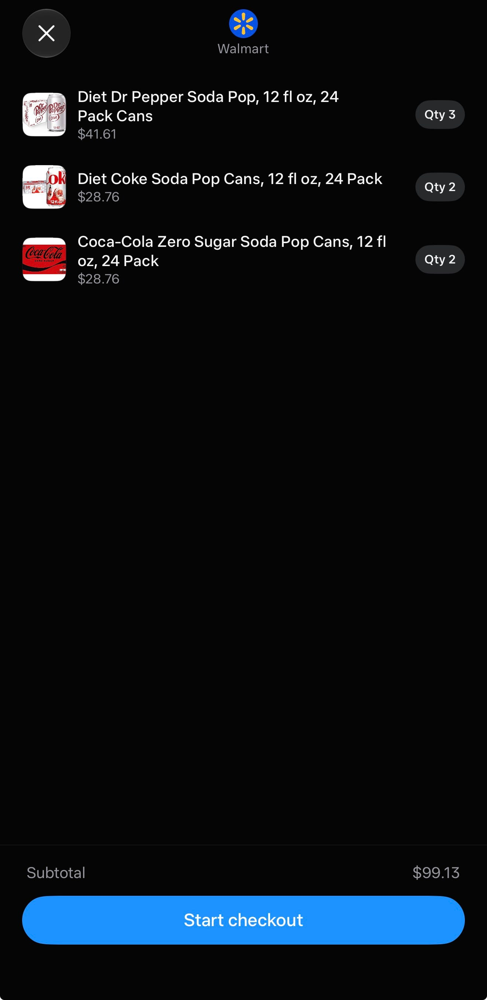
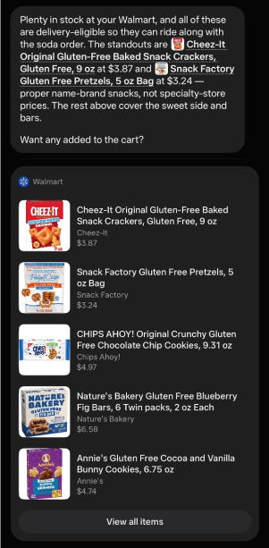

来源：https://www.retailgentic.com/p/first-look-musewalmart-connector
取文：2026-11-27，直接下载

#### Just in time for BFCM, the Walmart Connector is live in Muse and we have a Retailgentic FIRST LOOK for you hot of the presses!

## Welcome to the Agentic Commerce Future: The Muse and Walmart Connector

Back on October 21, Walmart [announced](https://corporate.walmart.com/news/2026/10/Making-It-Possible-for-Agents-to-Shop-on-Behalf-of-Customers) their second wave of embracing Agentic Commerce. The release was interesting, but vague enough we wanted to really see it in practice. They talked about your walmart account having a separate agent set of properties like limites, cards to be used, default addresses. Most importantly they suggested that the agent wouldn’t just ucp in, but it would ‘talk’ to Sparky.

Today we can finally see what this looks like live in a real world experience and we have it for you here at Retailgentic.

### Agent to Agent Agentic Commerce

This is the first connector that features a consumer buying agent (Muse on one side) and a seller agent on the (other) Sparky. The result is a really clean and elevated user experience.

## Muse Walmart Connector Setup

**Step 1: Add the connector:**

To get started fire up your muse, go into settings and ‘add connector’. The Walmart connector pops up and describes in detail what it does and how it works→

When I hit connect I get this permission dialog which tells us this is not just UCP, the connector is using MCP under the hood (probably for the dynamic cart ui piece, you’ll see in a sec)→

After I hit continue, I go to this step 2 (branded ‘review order’ which was a little confusing at first, but it’s a first look so we see some of the rough edges here)

**Step 2: Configure your Muse/Walmart agent settings**

Here you can configure your default muse bill to, ship to, payment method an ‘agent budget’ and a final ‘Allow Muse to shop’ - I like this as it builds confidence to have guard rails on both sides of the transaction - this has access to my account and I want to know what Muse is and is not doing.

That last step gives us this final confirmation window with more messaging→

## Muse Walmart Shopping Experience

We’re ready to go, let’s go shopping at Walmart! For this use case, in our office we use Agentic Commerce only to replenish our snacks, and we are low on bubbly cold caffeine to fuel our AI Native building. There’s an unusual Diet Dr. Pepper shortage so let’s see if Muse and Sparky can team up to help us through this crisis→

Back in the olden says with the OG Walmart/ChatGPT connector, it was datafeed based - datafeeds for hyperlocal inventory like this can be out of sync in minutes, but Sparky lives right on top of the Walmart inventory system and offers us a real time view of inventory and GREAT news- they have DDP in stock! I can never remember what the Walmart+ free ship threshold is so asked yet again ($35, no problem).

I threw 3 of the 24 packs into the cart and moved onto diet coke and so forth→

Note that I get a little visualization of the cart right here. I went ahead and added more to the cart and if you hit ‘view cart’ at any time, staying in muse you get this handy ui→

I’m clearly over my $35 threshold, so ordered that. It simply goes through a verification on the address and card and since i’m under the $100 limit I setup for Muse it just lets it rip.

### Thoughts on the Experience

I was on a plane while I did this with old school bad plane wifi and it was the fastest agentic shopping experience I’ve had - everything was near real time and snappy and easy. I really enjoyed this experience. It has a cart, it has all the level 4 things you would expect. In fact, I’m now going to move Muse up to Level 4- Advanced Buy - the missing cart was the key and they have really nailed cart building here - A+!

As their slogan says: “Muse Gets it Done ✅” - it really does!

## What Brands and Retailers Should Do.

**Retailers:**

This is an interesting new model, but it’s going to require a lot for you to offer it:

1. Really strong catalog and underlying inventory system at the store level
2. A v2/v3 agent that is very good like where Spary and AFS are today.
3. Customer account expansion to add agent settings.
4. A team that can build a connector between your agent and Muse

**Brands:**

Where we’re seeing consumers get frustrated is the shopping agents are outrunning the product catalog quality and detail - we’ve foreseen this coming in Retailgentic for a while, everyone is really feeling it right now. For example, we’re seeing retailer agents either mistakenly say products are vegan or gluten free or 100% miss products that do have these features. The reason this is happening is the retailer-side agent doesn’t have the information, or worse has conflicting information.

We recently ran an Amazon study on this and found that 81% of the 1,000 Amazon product pages we checked had at least one detail that contradicted another part of the same page. Source: ReFiBuy audit of 100 brands’ Amazon product pages, Oct 30 to Nov 3, 2026

Here’s a gluten-free search on the Muse/Walmart connector to show you how the consumer is going to do this and Walmart/Sparky’s answer.

Brands should work on a upgrading your content to level 3 enrichments and work closely with your retail partners to make sure all of that extra content is available on the retail site and to the the various agents that will need access be they answer-engines, on-site retail agents, or personal agents like Muse.
