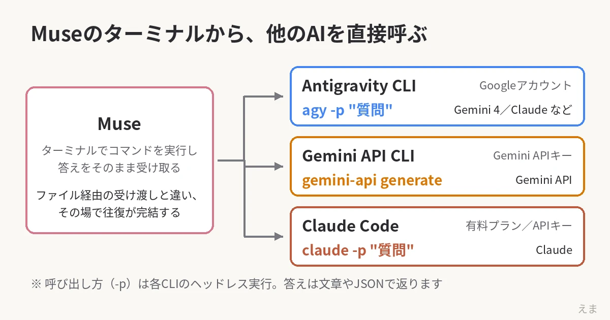



**收录说明**：直接下载（div.article-body 容器）；三 CLI 结构图已下载到 images/ 并本地化。

**内容摘要**：文章介绍如何利用 Muse 自带的终端安装其他 AI 的 CLI 工具，在作业途中用命令直接调用其他 AI 的回答，三条入口分别是 Google 账号登录的 Antigravity CLI、API 密钥使用的 Gemini API CLI 与 Anthropic 的 Claude Code。路线一 Antigravity CLI 有实测：agy models 列出 Gemini 4 Hydrogen、Gemini 3.8 Flash，以及 Claude Sonnet 4.6、Claude Opus 4.6、GPT-OSS 120B；首都提问约 7 秒返回、退出码 0，JSON 调用中计算题答案“51”与 status=SUCCESS、约 2.2 秒、合计 10,161 token 一并返回，指定 Claude Sonnet 4.6 提问约 1.7 秒得到“Claude Sonnet 4.6”的回答。作者在登录最后阶段遇到认证码交换通信超时、失败 2 次，改用环境变量 GODEBUG=http2client=0 把 HTTP/2 固定为 HTTP/1.1 后第 3 次完成登录，并注明这可能是其环境特有的问题。路线二 Gemini API CLI 只实测到 dry-run：gemini-api generate 加 --dry-run 显示了将发送的请求（URL 与含 gemini-4-hydrogen 的正文），不通信、以退出码 0 结束，实际生成调用未做，因为作者环境中的 Gemini API 密钥以注入方式提供、无法流用至该 CLI。路线三 Claude Code 只有步骤介绍、未实测：需 Claude Pro、Max、Ultra、Team、Enterprise 之一或 Console（API）账号，免费 claude.ai 套餐不能使用 Claude Code，作者环境中没有 Claude 侧的认证手段；另据官方仓库说明，Gemini CLI 的个人免费枠与 Google AI Pro／Ultra 用途已于 2026 年 6 月 18 日迁移至 Antigravity CLI。

**保留理由**：这是日本社区作者在自己环境中实测 Muse 终端调用其他 AI 的记录，三条路线的实测程度逐一写明且附有具体耗时与 token 数，是 Muse 与其他 AI 协作用法的少有的一手实测。

---

上一篇中，我整理了把 Google Drive 当作存放处、让 Muse 与 Gemini 通过文件交换数据的做法。那种方法的好处是「放进去就传到了」，但答案回来之前要经过人工确认和文件来回。

其实还有更直接的方法。Muse 自带终端（用文字输入命令的操作界面），所以只要装上其他 AI 的 CLI 工具（用命令操作的程序），在作业途中敲一条命令，就能直接拿到另一个 AI 的答案来用。本文整理用 CLI 调用 Claude（Anthropic）和 Gemini（Google）的方法，并附上在えま的环境中实际试过的结果（截至 2026 年 11 月 25 日）。

另外，本文出现的「Claude」指 Anthropic 的 AI，与本博客主题「Muse」（Meta 的 AI）是不同产品。名字相近，先在此区分。

本文的结论

- Muse 自带输入命令的界面（终端），只要装上 CLI 工具，就能用命令直接调用其他 AI
- Gemini 一侧的入口有两个：用 Google 账号的 Antigravity CLI，以及用 API 密钥的 Gemini API CLI。Claude 一侧是 Claude Code，需要付费套餐或 API 密钥
- 在えま的实测中，用 Antigravity CLI 的无头执行取到了 Gemini 4 和 Claude Sonnet 4.6 两者的回答

## 经由 CLI 有什么不同

- **答案当场返回：** 与经由文件传递不同，提问和回答在一条命令里就完成。答案可以直接用于下一步作业。
- **可以指定格式接收：** 很多 CLI 工具都能把输出格式指定为 JSON（机器易读的数据格式）。这样不仅拿到回答文字，还能一并拿到成功与否和使用量。
- **可以切换调用对象：** 只要改一下工具或模型的指定，就能马上去问另一个 AI。也适合用来比较多个 AI 的答案。

## 全貌：从 Muse 的终端出发的三个入口

调用方式按对方和认证方法分为三种。

- Antigravity CLI（命令是 `agy`）：用 Google 账号登录使用的个人入口。可以调用 Gemini 的模型。
- Gemini API CLI（命令是 `gemini-api`）：用 Gemini 的 API 密钥使用的入口。这是 Google 官方的实验性 CLI，为「拥有 shell 的 agent 直接调用 API」而设计。
- Claude Code（命令是 `claude`）：Anthropic 的 CLI。需要 Claude 的付费套餐，或用 API 密钥认证。

从 Muse 的终端出发的三个入口

## 路线一：用 Antigravity CLI 调用（有实测）

个人用 CLI 使用 Gemini 系 AI，目前主要以这种方式为主。此前已有的 Gemini CLI 个人用途（免费额度与 Google AI Pro／Ultra）已于 2026 年 6 月 18 日迁移至 Antigravity CLI（详情在后文一节提及）。

- **安装：** 在终端执行官方安装脚本，就会装上 `agy` 命令（macOS／Linux 的情况。Windows 的步骤也在官方文档中）。
- **登录：** 仅首次需要进行交互式初始设置。在浏览器中登录 Google 账号，把显示的验证码粘贴到 CLI 里，之后就能以已登录状态使用。免费的 Google 账号也能开始，在えま的环境中是用「Antigravity Starter Quota」这一免费额度运行的。
- **调用方式：** 在 `agy -p` 后面接上问题执行，它只处理一次、给出答案后退出（无头执行）。加上 `--output-format json` 后，除答案外还会以 JSON 返回成功与否（status）、耗时、token 使用量和会话 ID。用 `--continue` 还可以接着上一次的会话继续提问。

在えま的环境中的实测结果如下。

- **模型列表（`agy models`）：** 除了 Gemini 4 Hydrogen（强度 4 档）、Gemini 3.8 Flash（3 档），还并列着 Claude Sonnet 4.6、Claude Opus 4.6、GPT-OSS 120B。经由 Antigravity，也可以选择 Gemini 以外的模型。
- **以文本调用：** 问一个关于首都的问题，约 7 秒后返回回答，退出码为 0（成功）。
- **以 JSON 调用：** 连同计算题的答案「51」，一并返回了 status＝SUCCESS、耗时约 2.2 秒、使用量（合计 10,161 token）等。即便是很短的问题，输入侧 token 也有约 1 万之多，推测是因为包含了作为 agent 的基础指令。
- **调用 Claude：** 用 `--model` 指定 Claude Sonnet 4.6 并问「你是什么模型？」，约 1.7 秒后返回了「Claude Sonnet 4.6」的回答。即使没有 Claude Code 的合约，也能经由 Antigravity 从命令行调用 Claude。

## 卡住时：登录通信停住的情况（えま的环境中实际发生的事）

在えま的环境中，登录最后阶段交换验证码的通信超时，失败了 2 次。从同一网络用 curl 命令能正常到达同一目的地，于是加上把 CLI 侧通信方式（HTTP/2）固定为 HTTP/1.1 的设置（环境变量 `GODEBUG=http2client=0`）启动后，第 3 次完成了登录。

这很可能是えま环境特有的情况，并非通用步骤。不过，「浏览器侧已经登录完成，CLI 侧却进行不下去」时，去怀疑通信链路的问题，这种排查思路或许可供参考。

## 路线二：用 Gemini API CLI 调用（实测到 dry-run 为止）

Gemini API CLI（`gemini-api`）是 Google 官方的 CLI，为「拥有 shell 访问权的 agent」直接使用 Gemini API 而设计（官方仓库中标为 experimental，即实验性）。官方说明中，设想的使用者里就点名了其他 AI agent，「从 Muse 使用」这件事本身就包含在设计前提之中。

- **安装与认证：** 用安装脚本等安装，认证使用 Gemini API 密钥（在 Google AI Studio 签发）。也有用 `gemini-api configure` 保存密钥的方式。
- **命令形态：** 分为 generate（文本与多模态生成）、analyze（PDF、图片、音频、视频等解析）、image／video／music／tts（媒体生成）、agent（运行托管 agent）等按用途划分的子命令。
- **面向 agent 的设计：** 除了用 `--output-format json` 做结构化输出、用退出码区分成败（0＝成功，1＝执行或 API 失败，2＝用法错误，3＝认证失败），还有 `--dry-run` 这一确认模式。

在えま的环境中，实测了 `--dry-run`。给 `gemini-api generate` 传入一句简短问候并加上 `--dry-run`，它会显示预定实际发送的请求（目标 URL，以及包含模型名 `gemini-4-hydrogen` 的正文），不进行通信、以退出码 0 结束。这是一个在传入认证信息之前，确认命令拼装是否正确的机制。

另外，本次实测没有进行实际的生成调用。因为えま环境中的 Gemini 相关 API 密钥是以运行时注入的方式提供，无法挪用到这个 CLI 上。要实际调用，需要另外准备并注册 API 密钥。

## 路线三：用 Claude Code 调用（仅有步骤，无实测）

Anthropic 的 Claude Code 以编程辅助 CLI 而知名，但它官方提供了无头执行的机制，也设想了从其他 agent 或脚本调用的用法。

- **安装：** 推荐用官方安装器安装（此外还有 Homebrew、WinGet、npm 等方式）。运行环境为 macOS 13 以上、Windows 10（1809 以上）、Ubuntu 20.04 以上等，内存建议 4GB 以上。
- **认证条件：** 需要 Claude 的 Pro、Max、Ultra、Team、Enterprise 之一，或 Console（API）账号。官方文档明确写道，免费的 claude.ai 套餐无法使用 Claude Code。也有设置 API 密钥（`ANTHROPIC_API_KEY`）的方式。
- **调用方式：** 在 `claude -p` 后面接上问题执行，它会在无对话的情况下处理，并把结果返回到标准输出。可以用 `--output-format` 指定 JSON 等格式，用 `--allowedTools` 预先批准要用的工具，用 `--continue` 继续会话。官方也介绍了用管道把文件内容传进去提问的用法。

えま的环境中没有 Claude 侧的认证手段（付费套餐／API 密钥），因此这条路线没有实测。步骤依据 Anthropic 官方文档介绍。

## 补充：Gemini CLI 的现状

提到「用 CLI 使用 Gemini」，很多人会想到 Gemini CLI，但提供形态已经变了。按官方仓库的说明，免费额度与 Google AI Pro／Ultra（Google One）的个人用途已于 2026 年 6 月 18 日迁移至 Antigravity CLI。现在的 Gemini CLI（`gemini` 命令）主要面向 Gemini Code Assist 的 Standard／Enterprise 许可证（用付费 API 密钥或 Vertex AI 密钥的使用仍然可行）。此外还说明它未针对 Gemini 4 及以后版本优化。个人要新开始的话，按官方说明，把入口理解为 Antigravity CLI 更合适。

## 三个入口怎么选

- **只想用 Google 账号开始：** Antigravity CLI。只要登录就能用，可以从免费额度试起。也能选 Gemini 以外的模型。
- **想作为 API 细粒度调用：** Gemini API CLI。从媒体生成到文件解析，子命令齐全，有退出码和 JSON 输出等，便于程序处理的设计。使用需要准备 API 密钥，并按用量付费。
- **想用 Claude 本家：** Claude Code。如果持有 Claude 的付费套餐，就可以在该合约范围内从 CLI 调用。

## 需要注意的事项

- **认证信息的存放位置：** 请不要把 API 密钥写进文章、聊天或共享文件夹。CLI 认证应使用各工具的正式保存方式（登录或 configure），不要把密钥留在命令参数或明文文件里，这是基本原则。
- **CLI 的 agent 也能「执行」：** `agy` 和 `claude` 不只是回答问题，还是能编辑文件、执行命令的 agent。从 Muse 调用时，也应先确定允许作业的文件夹范围和执行时的批准规则，再使用才安全。
- **费用与额度：** Antigravity CLI 有按账号的用量额度，Gemini API CLI 与 Claude Code 的 API 使用则按用量计费。反复调用的用法下，不时查看 JSON 输出里的使用量会更安心。
- **提供状况容易变化：** 模型列表和免费额度条件会因提供方的情况而变化。本文内容基于 2026 年 11 月 25 日时点的官方信息与实测。

## 小结

- **可以直接调用：** 在 Muse 的终端装上 CLI 工具，就能用命令完成向其他 AI 的提问与回答，答案可直接用于作业。
- **入口有三个：** 面向个人的 Antigravity CLI、用 API 密钥的 Gemini API CLI、以 Claude 付费套餐等为前提的 Claude Code。认证方式的不同，直接就是入口的不同。
- **实测要点：** 在えま的环境中，从 Antigravity CLI 取到了 Gemini 4 和 Claude Sonnet 4.6 两者的回答。经由文件传递（上一篇）与用 CLI 直接调用，可以按场景区分使用。

## 出处与确认方法

- Claude Code 的安装、认证条件、无头执行：参考了 Anthropic 官方文档（code.claude.com 的设置、从程序执行、CLI 参考各页面）。
- Gemini CLI 的提供状况与迁移至 Antigravity CLI：参考了 Gemini CLI 的官方 GitHub 仓库（README，2026 年 11 月 25 日确认）。
- Antigravity CLI 的安装与无头执行：参考了 Google 官方文档（antigravity.google 的 Get started 与 Headless mode 页面）。
- **Gemini API CLI 的定位与命令：** 参考了官方 GitHub 仓库（google-gemini/gemini-api-cli 的 README）。
- **实测内容：** 基于在えま环境中的执行结果（实测记录为 2026 年 11 月 25 日）。Antigravity CLI 的版本在实测中自动更新，完成登录时点的版本为 1.5.17。
