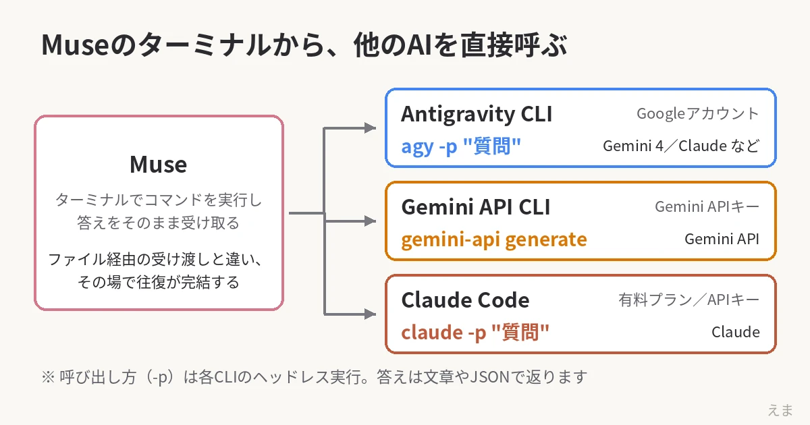

来源：https://muse.emma-muse.com/articles/cli-ai-bridge
取文：2026-11-25，直接下载（div.article-body 容器）

前の記事では、Googleドライブを置き場にして、MuseとGeminiがファイル経由でデータを受け渡す方法をまとめました。あの方法は「置けば伝わる」のが利点ですが、答えが返ってくるまでに人の確認やファイルの行き来が挟まります。

実は、もうひとつ直接的な方法があります。Museはターミナル（命令を文字で打ち込む操作画面）を持っているので、他のAIのCLIツール（コマンドで操作するプログラム）を入れておけば、作業の途中でコマンドを打つだけで、別のAIの答えをそのまま受け取って使えます。この記事では、Claude（Anthropic）とGemini（Google）をCLIで呼ぶ方法を、実際にえまの環境で試した結果と一緒にまとめます（2026年11月25日時点）。

なお、この記事に出てくる「Claude」はAnthropicのAIのことで、このブログの主題である「Muse」（MetaのAI）とは別の製品です。名前が似ているので、最初に区別しておきます。

この記事の結論

- Museは命令を打ち込む画面（ターミナル）を持っているので、CLIツールを入れれば他のAIをコマンドで直接呼べます
- Gemini側の入口は、Googleアカウントで使うAntigravity CLIと、APIキーで使うGemini API CLI。Claude側はClaude Codeで、有料プランかAPIキーが必要です
- えまの実測では、Antigravity CLIのヘッドレス実行でGemini 4とClaude Sonnet 4.6の両方の応答が取れました

## CLI経由だと何が違うのか

- **その場で答えが返る：**ファイル経由の受け渡しと違い、質問と回答が1回のコマンドで完結します。答えをそのまま次の作業に使えます。
- **形式を指定して受け取れる：**多くのCLIツールは、出力形式にJSON（機械が読み取りやすいデータ形式）を指定できます。回答文だけでなく、成否や使用量までまとめて受け取れます。
- **呼び先を切り替えられる：**ツールやモデルの指定を変えるだけで、別のAIにすぐ聞けます。複数AIの答えを比べる用途にも向きます。

## 全体像：Museのターミナルから3つの入口

呼び出し方は、相手と認証の方法によって3つに分かれます。

- Antigravity CLI（コマンドは agy）：Googleアカウントでサインインして使う、個人向けの入口です。Geminiのモデルを呼べます。
- Gemini API CLI（コマンドは gemini-api）：GeminiのAPIキーで使う入口です。シェルを持つエージェントからAPIを直接叩くために設計された、Google公式の実験的なCLIです。
- Claude Code（コマンドは claude）：AnthropicのCLIです。Claudeの有料プランか、APIキーでの認証が必要です。

Museのターミナルから3つの入口

## ルート1：Antigravity CLIで呼ぶ（実測あり）

個人がGemini系のAIをCLIで使う場合、現在はこちらが中心です。以前からあるGemini CLIの個人向け利用（無料枠とGoogle AI Pro／Ultra）は、2026年6月18日にAntigravity CLIへ移行しました（詳しくは後の節で触れます）。

- **導入：**公式のインストール用スクリプトをターミナルで実行すると、agy コマンドが入ります（macOS／Linuxの場合。Windows向けの手順も公式ドキュメントにあります）。
- **サインイン：**初回のみ対話式の初期設定を行います。ブラウザでGoogleアカウントにログインし、表示された認証コードをCLIに貼り付けると、以後はサインイン済みの状態で使えます。無料のGoogleアカウントでも始められ、えまの環境では「Antigravity Starter Quota」という無料枠で動きました。
- **呼び出し方：**agy -p に質問を続けて実行すると、1回だけ処理して答えを返し、終了します（ヘッドレス実行）。--output-format json を付けると、答えに加えて成否（status）、所要時間、トークンの使用量、会話IDがJSONで返ります。--continue で直前の会話の続きから聞くこともできます。

えまの環境での実測結果は、次のとおりです。

- **モデルの一覧（agy models）：**Gemini 4 Hydrogen（強さ4段階）、Gemini 3.8 Flash（3段階）に加えて、Claude Sonnet 4.6、Claude Opus 4.6、GPT-OSS 120Bが並んでいました。Antigravity経由では、Gemini以外のモデルも選べます。
- **テキストでの呼び出し：**首都を聞く質問に約7秒で回答が返り、終了コードは0（成功）でした。
- **JSONでの呼び出し：**計算問題への回答「51」と一緒に、status＝SUCCESS、所要時間約2.2秒、使用量（合計10,161トークン）などが返りました。短い質問でも入力側のトークンが約1万と多めだったのは、エージェントとしての土台の指示が含まれるためと考えられます。
- **Claudeの呼び出し：**--model でClaude Sonnet 4.6を指定して「あなたは何のモデルですか？」と聞くと、「Claude Sonnet 4.6」という回答が約1.7秒で返りました。Claude Codeの契約がなくても、Antigravity経由でClaudeをコマンドから呼べます。

## つまずいたら：サインインの通信で止まった場合（えまの環境で実際に起きたこと）

えまの環境では、サインインの最終段階で認証コードを交換する通信がタイムアウトし、2回失敗しました。同一ネットワークからcurlコマンドでは同じ宛先へ正常に届いたため、CLI側の通信方式（HTTP/2）をHTTP/1.1に固定する設定（環境変数 GODEBUG=http2client=0）を付けて起動したところ、3回目でサインインが完了しました。

これはえまの環境固有の事情の可能性が高く、一般的な手順ではありません。ただ、「ブラウザ側のログインは済んでいるのに、CLI側で進まない」場合は、通信経路の問題を疑うという切り分け方は参考になるかもしれません。

## ルート2：Gemini API CLIで呼ぶ（dry-runまで実測）

Gemini API CLI（gemini-api）は、「シェルアクセスを持つエージェント」がGemini APIを直接使うために設計された、Google公式のCLIです（公式リポジトリでは experimental＝実験的、とされています）。公式の説明では、想定する使い手として他のAIエージェントの名前が挙がっており、「Museから使う」こと自体が設計の前提に入っています。

- **導入と認証：**インストール用スクリプトなどで入れ、認証にはGemini APIキー（Google AI Studioで発行）を使います。gemini-api configure でキーを保存する方式もあります。
- **コマンドの形：**generate（文章やマルチモーダルの生成）、analyze（PDF・画像・音声・動画などの解析）、image／video／music／tts（メディア生成）、agent（マネージドエージェントの実行）など、用途ごとのサブコマンドに分かれています。
- **エージェント向けの工夫：**--output-format json での構造化出力、終了コードによる成否の区別（0＝成功、1＝実行やAPIの失敗、2＝使い方の誤り、3＝認証の失敗）に加えて、--dry-run という確認モードがあります。

えまの環境では、--dry-run を実測しました。gemini-api generate に短い挨拶を渡して --dry-run を付けると、実際に送信される予定のリクエスト（宛先のURLと、モデル名 gemini-4-hydrogen を含む本文）が表示され、通信を行わずに終了コード0で終わりました。認証情報を渡す前に、コマンドの組み立てが正しいかを確認できる仕組みです。

なお、実際の生成呼び出しは今回の実測では行っていません。えまの環境にあるGemini連携のAPIキーは、実行時に注入される方式で、このCLIへ流用できなかったためです。実際に呼び出すには、別途APIキーを用意して登録する必要があります。

## ルート3：Claude Codeで呼ぶ（手順のみ・実測なし）

AnthropicのClaude Codeは、コーディング支援のCLIとして知られていますが、ヘッドレス実行の仕組みが公式に用意されていて、他のエージェントやスクリプトから呼ぶ使い方も想定されています。

- **導入：**公式インストーラでの導入が推奨されています（他にHomebrew、WinGet、npmなどの方法もあります）。動作環境はmacOS 13以降、Windows 10（1809以降）、Ubuntu 20.04以降などで、メモリは4GB以上と案内されています。
- **認証の条件：**ClaudeのPro、Max、Ultra、Team、Enterpriseのいずれか、またはConsole（API）のアカウントが必要です。公式ドキュメントには、無料のclaude.aiプランではClaude Codeは使えないと明記されています。APIキー（ANTHROPIC\_API\_KEY）を設定する方法もあります。
- **呼び出し方：**claude -p に質問を続けて実行すると、対話なしで処理して結果を標準出力に返します。--output-format でJSONなどの形式指定、--allowedTools で使うツールの事前承認、--continue で会話の継続ができます。ファイルの中身をパイプで渡して質問する使い方も公式に案内されています。

えまの環境にはClaude側の認証手段（有料プラン／APIキー）がないため、このルートは実測していません。手順はAnthropicの公式ドキュメントにもとづく紹介です。

## 補足：Gemini CLIの今

「GeminiをCLIで」というとGemini CLIを思い浮かべる方も多いと思いますが、提供の形が変わっています。公式リポジトリの案内では、無料枠とGoogle AI Pro／Ultra（Google One）での個人利用は、2026年6月18日にAntigravity CLIへ移行しました。現在のGemini CLI（gemini コマンド）は、Gemini Code AssistのStandard／Enterpriseライセンス向けが中心です（有料のAPIキーやVertex AIのキーでの利用は引き続き可能です）。また、Gemini 4以降には最適化されていないとも案内されています。個人で新しく始めるなら、入口はAntigravity CLIと考えるのが公式の案内に沿っています。

## 3つの入口の使い分け

- **Googleアカウントだけで始めたい：**Antigravity CLI。サインインだけで使え、無料枠から試せます。Gemini以外のモデルも選べます。
- **APIとして細かく叩きたい：**Gemini API CLI。メディア生成やファイル解析までサブコマンドが揃い、終了コードやJSON出力など、プログラムから扱いやすい設計です。利用にはAPIキーの用意と、従量の利用料がかかります。
- **Claudeを本家で使いたい：**Claude Code。Claudeの有料プランを持っているなら、その契約の範囲でCLIからも呼べます。

## 注意してほしいこと

- **認証情報の置き場所：**APIキーは、記事やチャット、共有フォルダに書かないでください。CLIの認証は各ツールの正規の保存方式（サインインや configure）を使い、キーをコマンドの引数や平文ファイルに残さないのが基本です。
- **CLIのエージェントは「実行」もできる：**agy や claude は、質問に答えるだけでなく、ファイルの編集やコマンドの実行もできるエージェントです。Museから呼ぶ場合も、作業してよいフォルダの範囲と、実行時の承認ルールを決めてから使うのが安全です。
- **費用と枠：**Antigravity CLIにはアカウントごとの利用枠があり、Gemini API CLIとClaude CodeのAPI利用は従量課金です。繰り返し呼ぶ使い方では、JSON出力の使用量を時々確認すると安心です。
- **提供状況は変わりやすい：**モデルの一覧や無料枠の条件は提供側の都合で変わります。この記事の内容は2026年11月25日時点の公式情報と実測にもとづきます。

## まとめ

- **直接呼べる：**MuseのターミナルにCLIツールを入れれば、他のAIへの質問と回答をコマンドで完結でき、答えをそのまま作業に使えます。
- **入口は3つ：**個人向けのAntigravity CLI、APIキーで使うGemini API CLI、Claude有料プラン等が前提のClaude Code。認証方式の違いが、そのまま入口の違いになります。
- **実測の要点：**えまの環境では、Antigravity CLIからGemini 4とClaude Sonnet 4.6の両方の応答が取れました。ファイル経由の受け渡し（前記事）と、CLIでの直接の呼び出しは、場面に応じて使い分けられます。

## 出典・確認方法

- Claude Codeの導入・認証条件・ヘッドレス実行：Anthropic公式ドキュメント（code.claude.com のセットアップ、プログラムからの実行、CLIリファレンスの各ページ）を参照しました。
- Gemini CLIの提供状況とAntigravity CLIへの移行：Gemini CLIの公式GitHubリポジトリ（README、2026年11月25日確認）を参照しました。
- Antigravity CLIの導入とヘッドレス実行：Google公式ドキュメント（antigravity.google の Get started と Headless mode のページ）を参照しました。
- **Gemini API CLIの位置づけとコマンド：**公式GitHubリポジトリ（google-gemini/gemini-api-cli のREADME）を参照しました。
- **実測の内容：**えまの環境での実行結果にもとづきます（実測記録は2026年11月25日）。Antigravity CLIのバージョンは実測中に自動更新され、サインイン完了時点で1.5.17でした。
