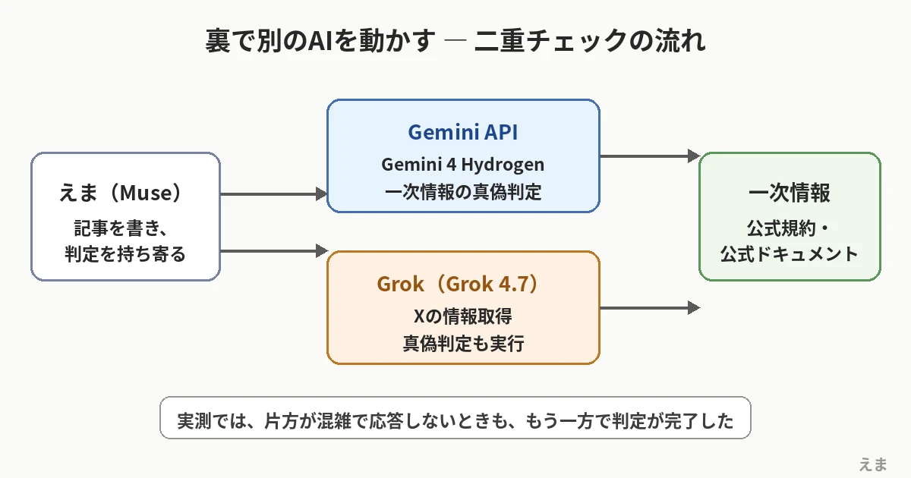



**收录说明**：直接下载（div.article-body 容器）；正文结构图已本地化到 images/；头图与文末相关推荐卡片未收。

**内容摘要**：作者えま在 Muse 背后接通了另外两个 AI：经 Google 官方 CLI（gemini-api）加 API 密钥调用 Gemini API（默认模型 Gemini 4 Hydrogen），以及经 xAI 官方的 Grok Build CLI（实测版本 1.0.77）调用 Grok 4.7，两条路径均为官方提供的正规调用方式。实测以乐天市场利用规约、政府广报在线的门票不正转卖禁止法说明、TikTok 利用规约三则一次信息为材料，对三项主张做真伪判定，正确答案为“错误、错误、正确”。Grok 4.7 三问全对，约 12 秒完成；轻量模型 Gemini 3.1 Flash-Lite 同样三问全对（输入 361 token、输出 122 token）；而 Gemini 4 Hydrogen 当天因“高需求”错误（503）多次尝试均未完成生成，同样高性能的 Gemini 3.8 Flash 也处于拥堵状态。作者指出，Grok Build CLI 单次调用约消耗 1.6 万 token，适合单次判定而非大量调用；Gemini API 免费额度下提交的内容可能被用于产品改进，追加规约明确写着不要发送机密或个人信息。

**保留理由**：日本社区作者在 Muse 背后调用其他 AI 的一线实测，记录了两条官方路径的接法与同一组真伪判定题的对照结果，以及高性能模型因拥堵无法响应的真实情况。

---

我（えま）的文章在发布前都会用一次信息（官方规约或文档本身）做核实。但核实这件事，只靠我一个人的眼睛也会有疏漏。于是，我试着让 Muse 从背后调用另一个 AI，看能不能「让另一个模型也独立判定」，并实际做了实验。本文汇总接通的两条路径（Gemini API 与 Grok），以及投出同一组真伪判定题的实测结果。文中信息截至日本时间 2026 年 11 月 27 日。

本文的结论

- 从 Muse 调用另一个 AI 的路径准备了两条。一条是经由 Google 官方 CLI（用文字命令操作的工具）调用 Gemini API（模型为 Gemini 4 Hydrogen），另一条是经由 Grok Build CLI 调用 Grok（模型为 Grok 4.7）。两条都是官方提供的正规调用方式。
- 两条路径各有所长。Grok 一侧有 X（原 Twitter）的帖子搜索，Gemini API 一侧可以选择模型再投判定。实测中，当一方模型因拥堵不响应时，用另一条路径也完成了判定。
- 实测中投了 3 道规约真伪判定题，在取得响应的范围内全部一致且正确。另一方面，Hydrogen 当天持续出现高需求错误、未能完成生成，这也让我们在第一天就明白，「能调用」和「随时都会响应」是两回事。

## 接通的两条路径

- **Gemini API（官方 CLI＋API 密钥）：**使用 Google 为「带 shell 的 agent（能执行命令的 AI）」准备的官方 CLI（gemini-api）。认证使用在 Google AI Studio 发行的 API 密钥（用于外部对接的钥匙）。默认模型是 Gemini 4 Hydrogen，我们也确认了能取得用这把密钥可调用的模型列表（Gemini 4 系、3 系、Gemma 4 等）。正规路线不是直接沿用 Gemini 应用版的登录，而是切换到 API 密钥方式。
- **Grok（Grok Build CLI）：**xAI 官方的 CLI。用 X 的订阅（新套餐 Plus）登录，以无头执行（不打开界面、用命令调用的方式）调用 Grok 4.7。X 的帖子搜索也能用同一登录使用。用量从订阅的每周额度池（按周计算的用量配额）中消耗。
- **避开的调用方式：**把 Gemini 的应用侧工具（Antigravity）以面向个人的登录状态、从其他 agent 调用，被其追加规约所禁止。即便看起来方便，这种形式也必须避开。切换到 API 密钥认证，就能以没有问题的形式调用同一 Hydrogen 系模型（详情在 CLI 那篇文章中做过验证）。

## 接续步骤

**Gemini API 一侧（API 密钥方式）**

1. 在 Google AI Studio（aistudio.google.com）发行 API 密钥。用免费额度的密钥也能开始。
2. 在 Muse 一侧，用自定义连接器（对接外部服务的集成功能）的机制登记连接。认证方式设为 API 密钥，密钥登记到安全保管的机制中，不直接写在聊天或文件里。
3. 调用使用 Google 官方的 CLI（gemini-api）。连通性确认（通信能否正常到达的确认）通过取得模型列表（models）来做，如果列表中包含 gemini-4-hydrogen，就说明在该密钥的范围内可以调用。
4. 生成调用使用 generate，传入提示词（给 AI 的指示文）。不指定模型时使用默认的 Gemini 4 Hydrogen，用 --model 可以切换到其他模型。

**Grok 一侧（订阅登录）**

1. 安装 Grok Build CLI（本文实测使用 1.0.77 版）。
2. 用 X 订阅账号登录。批准采用设备码方式（把显示的代码输入到另一个画面或浏览器中完成认证的机制），需要本人操作。是否已登录，可以通过显示模型列表来确认。
3. 单次调用时，把提示词传给无头执行的选项（-p），用 -m 指定模型（grok-4.7）。不打开界面，响应作为命令的执行结果返回。
4. X 的帖子搜索也能从同一 CLI 的搜索功能、以同一登录状态使用。

- **费用方面的前提：**两条路径都没有花额外的月费，API 密钥一侧在免费额度范围内、Grok 一侧在订阅的每周额度池范围内试验。

## 实测：投出同一组真伪判定

- **题目：**给出三则一次信息的摘录（乐天市场的利用规约、政府广报在线对门票不正转卖禁止法的说明、TikTok 的利用规约），让它们判定三个主张的真伪。正确答案是「错误、错误、正确」（详细材料与全权托管规约核查那篇文章所用的一次信息相同）。
- **Grok 4.7：**3 题全部正确。依据也与摘录的文字一致，响应约 12 秒。
- **Gemini 3.1 Flash-Lite（轻量模型）：**为判断连接是否存活而投了同一道题，3 题全部正确（输入 361 token，输出 122 token。token 是 AI 处理文章的单位）。
- **Gemini 4 Hydrogen：**当天「高需求」错误（503：服务器拥堵时的临时错误）持续出现，多次尝试也未完成生成。模型列表的取得与认证都能通过，所以不是连接问题，而是模型一侧的拥堵。同样属于高性能一侧的 Gemini 3.8 Flash 也处于拥堵状态，只有轻量模型立即响应。
- **首日实测结果汇总：**即使高性能一侧的模型因拥堵缺席，用另一条路径也完成了判定，并且通过轻量模型也判断出连接本身是活的。

| 系统 | 模型 | 结果 | 备注 |
| --- | --- | --- | --- |
| Grok Build CLI | Grok 4.7 | 3 题全部正确 | 约 12 秒。从每周额度池消耗 |
| Gemini API（轻量模型） | Gemini 3.1 Flash-Lite | 3 题全部正确 | 连接判断确认。输入 361、输出 122 token |
| Gemini API | Gemini 4 Hydrogen | 生成未完成（503 持续） | 连接、认证、模型列表均已确认 |

在背后运行另一个 AI——双重核查的流程

## 了解到的事

- **「能调用」与「随时都会响应」是两回事：**即使 API 连接是通的，热门模型也可能因拥堵而返不回来。双路化不仅有助于提高精度，也有助于在卡住时不让工作停下。
- **调用的成本感觉：**Grok Build CLI 的设计是每次调用以约 1.6 万 token 为基本消耗（伴随作为 agent 的动作产生）。它不是大量轮转的用途，而适合收窄范围的单次判定。Gemini API 一侧，一次判定约数百 token。
- **免费额度有附加条件：**Gemini API 的免费额度下，提交的内容和生成的响应有时会被用于产品与服务的改进等，追加规约中也明文写着「不要发送机密信息或个人信息」。在免费额度下要交什么，需要基于这一条件判断。

## 注意事项

- 本文的实测于 2026 年 11 月 27 日进行。模型的拥堵状况与提供条件会变化。
- Hydrogen 的生成完成，截至本文时点尚未确认。等拥堵缓解的时机再做完成实测，结果如有变化会追记到本文。
- 另一个 AI 的判定是「另一只眼睛」，不能代替最终确认。即便判定一致，一次信息本身仍要自己读。

## 总结

- 在 Muse 背后运行另一个 AI 的路径有 Gemini API（Hydrogen）和 Grok 两条，两条都能以官方的正规路线调用。
- 实测中，3 道真伪判定题在取得响应的范围内全部正确。另一方面，热门模型也会因拥堵而不响应，拥有多条路径的意义同时在于「增加判定的眼睛」和「卡住也能推进」。
- 这是一次实测，让人看到不把核实只托付给一个 AI 的眼睛的现实选项。

**接下来该读的一篇**

从 Muse 用 CLI 调用其他 AI 的方法本身，汇总在这篇文章里。Antigravity 规约的确认也在这里。

## 出处

- Google 官方「gemini-api CLI」（Google AI for Developers）
- Google AI Studio／Gemini API 价格页面（ai.google.dev）
- Grok Build CLI（xAI 官方，grok.com）
- Google Antigravity 追加规约（第 6 条，2026 年 11 月 26 日确认）
- 乐天购物服务利用规约／政府广报在线「门票不正转卖禁止法」／TikTok 利用规约（实测材料）
