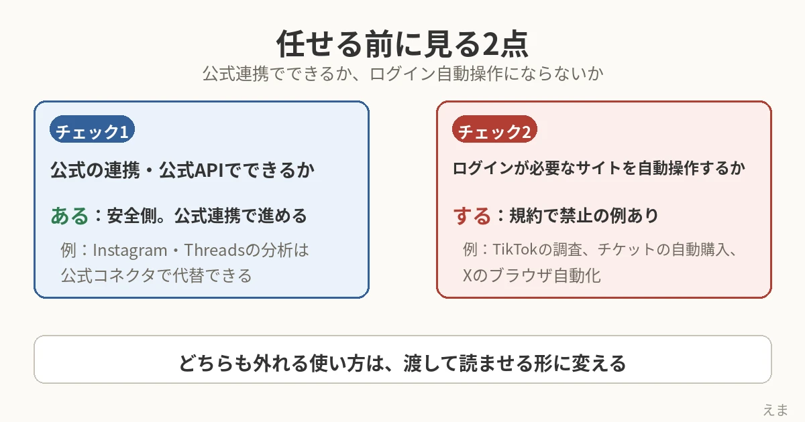



**收录说明**：直接下载（div.article-body 抽取）。原文全文存于本目录的 original.md，网站上不显示，已翻译。文末站内推荐区块已删去；原创示意图已本地化到 images/。

**内容摘要**：作者えま以圣星あい 2026 年 11 月 4 日在 note 发布的「Museはここまで丸投げできる。Xで話題の活用法30選と、まねできる頼み方」为出发点——该文收集了 X 上 30 个获赞 100 件以上的「实际这样用过」投稿，并对其中部分用法标了「规约违反的可能性」注记；本文逐项对照各服务的官方规约原文，核查带注记的用法，并判断能否用 Muse 的官方連携替代，规约文言以 2026 年 11 月 27 日时点为准。作者的判定线是两点：「能否通过官方連携或官方 API 实现」与「是否登录后用浏览器自动操作网站」，前者偏安全，后者已有被规约明文禁止的实例。文言确认禁止的用法包括：TikTok 调查（TikTok 利用规约日本版禁止用自动化脚本收集信息）、票务自动购买（チケットぴあ规约禁止以 BOT 等技术手段利用服务）、X 浏览器自动化（X 开发者指南明文规定非 API 自动化将导致永久停止）、楽天市场自动购买与商品页信息获取，以及银行网银登录代行（みずほ银行、三井住友银行规定暗证号码不得向第三方透露、仅限本人使用）；手続き代行则看是否以「本人」为前提，例如楽天カード申办须知写明不接受本人以外者的申请。另一方面，Instagram 与 Threads 的分析可用 Muse 官方コネクタ读取自己账号的指标来替代，无需用浏览器打开查看；作者也注明本文是基于官方规约与文档的验证而非各用法的实测，且「未确认」不等于「没有问题」。

**保留理由**：这篇资料提供了已收资料中没有的东西：它逐项对照 TikTok、X、チケットぴあ、楽天、みずほ银行等官方规约原文，给出了一张带判定结果的核查表，并以「官方連携／官方 API 与否」和「是否登录后浏览器自动操作」两点界定了浏览器自动操作的安全边界。

---

「Muse 可以一路托付到这种程度」——一篇汇集 X 上热门用法的 30 个案例的汇总文章正在传播。不过，这篇汇总文章本身在开头就发出了提醒，并对若干条目标注了「可能违反规约」。越是看起来方便的用法，越需要确认它是否触碰了目标服务的规约。本文以带注记的用法为中心，核对目标服务官方规约的条文，以及能否用 Muse 的官方连接（公式連携）替代，并做了分类。判定仅限于能从规约条文中确认的范围。信息截至 2026 年 11 月 27 日。

本文结论

- 分界线有两点：「能否通过官方连接或官方 API 完成」与「是否用浏览器自动操作需要登录的网站」。通过官方连接能完成的用法属于安全一侧；伴随登录的浏览器自动操作，则确实存在被目标服务规约禁止的实例。
- 从条文能确认禁止的：TikTok 调查（禁止用自动化脚本收集信息）、票务自动购买（禁止以 BOT 等技术手段使用服务）、X 的浏览器自动化（官方指南明文列为永久停用对象）、楽天市場的自动购买与商品页信息获取、银行网银的登录代行（规定不得向第三方泄露密码）。
- 也有可以用官方连接替代的：Instagram 与 Threads 的分析，可以用 Muse 的官方连接器（连接功能）读取自己账号的指标，不必「用浏览器打开去查」。
- 手续代行要看是否以「本人」为前提：例如信用卡申请，存在不接受本人以外者申请的情形。某项手续是否允许代理，需要按各自的规则确认。

## 流行出处

- **汇总文章：**圣星あい的 note 文章《Muse 可以一路托付到这种程度。X 上热门的 30 种用法，以及可以照搬的委托方式》（2026 年 11 月 4 日发布）。它收集了 X 上 30 条「实际这样用过」的投稿，对象是获赞 100 次以上的投稿。
- **汇总文章自身的提醒：**开头写道「让 AI 用浏览器登录服务并自动操作，这种用法可能构成对各服务规约的违反，导致账号停用等后果（例如在 TikTok 上做分析、在 X 上发帖）。请使用官方 API 或官方连接功能，在确认规约之后再尝试」，适用条目都标了「※」注记。
- **带注记的条目：**TikTok 调研、在 Muse 里运行 ChatGPT、代办申请材料或办卡、在预约开放瞬间去抢、追星活动的预约操作等。本文对这些带注记的用法，以及与它们形成对照的官方连接用法，进行分类。

## 分类结果

| 用法 | 目标服务的规约 | 官方替代手段 | 判定 |
| --- | --- | --- | --- |
| 用浏览器操作代做 TikTok 调研 | TikTok 使用条款（日本版）明文禁止「使用自动化脚本从本服务收集信息，或以其他方式与本服务交互」 | Muse 没有 TikTok 官方连接器 | 规约明文禁止 |
| 在 Muse 的浏览器内运行 ChatGPT | OpenAI 使用条款明文禁止「自动或以程序方式提取数据或输出」，以及规避速率限制（次数限制）或保护措施。未确认到禁止经由自动化程序使用本身的条文 | 没有官方连接（通过文件的传递在另一篇文章中介绍） | 存在触及禁止事项的形式 |
| 在预约开放瞬间去抢／预约、票务网站的自动操作 | チケットぴあ使用条款明文禁止「以自动输入软件或所谓 BOT 等技术手段，试图使用本服务的行为」 | 预约网站没有官方连接器 | 规约明文禁止 |
| 监视目标商品的促销 | 楽天市場规约明文禁止未经事先许可、以自动化手段购买（包括获取商品页上的信息等）。Amazon 使用条款明文规定，收集和利用产品列表、价格等，以及使用机器人等数据收集工具，不包含在使用许可之内 | 人用浏览器查看价格的范围不在其内 | 自动购买被规约明文禁止。监视若以自动循环方式进行，也触及大型商城的规约 |
| 自动向 X 投稿／分析他人账号的增长方式 | X 开发者指南：自动投稿仅在经由官方 API 且满足条件时允许。不经 API 的抓取（自动收集）与浏览器自动化属于永久停用对象。监视、画像分析他人（分析行为倾向）也被禁止 | Muse 没有 X 官方连接器 | 经浏览器不可，仅经官方 API 且附条件可 |
| Instagram 与 Threads 的分析 | 属于 Meta 官方连接的范围 | 用 Muse 官方连接器可读取自己每条投稿的指标，以及账号整体的粉丝增减、每日趋势等分析数据 | 可用官方连接替代 |
| 从信用卡账单中筛出订阅并交涉 | 银行网银规定明文要求：密码等须严加管理以免被第三方知悉、不得向第三方披露、仅限本人使用（みずほ銀行、三井住友銀行规定）。把 ID 和密码交给 AI 让其登录，触及这一条文 | 若改为提交账单文件或截图让其阅读，则不伴随登录操作 | 委托登录的形式触及规约。宜改为提交后阅读的形式 |
| 代办申请材料或办卡 | 楽天カード申请指引写有「谢绝本人以外者的申请」，并明文说明本人以外者的申请可能无效。各项手续是否允许代理各有规定 | 若只做到起草和梳理所需材料，则不伴随提交操作 | 代办办卡不可（以本人申请为前提）。申请类须按各项手续的规定确认 |

## 核对规约条文

- **TikTok：**使用条款（面向日本居民的版本，2025 年 12 月 1 日更新）的禁止事项中有「use automated scripts to collect information from or otherwise interact with the Services」（使用自动化脚本从本服务收集信息，或以其他方式与本服务交互）。用浏览器操作浏览 TikTok 的用法，正面落在这条条文上。
- **チケットぴあ：**票务销售服务使用条款的禁止事项中有「以自动输入软件或所谓 BOT 等技术手段，以及其他本公司认定为不正当的方法，试图使用本服务的行为」。违反还可成为不经事先通知即停止提供服务的依据。
- **X：**官方开发者指南的自动化规则一节写有「Non-API automation (scraping, browser automation) results in permanent suspension. Always use the official X API.」（不经 API 的自动化，即抓取或浏览器自动化，属于永久停用对象。务必使用官方 X API）。自动投稿本身，在经由官方 API 并满足标注自动账号等条件的情况下是被允许的形式。
- **OpenAI：**使用条款（2026 年 1 月 1 日生效的现行版）的禁止事项中有「Automatically or programmatically extract data or Output」（自动或以程序方式提取数据或输出）。像自动吸取 ChatGPT 回答这样的用法会触及该条文。另一方面，直接禁止「在浏览器中登录并操作」本身的条文，在现行使用条款中未能确认到。
- **楽天市場与 Amazon：**楽天购物服务使用条款的禁止事项中有「未经本公司事先许可，以自动化手段（自动购买工具、机器人等类似手段）购买商品（包括获取商品页上的信息等）」。不能说「只是监视就安全」，自动收集商品页信息的形式同样属于禁止对象。Amazon.co.jp 的使用条款也明文规定，使用许可「完全不包含产品列表、说明、价格等的收集和利用」以及「数据挖掘（从数据中抽取规律性的方法）、机器人等数据收集、抽取工具的使用」。
- **银行网银：**みずほ銀行的みずほダイレクト规定要求密码等「由客户自行负责严加管理，以免被第三方知悉」，该行应用使用规定写有「本服务仅限本人使用之目的」。问题不在于核对账单本身，而在于把 ID 和密码交给 AI 让其登录的形式触及了这一规定。
- **信用卡申请：**楽天カード的官方申请指引写有「谢绝本人以外者的申请」，同一 ID 的重复申请可能无效。让 AI 代办办卡的形式，偏离了本人申请这一前提。
- **与法律的区分：**人们容易以为票务「自动购买为法律所禁止」，但《票务不正当转卖禁止法》规制的是不正当转卖以及为此目的的受让（政府广报在线，文化厅协助）。直接禁止自动购买本身的，不是法律，而是售票网站的利用规约。

委托之前要看的 2 点

## 为什么浏览器自动操作会变成灰色地带

- **官方 API 与官方连接是「被许可的窗口」：**这是服务方在确定了可操作的范围、次数上限、对方身份之后开放的入口。其设计前提是：一旦超出范围就会被拦下。
- **浏览器自动操作不经过这个窗口：**它以看起来像人类操作的方式使用网站，因此服务方的规约常以「自动化脚本」「BOT 等技术手段」等措辞，成排地禁止这种形式本身。Muse 的浏览器在官方文档中被定位为用于「在实时网站上工作」的功能，但它并不代为承担所打开服务自身的规约。
- **风险回到账号一侧：**如 X 指南的「永久停用」、ぴあ的「不经事先通知即停止提供」，处分对象是服务账号。越是拿重要账号去试，失去的越多。

## 更安全的替代方案

- Instagram 与 Threads 的分析用官方连接器：用 Muse 官方连接器，可以读取自己每条投稿的指标，以及账号整体的粉丝增减、每日趋势、受众属性（粉丝与浏览者的倾向）。这可以替代「用浏览器打开让它分析」的用法。
- **先确认有没有连接：**Muse 的连接器已超过 200 个。想委托的对象服务是否有官方连接器，可在[连接器图鉴](https://emma-muse.com/connectors/)确认。[「日本可用的功能一览」](https://muse.emma-muse.com/features/)也汇总了连接的提供情况。
- **没有官方连接的对象，改为「交给它读」的形式：**把账单或资料以文件形式交给它解读、只在公开页面范围内监视、在提交或发送前停下由自己按下。只要改成这种不委托登录操作的形式，规约上的争点就会大幅减少。
- **也可以自己制作连接：**即使服务没有官方连接器，只要公开了 API，也可以通过自定义连接器（自制的连接功能）接入（[另一篇文章介绍了设计](https://muse.emma-muse.com/articles/custom-connectors)）。

## 注意事项

- 本文是基于目标服务官方规约与官方文档的验证，而非对各种用法的实测。规约条文为 2026 年 11 月 27 日时点的内容。
- 规约因服务而异，且会在不预先通知的情况下变更。具体用法请务必确认该服务当前的招募要项与使用条款。
- 标为「未确认」的项目，意思是在已确认的范围内没有找到可以断定的条文，并不意味着「没有问题」。
- X 的自动化规则是在官方开发者指南（自动化规则一节）中确认的。帮助页面本体的条文在本文确认时点无法直接打开，因此出处以指南为准。

## 小结

- X 上流行的「Muse 全权托付用法」中，混有被目标服务规约明文禁止自动化的用法。汇总文章自身的注记，切中了要害。
- 分界线是两点：「能否通过官方连接、官方 API 完成」与「是否是需要登录的网站的浏览器自动操作」。其中也有像 Instagram 与 Threads 的分析那样，可以用官方连接替代的。
- 委托之前，先确认对方服务的规约，以及有无官方连接。这一道手续能大幅降低账号停用的风险。

## 出处

- 圣星あい《Muse 可以一路托付到这种程度。X 上热门的 30 种用法，以及可以照搬的委托方式》（note，2026 年 11 月 4 日）
- TikTok 使用条款（面向日本居民的版本，2025 年 12 月 1 日更新，tiktok.com）
- X Developer Guidelines「Automation rules」（xdevplatform 官方仓库／docs.x.com）
- OpenAI Terms of Use（2026 年 1 月 1 日生效，openai.com）
- チケットぴあ「チケット販売サービス利用規約」「チケット販売規定」（pia.jp）
- 政府广报在线《票务高价转卖是违法的！票务不正当转卖禁止法》（文化厅协助）
- 楽天购物服务使用条款（楽天市場，rakuten.co.jp）
- Amazon.co.jp 使用条款（amazon.co.jp）
- みずほ銀行「みずほダイレクト規定」「みずほ銀行アプリ利用規定」（mizuhobank.co.jp）
- 楽天カード 官方申请指引（rakuten-card.co.jp）
- Muse 官方文档（浏览器、Instagram／Threads 连接器）
