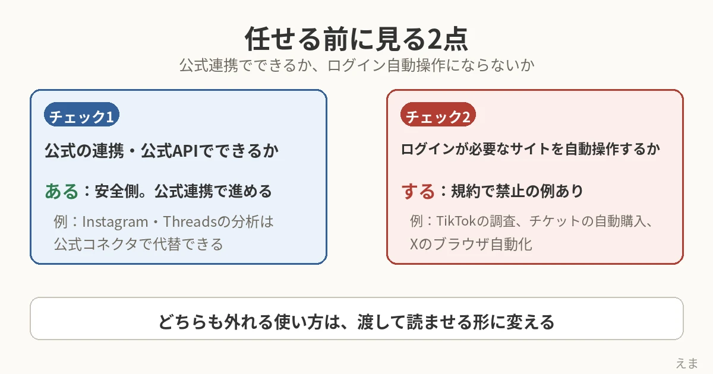

来源：https://muse.emma-muse.com/articles/marunage-terms-check
取文：2026-11-27，直接下载（div.article-body）；文末「次に読むべき1本」站内推荐区块已删去

「Museはここまで丸投げできる」。Xで話題になった活用法を30個集めたまとめ記事が広がっています。ただ、そのまとめ記事自身が、冒頭で注意を促し、いくつかの項目に「規約違反の可能性」の注記を付けています。便利そうな使い方ほど、対象サービスの規約に触れていないか確かめる必要がある、ということです。この記事では、注記の付いた使い方を中心に、対象サービスの公式規約の文言と、Museの公式連携で置き換えられるかを確かめ、仕分けました。判定は規約の文言で確認できた範囲に限ります。2026年11月27日時点の情報です。

この記事の結論

- 線引きは2点です：「公式の連携や公式APIでできるか」と「ログインが必要なサイトをブラウザで自動操作するか」です。公式連携でできる使い方は安全側、ログインを伴うブラウザ自動操作は、対象サービスの規約で禁じられている例が実際にあります。
- 文言で禁止が確認できたもの：TikTokの調査（自動スクリプトによる情報収集の禁止）、チケットの自動購入（BOT等の技術的手段による利用の禁止）、Xのブラウザ自動化（公式ガイドラインで永久停止の対象と明記）、楽天市場での自動購入と商品ページの情報取得、銀行のネットサービスへのログイン代行（暗証番号を第三者に開示しない決まり）です。
- 公式連携で置き換えられるものもあります：InstagramとThreadsの分析は、Museの公式コネクタ（連携機能）で自分のアカウントの指標が読めます。「ブラウザで開いて調べさせる」必要はありません。
- 手続きの代行は「本人が前提」かどうかで見ます：クレジットカードの申込みのように、本人以外からの申込みを受け付けない例があります。代理が認められる手続きかどうかは、個別の決まりで確かめる必要があります。

## 流行の出所

- **まとめ記事：**聖星あいさんのnote「Museはここまで丸投げできる。Xで話題の活用法30選と、まねできる頼み方」（2026年11月4日公開）です。Xで「実際にこう使った」という投稿を30個集めたもので、いいね100件以上の投稿が対象です。
- **まとめ記事自身の注意：**冒頭に「AIにブラウザでサービスへログインさせて自動で操作する使い方は、各サービスの規約違反として、アカウント停止などにつながる可能性があります（TikTokで分析、Xで投稿など）。公式のAPIや公式の連携機能を使い、規約を確かめたうえで試してください」と書かれ、当てはまる項目には「※」の注記が付いています。
- **注記が付いた項目：**TikTokのリサーチ、Museの中でChatGPTを動かす、申請書類やカード作成を代行、予約開始の瞬間に取りに行く、推し活の予約操作などです。この記事では、この注記のある使い方と、対比になる公式連携の使い方を仕分けます。

## 仕分け結果

| 使い方 | 対象サービスの規約 | 公式の代替手段 | 判定 |
| --- | --- | --- | --- |
| TikTokのリサーチをブラウザ操作で任せる | TikTok利用規約（日本向け版）に「自動化されたスクリプトを用いて、サービスから情報を収集すること、またはその他サービスとやり取りすること」の禁止が明記 | MuseにTikTokの公式コネクタはない | 規約で禁止が明記 |
| Museのブラウザ内でChatGPTを動かす | OpenAI利用規約に「データまたは出力を自動的またはプログラム的に抽出すること」の禁止と、レート制限（回数制限）や保護措置の回避の禁止が明記。自動プログラム経由の利用そのものを禁じる文言は未確認 | 公式の連携はない（ファイルを介した受け渡しは別記事で紹介） | 禁止事項に触れる形がある |
| 予約開始の瞬間に取りに行く／予約・チケットサイトの自動操作 | チケットぴあの利用規約に「自動入力を行うソフトウェアやいわゆるBOT等の技術的手段により、本サービスを利用しようとする行為」の禁止が明記 | 予約サイトの公式コネクタはない | 規約で禁止が明記 |
| 狙った商品のセール監視 | 楽天市場の規約に、事前の許可なく自動化された手段で購入すること（商品ページ上の情報取得等を含む）の禁止が明記。Amazonの利用規約では、製品のリストや価格などの収集および利用と、ロボットなどのデータ収集ツールの使用は、利用許可に含まれないと明記 | 人がブラウザで価格を見る範囲は対象外 | 購入の自動化は規約で禁止が明記。監視も自動で回す形は大手モールの規約に触れる |
| Xへの自動投稿／他人のアカウントの伸び方分析 | Xの開発者ガイドライン：自動投稿は公式API経由のみ条件付きで可。APIを介さないスクレイピング（自動収集）やブラウザ自動化は永久停止の対象。他人の監視・プロファイリング（行動傾向の分析）も禁止 | MuseにXの公式コネクタはない | ブラウザ経由は不可、公式API経由のみ条件付きで可 |
| InstagramとThreadsの分析 | Metaの公式連携の範囲 | Museの公式コネクタで、自分の投稿とアカウントのインサイト（フォロワー増減、日次トレンドなどの分析データ）が読める | 公式連携で代替できる |
| カード明細からサブスク洗い出し・交渉 | 銀行のネットサービスの規定に、暗証番号等を第三者に知られないよう厳重に管理すること、第三者に開示しないこと、自身による利用のみとすること、が明記されている（みずほ銀行・三井住友銀行の規定）。AIにIDと暗証番号を渡してログインさせる形は、この文言に触れる | 明細ファイルやスクリーンショットを渡して読ませる形なら、ログイン操作は伴わない | ログインを任せる形は規約に触れる。渡して読ませる形に寄せる |
| 申請書類やカード作成の代行 | 楽天カードの申込み案内に「ご本人様以外からのお申し込みはご遠慮ください」とあり、本人以外の申込みは無効となる場合があると明記。手続きごとに代理の可否が決まっている | 下書きや必要書類の洗い出しまでなら、提出操作は伴わない | カード作成の代行は不可（本人の申込みが前提）。申請系は手続きごとの決まりで確認 |

## 規約の文言を確認する

- **TikTok：**利用規約（日本在住者向けの版、2025年12月1日更新）の禁止事項に「use automated scripts to collect information from or otherwise interact with the Services」（自動化されたスクリプトを用いて、本サービスから情報を収集すること、またはその他本サービスとやり取りすること）とあります。ブラウザ操作でTikTokを見て回る使い方は、この文言に正面から当たります。
- **チケットぴあ：**チケット販売サービス利用規約の禁止事項に「自動入力を行うソフトウェアやいわゆるBOT等の技術的手段、その他当社が不正とみなした方法により、本サービスを利用しようとする行為」とあります。違反は、事前の通知なしにサービス提供を止める根拠にもなるとされています。
- **X：**公式の開発者ガイドラインの自動化ルールの節に「Non-API automation (scraping, browser automation) results in permanent suspension. Always use the official X API.」（APIを介さない自動化、スクレイピングやブラウザ自動化は永久停止の対象になる。必ず公式のX APIを使うこと）とあります。自動投稿そのものは、公式API経由で、自動アカウントの表示などの条件を満たせば認められる形です。
- **OpenAI：**利用規約（2026年1月1日発効の現行版）の禁止事項に「Automatically or programmatically extract data or Output」（データまたは出力を、自動的またはプログラム的に抽出すること）とあります。ChatGPTの回答を自動で吸い上げるような使い方は、この文言に触れます。一方で、「ブラウザでログインして操作すること」自体を直接禁じる文言は、現行の利用規約では確認できませんでした。
- **楽天市場とAmazon：**楽天ショッピングサービスご利用規約の禁止事項に「当社の事前の許可を得ることなく、自動化された手段（自動購入ツール・ロボットなどこれらに準ずる手段）を用いて商品を購入すること（商品ページ上の情報取得等を含む）」とあります。「監視だけなら安全」とは言い切れず、商品ページの情報を自動で集める形も禁止の対象です。Amazon.co.jpの利用規約でも、利用許可には「製品のリスト、解説、価格などの収集および利用」や「データマイニング（データから規則性を抽出する手法）、ロボットなどのデータ収集・抽出ツールの使用は、一切含まれません」と明記されています。
- **銀行のネットサービス：**みずほ銀行のみずほダイレクト規定では、暗証番号等は「お客さま自身の責任において第三者に知られないよう厳重に管理するもの」とされ、同行のアプリ利用規定には「本サービスを自身による利用のみの目的で利用するものとし」とあります。明細の確認自体が問題なのではなく、IDと暗証番号を渡してAIにログインさせる形が、この決まりに触れます。
- **クレジットカードの申込み：**楽天カードの公式の申込み案内には「ご本人様以外からのお申し込みはご遠慮ください」とあり、同一IDでの重複申込みは無効となる場合があるとされています。カード作成をAIに代行させる形は、本人の申込みという前提から外れます。
- **法律との切り分け：**チケットの「自動購入が法律で禁止」と思われがちですが、チケット不正転売禁止法が対象とするのは、不正転売と、その目的での譲り受けです（政府広報オンライン、文化庁協力）。自動購入そのものを直接禁じているのは、法律ではなく販売サイトの利用規約です。

任せる前に見る2点

## なぜブラウザ自動操作がグレーになるのか

- **公式APIや公式連携は「許可された窓口」です：**サービス側が、できる操作の範囲、回数の上限、相手の身元を決めたうえで開いている入口です。範囲を外れた使い方をすれば止められる、という前提で設計されています。
- **ブラウザ自動操作は、その窓口を通りません：**人間の操作に見える形でサイトを使うため、サービス側の規約は「自動化されたスクリプト」「BOT等の技術的手段」といった文言で、この形そのものを禁じている例が並びます。Museのブラウザは、公式ドキュメント上は「ライブなウェブサイトでの作業」のための機能と位置づけられていますが、開いた先のサービスの規約まで肩代わりするものではありません。
- **リスクはアカウント側に返ってきます：**Xのガイドラインの「永久停止」、ぴあの「事前通知なしの提供中止」のように、処分の対象はサービスのアカウントです。大切なアカウントで試すほど、失うものが大きくなります。

## 安全に寄せる代替案

- InstagramとThreadsの分析は公式コネクタで：Museの公式コネクタで、自分の投稿ごとの指標や、アカウント全体のフォロワー増減・日次トレンド・オーディエンス属性（フォロワーや閲覧者の傾向）が読めます。「ブラウザで開いて分析させる」使い方の置き換え先になります。
- **連携があるか先に確かめる：**Museのコネクタは200件を超えています。任せたい相手のサービスに公式コネクタがあるかは、[コネクタ図鑑](https://emma-muse.com/connectors/)で確かめられます。[「日本で使える機能一覧」](https://muse.emma-muse.com/features/)にも、連携の提供状況をまとめています。
- **公式連携がない相手は「渡して読ませる」形に寄せる：**明細や資料をファイルで渡して読み解かせる、公開ページの範囲で見張らせる、提出や送信の直前で止めて自分が押す。このようにログイン操作を任せない形に変えるだけで、規約の論点は大きく減ります。
- **連携を自作する手もあります：**公式コネクタがないサービスでも、APIが公開されていればカスタムコネクタ（自作の連携機能）でつなぐ方法があります（[別記事で設計を紹介しています](https://muse.emma-muse.com/articles/custom-connectors)）。

## 注意点

- この記事は、対象サービスの公式規約と公式ドキュメントをもとにした検証であり、各使い方の実測ではありません。規約の文言は2026年11月27日時点のものです。
- 規約はサービスごとに異なり、予告なく変わります。個別の使い方では、必ずそのサービスの現在の応募要項・利用規約を確認してください。
- 「未確認」とした項目は、確認した範囲で断定できる文言が見つからなかったという意味であり、「問題ない」という意味ではありません。
- Xの自動化ルールは、公式の開発者ガイドライン（自動化ルールの節）で確認しました。ヘルプページ本体の文言は、本記事の確認時点では直接開けなかったため、出典はガイドラインに寄せています。

## まとめ

- Xで流行る「Muse丸投げ活用法」には、対象サービスの規約で自動化が明示的に禁じられている使い方が混ざっています。まとめ記事自身の注記は、的を射ていました。
- 線引きは「公式連携・公式APIでできるか」「ログインが必要なサイトのブラウザ自動操作か」の2点です。InstagramとThreadsの分析のように、公式連携で置き換えられるものもあります。
- 任せる前に、相手のサービスの規約と、公式連携の有無を確かめる。この一手間で、アカウント停止のリスクは大きく下げられます。

## 出典

- 聖星あい「Museはここまで丸投げできる。Xで話題の活用法30選と、まねできる頼み方」（note、2026年11月4日）
- TikTok 利用規約（日本在住者向け版、2025年12月1日更新、tiktok.com）
- X Developer Guidelines「Automation rules」（xdevplatform公式リポジトリ／docs.x.com）
- OpenAI Terms of Use（2026年1月1日発効、openai.com）
- チケットぴあ「チケット販売サービス利用規約」「チケット販売規定」（pia.jp）
- 政府広報オンライン「チケットの高額転売は禁止です！チケット不正転売禁止法」（文化庁協力）
- 楽天ショッピングサービスご利用規約（楽天市場、rakuten.co.jp）
- Amazon.co.jp 利用規約（amazon.co.jp）
- みずほ銀行「みずほダイレクト規定」「みずほ銀行アプリ利用規定」（mizuhobank.co.jp）
- 楽天カード 公式申込み案内（rakuten-card.co.jp）
- Muse公式ドキュメント（ブラウザ、Instagram／Threadsコネクタ）
