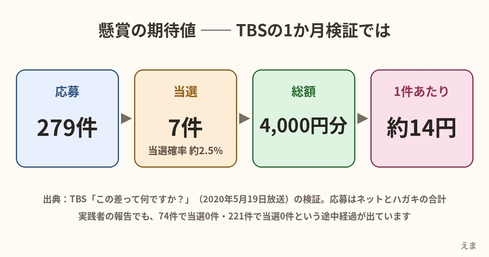



**收录说明**：直接下载（div.article-body 容器）；作者声明本文不是本人实测，而是据公表信息核查流行说法的出处、实践者报告、主办方规约与期望值数字；期望值图已本地化到 images/；头图与文末相关推荐卡片未收。

**内容摘要**：2026 年 11 月，X 上“让 AI 秘书每天巡查抽奖、回过神来发现中了块砧板”的帖子走红，随后出现了教人用 Muse 代抽奖的付费 note（11 月 4 日发布，300 日元）与实测博客；作者声明本文不是本人实测，而是据公开信息核查流行说法的出处、实践者报告、主办方规约与期望值数字。实践者おでん太郎 11 月 4 日至 7 日 4 天内用 Muse 抽 44 件、Claude 抽 30 件，共 74 件，11 月 7 日时中奖 0 件；11 月 13 日首次中奖 1 件，为 X 关注转发型的某大企业官方账号活动，奖品是眼部护理用品；另一名实践者 3 天抽 163 件、截至 11 月 22 日累计 221 件，中奖仍为 0 件。希尔顿度假俱乐部（Hilton Grand Vacations）的官方活动规约明确写着，他人或团体代为应募、商业抽奖代应服务及自动化应募设备均属无效与失格，“机械复制的应募”亦属失格；作者提醒并非所有活动规约都有相同表述。以 TBS《这个差别是什么？》2020 年 5 月 19 日播出的一个月验证为准：279 件应募中 7 件，奖品总额 4,000 日元，中奖率约 2.5%，每件约 14 日元。作者指出，应募需提供姓名、住址、电话号码，件数越多，个人信息交出的对象与踩中虚假抽奖的机会也越多；X 与 Instagram 的机械参与还可能导致账号受限或冻结。

**保留理由**：作者据公开信息核查了日本 X 上流行的“Muse 代抽奖”说法，核对了实践者的中奖实绩、主办方规约原文与期望值数字，是对一种流行用法的冷静验证。

---

「让 AI 秘书每天巡查抽奖并应募，回过神来发现中了块砧板」。2026 年 11 月，这样一条帖子在 X 上引发热议，随后把抽奖应募交给 Muse 的实践、以及总结其方法的付费文章接连出现。听起来挺有意思，但活动规约与实际的获奖实绩究竟如何？本文核查这股流行的出处、实践者的报告、主办方的官方规约，以及期望值的数字。另外，本文不是抽奖应募的实测，而是基于公开信息的验证。文中信息截至日本时间 2026 年 11 月 27 日。

本文的结论

- 技术上可行，实践者也确实存在。但实践者的报告显示，即使应募数十到数百件，结果也持续是零中奖或极少中奖。
- 至少大型活动的规约中，有明文规定代应募或自动化应募「无效、失格」的例子。如果中了也会被取消，那搭这套机制就没有意义。
- 期望值的大致参考是每件约 14 日元（来自电视节目为期一个月的验证）。这不是「赚钱」，而是能否贴补家用的水平。
- 应募需要姓名、住址、电话号码。件数越多，交出个人信息的对象、以及踩中虚假抽奖的机会就越多。

## 流行的出处

- **发端的帖子：**据付费 note 的作者说，起因是 2026 年 11 月 3 日夜里在 X 上看到的一条帖子。内容是「让 AI 秘书每天巡查抽奖并应募，回过神来发现中了块砧板」，作为「AI 默默替人做完麻烦的应募工作」的故事传播开来。
- **付费 note（2026 年 11 月 4 日发布）：**AI 自动化实验室的实况验证文章（300 日元）公开了每天巡查 4 次、一天应募 50 件、每月约 1,500 件的体制，以及给 AI 的指示文（提示词）。
- **实践博客（2026 年 11 月 6 日发布）：**おでん太郎的博客报告了把抽奖应募交给 Muse 和 Claude 的实践，带件数与结果。下一节来看内容。
- **派生的扩散：**据读过付费 note 的另一位实践者报告，实验开始 3 天应募 163 件，截至 2026 年 11 月 22 日累计完成 221 件自动应募，中奖仍为 0 件。

## 核实实践者的实绩

- **应募 74 件，中奖 0 件（开始第 4 天时）：**在おでん太郎的实践中，2026 年 11 月 4 日至 7 日的 4 天里，Muse 应募 44 件，Claude 应募 30 件，合计 74 件。明细是 Instagram 的关注＋点赞型 31 件、X 的关注＋转发型 17 件、企业网站的应募表单 26 件。截至 11 月 7 日中奖 0 件。
- **两周后首次中奖 1 件：**之后在 11 月 13 日首次中奖。是 X 关注＋转发型的某大企业官方账号活动，奖品是眼部护理用品。中奖通知通过私信送达，住址等信息的回复没有让 AI 输入，而是自己发送的。
- **这是带安全规则的实践：**这项实践不是无限制地全权托管，而是在以下规则下运转的：主办方只限于大型企业的官方活动；住址一开始不提供（中途起仅限大型企业官方活动、由本人确认内容后解禁，门牌号的输入与发送按钮的操作由本人进行）；不作虚假回答；社交平台的应募每天 1 至 2 件并留出时间间隔。
- **也报告了挫折：**Muse 的浏览器曾一度被限制登录 X，X 的应募便分给了另一个 AI。文中还记录到，实际遇到过应募须知里写着「通过不正当程序进行的应募无效」的活动。

## 规约是怎么写的

- **官方规约的实例：**希尔顿度假俱乐部（Hilton Grand Vacations）的官方活动规约中明文写着：「由其他个人或团体进行的应募、包括以商业为目的的抽奖代应服务和／或应募服务网站等其他网站或电子邮件地址进行的应募均属无效，并视为失格。也请勿使用使应募手续自动化的设备或软件。」还有「由机械复制的应募视为失格」的字句（在现行的 2026 年活动规约中也确认了同样的文字）。
- **也有把以转卖为目的的应募判为无效的例子：**该公司的另一份活动规约中，以转让或转卖奖品为目的的应募被列为应募、中奖的无效事由。以把中奖品变现为前提的搭建方式，在规约一侧也不被认可。
- **并非所有规约都是同样的文字：**这里需要保留。禁止代应募、自动应募，在已确认的范围内只是「大型活动规约中有明文例子」，未必是所有活动通用的文字。不过，据活动支援公司的解说，主办方一侧也标准配备了针对自动应募的对策（一种图片验证 reCAPTCHA、访问频率限制等）。
- **规约的读法：**应募之前，先确认该活动的应募须知里有没有写到「通过程序应募」「代应募」的处理方式，这样最稳妥。对着须知所禁止的方式持续自动应募，只会抱着中奖被取消的风险让件数不断增加。

## 用数字看期望值

- **电视节目为期一个月的验证：**TBS《这个差别是什么？》（2020 年 5 月 19 日播出）的验证中，一个月应募 279 件、中奖 7 件，总额 4,000 日元。中奖率约 2.5%，折算到每件应募约 14 日元。
- **与实践者的数字并排看：**74 件 0 件、221 件 0 件这样的实践者中途结果，与这个概率并不严重矛盾。数百件应募可期待的获奖是数件，其中内容也以数千日元规模为主，这就是数字显示的水平。
- **工夫与变现性：**中奖品以实物为主，领取、以及在不使用时处理掉都要花工夫。也有规约禁止转卖奖品的例子，因此「把中奖品卖掉换现金」是难以作为前提的搭建方式。
- **作为结论的数字：**这不是「AI 会自己赚钱」的水平，而是偶尔给坚持下去的人一点小奖励、贴补家用的程度。

抽奖的期望值

## 风险在哪里

- **个人信息的散布：**表单型应募需要姓名、住址、电话号码、电子邮箱。增加件数这项工作，直接就是「增加交出自己信息的对象」的工作。在おでん太郎的实践中，住址的处理也在中途被重新审视，最后收敛为由本人完成输入与发送。
- **虚假抽奖、虚假中奖通知：**伪装成抽奖收集个人信息的网站，以及谎称「您中奖了」的通知，此前就一再被提醒（例如 Belluna 的抽奖说明）。自动跑件数越多，撞上这类恶意对象的机率也越大。
- **社交账号受限：**X 和 Instagram 的关注＋转发型，如果反复进行机械式参与，可能成为账号受限或冻结的对象。活动规约中也有例子规定，因参与导致的账号受限、冻结，主办方不承担责任。最好避免用重要的账号去跑。
- **很难做到「完全放任」：**图片验证、登录限制、各网站表单的差异都会成为障碍，实践者的报告中也一直有分工和手工调整。

## 如果要试，这条界线

实践者的安全规则可供参考。如果要试，至少可以考虑守住以下 5 点。

- 主办方只限于大型企业的官方活动。
- 先在应募须知中确认自动应募、代应募的处理方式。
- 需要住址的，由本人确认内容，最后的发送按钮自己按。
- 把抽奖专用的电子邮箱和账号分开。
- 不作虚假回答。

越是越过这条界线，违反规约和个人信息泄露的风险就越高。

## 注意事项

- 本文是基于公开信息（实践者的博客与 note、主办方的官方规约、节目的官方存档）的验证，不是抽奖应募的实测。实践者的件数与中奖报告，是各作者本人的申报。
- 规约的文字因活动而异。个别应募时，请务必确认该活动的应募须知。
- 奖品的金额换算与中奖概率会因验证条件而变化。请把数字当作观察水平的参考。

## 总结

- 「把抽奖应募交给 Muse」这股流行确实存在，实践者的报告也已陆续出齐。结果是应募数十到数百件、中奖为零或极少，颇为朴素。
- 大型活动的官方规约中有明文把代应募、自动应募定为无效、失格，也有把以转卖为目的的应募定为无效的例子。
- 期望值以每件约 14 日元为大致参考，不是「赚钱」的话题。是否值得承担个人信息与账号的风险，这一点需要慎重判断。

**接下来该读的一篇**

「AI 真能自己赚钱吗」这个疑问，我们在另一种形式下也在核实。请一并参阅。

## 出处

- おでん太郎《把抽奖应募全权交给 Muse！赚钱的用法与诀窍》（2026 年 11 月 6 日发布，2026 年 11 月 24 日更新）
- AI 自动化实验室《【实况验证】让 AI 全自动做「每日抽奖＆每日积分活动」会怎样？完全放任循环的搭建方法与提示词全公开》（note，2026 年 11 月 4 日）
- やまざき《AI 抽奖自动化模板集｜可直接复制粘贴的指示文全套》（note，2026 年 11 月）
- 希尔顿度假俱乐部 官方活动规约（hgvc.co.jp）
- TBS《这个差别是什么？》官方存档《认真持续应募抽奖一个月能赚多少钱》（2020 年 5 月 19 日播出）
- Belluna 抽奖提醒页面／SB Gift「自动应募对策」的解说
