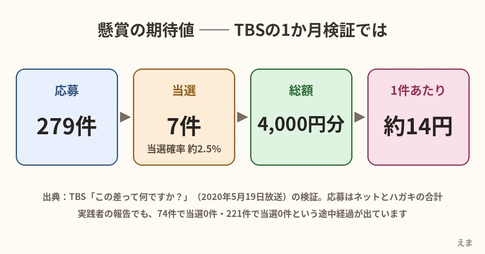

来源：https://muse.emma-muse.com/articles/sweepstakes-trend-check
取文：2026-11-26，直接下载

「AI秘書に毎日懸賞を巡回・応募させていたら、気づいたらまな板が当たっていた」。2026年11月、Xでこんな投稿が話題になり、Museに懸賞応募を任せる実践や、その方法をまとめた有料記事が相次ぎました。面白そうな話ですが、キャンペーンの規約や実際の当選実績はどうなっているのでしょう。この記事では、流行の出所と実践者の報告、主催者の公式規約、期待値の数字を確かめます。なお、これは懸賞応募の実測ではなく、公表情報をもとにした検証です。2026年11月27日時点の情報です。

この記事の結論

- 技術的には可能であり、実践者もいます。ただし実践者の報告では、数十〜数百件応募しても当選はゼロか、ごくわずかという結果が続いています。
- 少なくとも大手のキャンペーン規約には、代理応募や自動化した応募を「無効・失格」と明記した例があります。当選しても取り消される形では、仕組みを作る意味がありません。
- 期待値の目安は1件あたり約14円です（テレビ番組の1か月検証より）。「稼ぐ」ではなく、家計の足しに届くかどうかという水準です。
- 応募には氏名・住所・電話番号が必要です。件数を増やすほど、個人情報を渡す先と、偽の懸賞を踏む機会が増えていきます。

## 流行の出所

- **発端の投稿：**有料noteの筆者によると、2026年11月3日の夜にXで見た投稿がきっかけでした。「AI秘書に毎日懸賞を巡回・応募させていたら、気づいたらまな板が当たっていた」という内容で、面倒な応募作業をAIが黙々とこなしてくれる話として広がりました。
- **有料note（2026年11月4日公開）：**AI自動化ラボの実況検証記事（300円）では、毎日4回の巡回で1日50件、月間約1,500件に応募する体制と、AIへの指示文（プロンプト）が公開されています。
- **実践ブログ（2026年11月6日公開）：**おでん太郎さんのブログでは、MuseとClaudeに懸賞応募を任せた実践が、件数と結果つきで報告されています。次の節で中身を見ていきます。
- **派生の広がり：**有料noteを読んだ別の実践者の報告では、実験開始から3日で163件、2026年11月22日時点で累計221件の自動応募が完了し、当選はまだ0件とされています。

## 実践者の実績を確かめる

- **74件応募して、当選0件（開始4日時点）：**おでん太郎さんの実践では、2026年11月4日から7日の4日間で、Museが44件、Claudeが30件、合わせて74件に応募しました。内訳はInstagramのフォロー＋いいね型が31件、Xのフォロー＋リポスト型が17件、企業サイトの応募フォームが26件です。11月7日時点で当選は0件でした。
- **2週間で初当選1件：**その後、11月13日に初めて当選しました。Xのフォロー＋リポスト型による大手の公式アカウントのキャンペーンで、賞品は目もとのケア用品でした。当選の連絡はDMで届き、住所などの返信はAIに入力させず、自分で送っています。
- **安全ルールつきの実践だった：**この実践は無制限の丸投げではなく、以下のルールのもとで回されていました。主催は大手の公式キャンペーンだけに絞る、住所は最初は出さない（途中から大手の公式に限り本人が中身を確かめて解禁し、番地の入力と送信ボタンの操作は自分で行う）、うその回答はしない、SNSの応募は1日1〜2件で時間を空ける、という内容です。
- **つまずきも報告されている：**MuseのブラウザからはXのログインが一時的に制限され、Xの応募は別のAIに分担させたそうです。また、応募要項に「不正なプログラムによる応募は無効」と書かれたキャンペーンを実際に見かけたことも記されています。

## 規約はどうなっているか

- **公式規約の実例：**ヒルトングランドバケーションズの公式キャンペーン規約には、「他の人物または団体による応募、商業目的の懸賞応募サービスおよび／または応募サービスサイトなどを含む他のウェブサイトやEメールアドレスからの応募は無効であり、失格となります。応募手続きを自動化する機器やソフトウェアの利用もご遠慮ください」と明記されています。「機械によって複製された応募は失格」という文言もあります（現行の2026年のキャンペーン規約でも同文を確認しました）。
- **転売目的の応募を無効とする例も：**同社の別のキャンペーン規約では、賞品の譲渡や転売を目的とした応募が、応募・当選の無効事由に挙げられています。当選品を換金する前提の組み立ても、規約の側からは認められていません。
- **すべての規約が同じ文言ではない：**ここは留保が必要です。代理・自動応募の禁止は、確認した範囲では大手の規約に明記された例があるという話であり、全キャンペーン共通の文言とは限りません。ただ、主催者側も自動応募への対策（画像認証の一種であるreCAPTCHAや、アクセス頻度の制限など）を標準的に備えていると、キャンペーン支援会社の解説でも説明されています。
- **規約の読み方：**応募する前に、そのキャンペーンの応募要項に「プログラムによる応募」「代理応募」の扱いが書かれていないかを確認するのが確実です。要項で禁じられているものに自動で応募し続ける形では、当選の取り消しリスクを抱えたまま件数だけが増えていきます。

## 数字で見る期待値

- **テレビ番組の1か月検証：**TBS「この差って何ですか？」（2020年5月19日放送）の検証では、1か月で279件応募して当選7件、総額4,000円分でした。当選確率は約2.5%、応募1件あたりに直すと約14円です。
- **実践者の数字と並べると：**74件で0件、221件で0件という実践者の途中経過は、この確率と大きく矛盾しません。数百件の応募で期待できる当選は数件、その中身も数千円規模が中心というのが数字の示す水準です。
- **手間と換金性：**当選品は現物が中心で、受け取りや、使わない場合の処分の手間もかかります。賞品の転売が規約で禁じられている例もあるため、「当選品を売って現金化」は前提にしにくい組み立てです。
- **結論としての数字：**「AIが勝手に稼いでくれる」水準ではなく、続けた人への小さなご褒美が時々届く、という家計の足しレベルです。

懸賞の期待値

## リスクはどこにあるか

- **個人情報の配布：**フォーム型の応募には、氏名・住所・電話番号・メールアドレスが必要です。件数を増やす作業は、そのまま「自分の情報を渡す先を増やす作業」になります。おでん太郎さんの実践でも、住所の扱いは途中で見直され、最後の入力と送信は本人が行う形に寄せられていました。
- **偽の懸賞・偽の当選連絡：**懸賞を装って個人情報を集めるサイトや、「当選しました」と偽る連絡については以前から注意喚起されています（ベルメゾンの懸賞解説など）。自動で件数を回すほど、こうした悪質な先に当たる機会も増えます。
- **SNSアカウントの制限：**XやInstagramのフォロー＋リポスト型は、機械的な参加を繰り返すとアカウントの制限や凍結の対象になり得ます。キャンペーン規約の中には、参加に起因するアカウントの制限・凍結について主催者は責任を負わないとしている例もあります。大切なアカウントで回すのは避けたいところです。
- **「完全放置」にはなりにくい：**画像認証やログインの制限、サイトごとのフォームの違いが壁になり、実践者の報告でも分担や手作業の調整が入り続けています。

## もし試すなら、の線引き

実践者の安全ルールが参考になります。試す場合は、少なくとも次の5点を守ることが考えられます。

- 主催は大手の公式キャンペーンだけに絞る。
- 応募要項で自動応募や代理応募の扱いを先に確かめる。
- 住所が必要なものは本人が中身を確認し、最後の送信ボタンは自分で押す。
- 懸賞専用のメールアドレスとアカウントを分ける。
- うその回答はしない。

この線引きを外すほど、規約違反や個人情報流出のリスクは上がります。

## 注意点

- この記事は公表情報（実践者のブログとnote、主催者の公式規約、番組の公式アーカイブ）をもとにした検証であり、懸賞応募の実測ではありません。実践者の件数や当選の報告は、各筆者本人の申告です。
- 規約の文言はキャンペーンごとに異なります。個別の応募では、必ずそのキャンペーンの応募要項を確認してください。
- 賞品の金額換算や当選確率は、検証の条件によって変わります。数字は水準を見るための目安として扱ってください。

## まとめ

- 「Museに懸賞応募を任せる」という流行は実際にあり、実践者の報告も出そろってきました。結果は、数十〜数百件の応募で当選ゼロかごくわずかという地味なものです。
- 大手の公式規約には、代理・自動応募を無効・失格とする明記があり、転売目的の応募を無効とする例もあります。
- 期待値は1件あたり約14円が目安で、「稼ぐ」話ではありません。個人情報とアカウントのリスクを引き受けるほどの数字かは、慎重に判断したいところです。

**次に読むべき1本**

「AIが勝手に稼ぐ」は本当にできるのか、という問いは、別の形でも確かめています。あわせてご覧ください。

## 出典

- おでん太郎「Museで懸賞応募を丸投げ！お金を稼ぐ使い方と裏技」（2026年11月6日公開、2026年11月24日更新）
- AI自動化ラボ「【実況検証】AIに「毎日の懸賞＆デイリーポイ活」を全自動でやらせてみたらどうなる？完全放置ループの作り方とプロンプト全公開」（note、2026年11月4日）
- やまざき「AI懸賞自動化テンプレ集｜コピペで使える指示文フルセット」（note、2026年11月）
- ヒルトングランドバケーションズ 公式キャンペーン規約（hgvc.co.jp）
- TBS「この差って何ですか？」公式アーカイブ「1ヶ月本気で懸賞に応募し続けたらいくら稼げるのか」（2020年5月19日放送）
- ベルメゾン 懸賞の注意喚起ページ／SBギフト「自動応募対策」の解説
