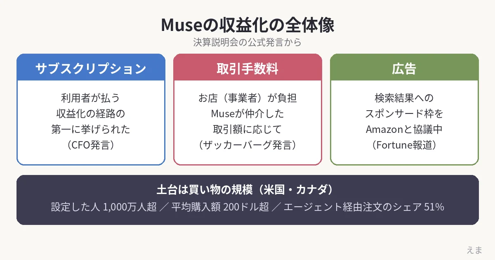



**收录说明**：直接下载（div.article-body 抽取）。原文全文存于本目录的 original.md，网站上不显示，已翻译。文末站内推荐区块已删去；文中自制配图（収益化全体像）已本地化到 images/，作者头像与头图为装饰图，未收。核心依据为 Meta 2026 年第三季度财报电话会准备原稿（该电话会本身按用户决定不单独收录），另引 Forter Intelligence 统计、Fortune 2026-11-25 报道与 TipRanks 分析文章。

**内容摘要**：本文以 2026 年 10 月 21 日 Meta 第三季度财报电话会上的官方发言为依据，梳理 Muse 的盈利模式，指出其结论来自扎克伯格等人的正式表述而非分析师推测。财报准备原稿称，提供开始约一个半月内，美国和加拿大已有 1,000 万人以上设置了 Muse，其中约 25% 的人在任意一日使用 Muse。购物是最大用途，超过四分之一的使用者将其用于购物，平均购买额超过 200 美元；Forter Intelligence 的统计显示，截至 2026 年 11 月 22 日的一周，代理经手订单中有 51% 由 Muse 完成。盈利模式为「订阅 + 交易手续费」两条线，手续费按 Muse 促成的交易额由商家承担，使用者不因此被加收费用；但手续费率与开始时间均未公布。文章还提到，亚马逊与 Meta 的解封谈判中，Muse 搜索结果中的赞助位是焦点之一（Fortune 引述知情人士），而 Muse 完成支付后广告转化更易衡量则是分析师的看法，并非 Meta 的官方说法。

**保留理由**：本篇的价值在于把财报电话会官方表述中关于 Muse 盈利模式与使用规模的说法集中整理出来，并区分了官方所说的「设置した人」与常被报道的「活跃用户」，同时注明手续费率与开始时间尚未公布。文中还以 Forter Intelligence 的统计（截至 2026 年 11 月 22 日的一周代理订单占比 51%）为盈利规模提供了外部佐证。

---

Muse 是一个可以免费使用的个人智能体，但 Meta 要如何靠它赚钱，在 2026 年 10 月 21 日的第三季度财报说明会上，扎克伯格本人的话已经讲得相当具体。这里不是分析师的推测，而是从官方发言中解读。

本文的结论

- Muse 的变现是「订阅 + 交易手续费」两根支柱，财报说明会上已正式明言。手续费由商家根据 Muse 促成的购物交易额承担。使用方面，美国和加拿大有超过 1,000 万人设置了 Muse，最多的用途是购物，平均购买金额超过 200 美元。不过，手续费率和开始时间尚未公布。

## 财报里给出的数字——「设置过的人」超过 1,000 万

在财报说明会的准备原稿（Prepared Remarks）中，扎克伯格这样说明 Muse 的起步。

- **设置过的人超过 1,000 万**：从开始提供起约一个半月，美国和加拿大有超过 1,000 万人设置了 Muse 个人智能体。有时会被报道为「活跃用户 1,000 万」，但官方说法是「设置过的人」。
- **约 25% 的人日常使用**：据说设置过的人中约 25% 会在任意某一天使用 Muse。
- **最大用途是购物**：超过四分之一的使用者将其用于购物，平均购买金额超过 200 美元。CFO（首席财务官）Susan Li 也补充说，周活跃（每周至少使用一次的人）中有超过 25% 用于购物。

外部统计也印证了购物的强势。据 Forter Intelligence 的统计（Fortune 和 CNBC 报道），截至 2026 年 11 月 22 日的一周，经由智能体的订单中有 51% 由 Muse 完成。

面对这一现状，扎克伯格宣称「Muse 已经确立了明确的产品市场契合（产品与市场需求相吻合的状态）。接下来将进入更偏运营的阶段，专注于扩大产品、增长收入和优化计算成本」。也就是说，官方已经把航向从扩大用户的阶段转向赚钱的阶段。

## 变现的设计——订阅与交易手续费

关于变现的全貌，CFO 解释说「以订阅为起点，存在多条变现路径」。在此基础上，扎克伯格进一步谈到具体形式的，是购物手续费。

- **手续费的机制**：官方发言的内容是「构建一个基于 Muse 促成的交易收取手续费的商务工具（商业交易功能）。负担预计会落在商家一侧」。
- **付钱的不是用户而是店铺**：手续费的负担者不是购物的人，而是销售商品的商家。并不是用户经由 Muse 购物时会被额外收费。
- **为什么以购物为轴**：使用的中心是购物，平均购买金额也超过 200 美元，因此与交易联动的手续费与使用的实际情况直接挂钩。

在经由智能体的订单中占有过半份额的 Muse，如果采取按交易收取手续费的形式，购物的规模就会直接成为收入的规模。在财报场合能谈到如此具体，本身就说明变现不是「未来的构想」，而是「执行阶段的计划」。

Muse 变现的全貌（据财报说明会的官方发言）

## 与广告的连接——与 Amazon 谈判一脉相承

Meta 的本业是广告。Muse 的变现也没有与广告割裂。

- **赞助位的谈判**：据 Fortune 引述相关人士的说法，在与 Amazon 的解封谈判中，如何把赞助位（广告）编入 Muse 的搜索结果，是焦点之一。与手续费模式并列，广告位也作为变现的构件成为谈判对象。
- **对广告效率的波及**：分析师提出一种看法：经由 Muse 的支付完成后，广告的转化（与购买等成果的关联）更容易衡量，广告主的投入产出比会提高。这是分析师的见解，不是 Meta 的官方发布。

## 还没有决定的事

把从官方发言中能知道的事和还不知道的事分开来看。

- **手续费率未公布**：按交易额的百分之几收取，官方没有给出。
- **开始时间未公布**：手续费模式何时开始，也没有宣布。
- **数字是美国和加拿大的**：超过 1,000 万这个数字是北美的，并不代表日本的使用情况。

## 总结

- **变现已在官方层面明言**：以订阅为起点存在多条路径，购物交易手续费计划以商家负担的形式实施。
- **基础是购物的规模**：设置过的人在北美超过 1,000 万，最大用途是购物，平均购买金额超过 200 美元，经由智能体的订单份额过半。
- **剩下的焦点是条件**：手续费率与开始时间，以及 Amazon 谈判的走向，是决定变现真实面貌的下一批材料。

## 出处

- Meta Platforms Q3 2026 Results Conference Call – Prepared Remarks（Meta IR 官方发布，2026 年 10 月 21 日）
- TipRanks《Meta's Muse Could Unlock a New Revenue Stream》（2026 年 11 月 27 日，分析师意见文章）
- Fortune（2026 年 11 月 25 日，有关与 Amazon 谈判的报道）
- Forter Intelligence 的统计（Fortune／CNBC 报道，2026 年 11 月）
