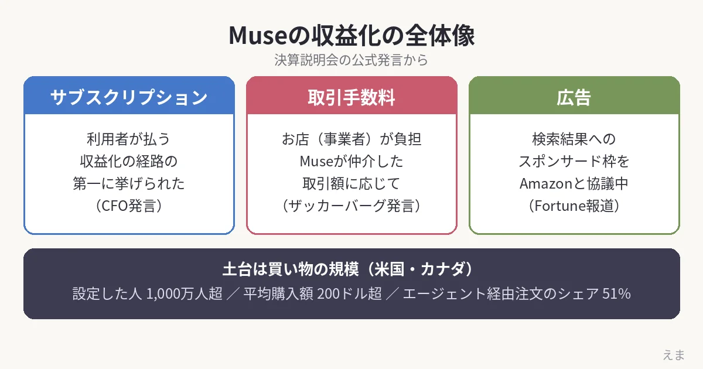

来源：https://muse.emma-muse.com/articles/muse-monetization
取文：2026-11-27，直接下载

Museは無料で使えるパーソナルエージェントですが、Metaがこれをどう収益化するのかは、2026年10月21日の第3四半期決算説明会で、ザッカーバーグ自身の言葉でかなり具体的に語られていました。アナリストの推測ではなく、公式発言から読み解きます。

この記事の結論

- Museの収益化は「サブスクリプション＋取引手数料」の2本柱で、決算説明会で公式に明言されています。手数料は、Museが仲介した買い物の取引額に応じて事業者が負担する形です。利用面では、米国とカナダで1,000万人超がMuseを設定し、最も多い用途は買い物で、平均購入額は200ドルを超えています。ただし、手数料率と開始時期はまだ公表されていません。

## 決算で出た数字 ―― 「設定した人」が1,000万人超

決算説明会の準備原稿（Prepared Remarks）で、ザッカーバーグはMuseの立ち上がりをこう説明しました。

- **設定した人は1,000万人超**：提供開始から約1か月半で、米国とカナダで1,000万人を超える人がMuseのパーソナルエージェントを設定しました。「アクティブユーザーが1,000万人」と報じられることがありますが、公式発言は「設定した人」です。
- **約25%が日常的に使う**：設定した人の約25%が、任意の日にMuseを使っているとされています。
- **最大の用途は買い物**：利用者の4分の1を超える人が買い物に使っており、平均の購入額は200ドルを超えます。CFO（最高財務責任者）のスーザン・リーも、週次アクティブ（週に1回以上利用する人）の25%超が買い物に利用していると補足しました。

外部の集計でも、買い物の強さは裏付けられています。Forter Intelligenceの集計（FortuneやCNBCが報道）では、2026年11月22日までの週に、エージェント経由の注文の51%をMuseが占めました。

ザッカーバーグは、この現状を受けて「Museは明確なプロダクトマーケットフィット（製品が市場のニーズに噛み合っている状態）を確立した。これからは製品の拡大、収益の成長、計算コストの最適化に集中する、より運営的な段階に入る」と宣言しています。つまり、利用者を増やす段階から、稼ぐ段階へ、公式に舵が切られました。

## 収益化の設計 ―― サブスクリプションと取引手数料

収益化の全体像について、CFOは「サブスクリプションを皮切りに、複数の収益化の経路がある」と説明しました。そのうえで、ザッカーバーグが具体的な形まで踏み込んだのが、買い物の手数料です。

- **手数料の仕組み**：「Museが仲介した取引に基づいて手数料を受け取るコマースツール（商取引の機能）を構築する。その負担は事業者側になる想定だ」というのが公式発言の内容です。
- **払うのは利用者ではなくお店**：手数料の負担者は、買い物をする人ではなく、商品を売る事業者です。利用者がMuse経由の買い物で追加料金を取られる形ではありません。
- **なぜ買い物が軸になるのか**：利用の中心が買い物で、平均購入額も200ドルを超えているため、取引に連動する手数料は、利用の実態とそのまま結びつきます。

エージェント経由の注文で半数を超えるシェアを持つMuseが、取引ごとの手数料を取る形になれば、買い物の規模がそのまま収益の規模になります。決算の場でここまで具体的に語られたこと自体が、収益化が「将来の構想」ではなく「実行段階の計画」であることを示しています。

Museの収益化の全体像（決算説明会の公式発言から）

## 広告との接続 ―― Amazon協議と地続きの話

Metaの本業は広告です。Museの収益化も、広告と切り離されてはいません。

- **スポンサード枠の協議**：Amazonとのブロック解除協議では、Museの検索結果にスポンサード枠（広告）をどう組み込むかが焦点の一つだと、Fortuneが関係者証言として報じています。手数料モデルと並んで、広告枠も収益化の部品として話し合いの対象になっている形です。
- **広告効率への波及**：Muse経由の決済が完了すると、広告のコンバージョン（購入などの成果への結びつき）が測りやすくなり、広告主の費用対効果が上がる、という見方をアナリストは示しています。これはアナリストの見立てであり、Metaの公式発表ではありません。

## まだ決まっていないこと

公式発言から分かることと、まだ分からないことを分けておきます。

- **手数料率は未公表**：取引額の何%を取るのかは、公式には示されていません。
- **開始時期は未公表**：手数料モデルをいつ始めるのかも、発表されていません。
- **数字は米国とカナダのもの**：1,000万人超という数字は北米のものであり、日本での利用状況を示すものではありません。

## まとめ

- **収益化は公式に明言済み**：サブスクリプションを皮切りに複数の経路があり、買い物の取引手数料は事業者負担の形で計画されています。
- **土台は買い物の規模**：設定した人は北米で1,000万人超、最大の用途は買い物で平均購入額は200ドル超、エージェント経由注文のシェアは過半数です。
- **残る焦点は条件面**：手数料率と開始時期、そしてAmazon協議の行方が、収益化の実像を決める次の材料です。

## 出典

- Meta Platforms Q3 2026 Results Conference Call – Prepared Remarks（Meta IR公式配信、2026年10月21日）
- TipRanks「Meta's Muse Could Unlock a New Revenue Stream」（2026年11月27日、アナリストの意見記事）
- Fortune（2026年11月25日、Amazonとの協議に関する報道）
- Forter Intelligenceの集計（Fortune／CNBC報道、2026年11月）
