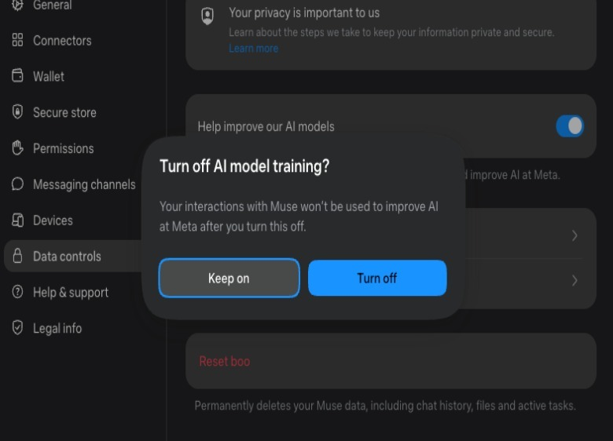
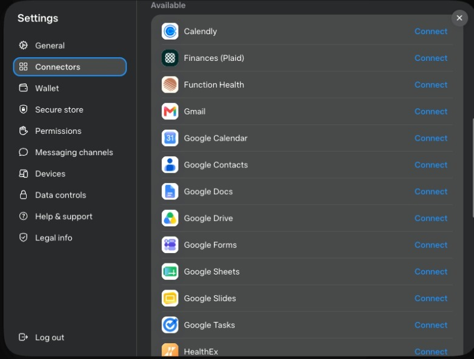
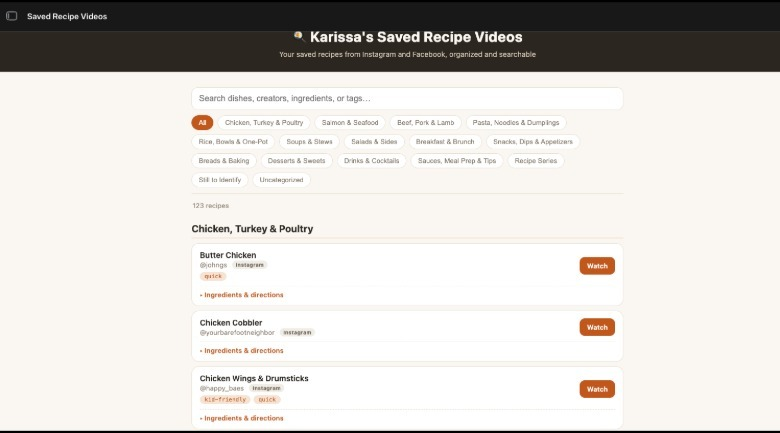



**收录说明**：直接下载。原文的三张作者截图已下载到本目录的 images/，首图插画未收；原站图片为延迟加载，抽取时以真实地址替换了占位图。原文全文存于本目录的 original.md，网站上不显示，已翻译。

**内容摘要**：作者在 Muse 发布后数日做了上手实测。入门只需一个 Meta 账号，可在 iOS、Android 与网页使用，首次登录后智能体会请用户为它起名并更换头像。设置中可以关闭「用我的互动改进 AI 模型」的数据共享，权限默认「询问部分操作」，作者建议改为「始终询问」。连接器一节接了 Spotify 与 OpenTable，并通过 Stripe 钱包绑卡付款，购买前会请用户确认；作者还让 Muse 按 Notion 的公开 API 指引自行接通。实测中，Muse 把作者在 Facebook 与 Instagram 收藏的菜谱整理成可检索的菜谱本和餐厅清单，还按直飞偏好给出了旅行方案并设了机票价格追踪。

**保留理由**：上线首周的一手上手记录，包含设置、权限与连接器的具体操作细节和两项真实任务的过程，是已收资料中少有的早期实测。

---

## 如何上手 Meta 的新 AI 智能体 Muse

选择退出数据共享是很好的第一步。

作者：[Karissa Bell](/author/karissa-bell/)

2026 年 9 月 12 日 10:00 am EST

Meta

Meta 刚刚发布了其首款面向消费者的 [AI 智能体 Muse](https://www.engadget.com/2253133/meta-reveals-its-ai-agent-that-can-shop-send-emails-and-plan-trips-on-your-behalf/)。与其他公司的智能体一样，Muse 能完成的任务清单很长。该智能体可以浏览网页、网购、填写表单、规划旅行、发送邮件、安排日程，以及做更多事情。

它可以连接 Google、Spotify 等一大批第三方服务。而且，正如 Meta AI 产品副总裁 Vishal Shah 告诉我的，它能「构建自己的软件」，因此也能处理更复杂的多步骤任务。

但 Meta 做法中最有意思的一点是，它强调让 Muse 比其他平台的智能体更易用。该智能体的设计目标是完全不需要「技术经验」，公司希望这能让它触达那些原本可能接触不到这项技术的人。而且，在我自己试用 Muse 几天后，我可以确认上手几乎没有学习曲线。以下是让 Muse 为你工作所需要了解的内容。

## 入门

Muse 与现有的 Meta AI 应用相互独立，有自己的 [iOS](https://apps.apple.com/us/app/muse-from-meta/id6760173601) 和 [Android](https://play.google.com/store/apps/details?id=com.facebook.aura&hl=en_US) 应用以及[网站](https://muse.ai/)。你不需要 Facebook 或 Instagram 账户，但需要一个 Meta 账户。在网页端，我登录时只需输入手机号，Muse AI 就已经把我的相关账户关联好了。

登录后，Muse 最先会要求你做的事情之一，是给它改名。我不知道为什么，但 Meta 真的很想让你给自己的智能体起个名字。你也可以更换它的头像。我把我的命名为 boo，并把头像换成了一只猫，但其实没什么区别。

在开始做别的事情之前，值得先看看 Muse 的设置。我想改的第一项设置，是选择不允许 Meta 用我与 Muse（呃，boo）的互动来训练其模型。你可以进入 Muse 的设置，向下滚动到「数据控制（data controls）」，取消勾选「帮助改进我们的 AI 模型（help improve our AI models）」。

在设置里时，值得顺便切到「权限（permissions）」标签页，在那里可以更改智能体执行操作需要请求许可的频率。Meta 的默认设置是「对部分操作请求许可（ask for some actions）」，这些操作需要访问网页和第三方服务。该公司表示，Muse 的内部防护措施旨在让它在「同意很重要（consent matters）」的情形下[请求许可](https://research.meta.ai/blog/security-and-safety-for-ai-agents-our-approach-with-muse)，并在更「低风险（low-risk）」的场景中自行行动。但这同样需要信任 Meta 的 AI 能分辨什么才是真正的「低风险」。考虑到 Meta 已警告 Muse 可能而且确实会犯错，你可能想把设置切换为「始终询问（always ask）」。如果之后觉得摩擦太多，你随时可以再回来调整。

## 连接第三方应用与信用卡

虽然不把 Muse 连接到其他服务它也能运行，但不连接的话，你能做的事情会有些受限。你可以在设置菜单的「连接器（connectors）」标签页看到它可以访问哪些第三方应用。同样，你在这里要谨慎一些。例如，我授予了 Spotify 和 OpenTable 的访问权限，因为它们看起来风险相对较低。如果 boo 在 Spotify 上建了一堆糟糕的歌单，或者在错误的餐厅订了晚餐，可能会有些烦人，但损害很容易控制。

我也听说有些人专门为智能体建了一个 Gmail 账户，这样它就能有一定的邮件访问权限，同时仍与主收件箱保持分离。你得自己决定能接受到什么程度。

如果你希望 Muse 能访问某项服务，但它没有出现在 Meta 的列表里，你很可能仍然可以自行建立连接。Meta 表示，Muse 能够访问任何提供公开 API 的服务，不过你可能需要手动完成一些步骤。例如，我问它能否连接我的 Notion 账户，它一步步指导我如何通过该应用建立连接。

如果你确实想让 Muse 能代你购物，就需要设置一张关联的信用卡，可以在设置的「钱包（wallet）」部分找到。好消息是，这一连接由 Stripe 促成，因此 Muse 实际上永远无法获取你的完整卡号。它也应该在实际购买前与你确认。不过，和其他操作一样，Meta 提醒至少仍存在一定风险。「Muse 可能会采取意料之外的操作。请仔细留意它。」

## 那么，你能用 Muse 做什么？

同样，这真的取决于你想完成什么，以及你让它可以访问其他服务时的安心程度。但即使你只把它连接到其他 Meta 应用，你仍然可以做不少事情。

我一开始比较谨慎，所以决定从几项与我的 Facebook 和 Instagram 活动相关的任务开始。和很多人一样，我在 Instagram 上收藏了大量视频和帖子，但很少回头看。其中很多是菜谱视频，我总是抱着真正去尝试的意图收藏，但实际上很少记得去做。这看起来很适合交给 Muse。

我先让 boo 翻遍我在 Facebook 和 Instagram 上的所有收藏，挑出菜谱，并把它们整理成更易读、更易检索的形式，包括配料表和烹饪步骤。它返回了一份整理好的菜谱列表，按类型分组，展示配料、步骤以及返回原帖的链接。这基本上就像我自己的、由 Instagram 驱动的菜谱书。它还利用我收藏的、关于有朝一日想去试试的餐厅的帖子，为我做了一份类似的可检索指南，按城市整理。

Meta 曾把旅行规划称为 Muse 的一大用例。碰巧，我正在考虑今年晚些时候规划一次国际旅行，所以我让它帮我开始研究可能与行程有关的细节。我给了它一些关于时间和我的偏好的信息（只坐直飞航班），它提供了几个从我所在城市出发的航班选项，并设置了一个价格追踪器来监控价格。我预计这趟旅行会覆盖多个城市，它就如何安排路线顺序提出了几条建议。它甚至建议我考虑多城市机票，这样我就能从与飞抵时不同的机场出发。这些都不算什么石破天惊的发现，但我喜欢它会按固定间隔监控机票价格之类的东西。

你使用 Muse 越多，它对你的了解就越多。你随时可以看看「点子（ideas）」标签页，Muse 会在那里列出它可能帮上忙的一堆事情。其中一些很泛泛，比如提供比价，但另一些则更贴合你的实际兴趣。

同样，保持一定程度的谨慎是必要的。我们已经有不少例子：AI 智能体在收到看似无害的指令后有些失控，比如[预订一节健身课](https://www.bbc.com/news/articles/cn0nww2qlp7o)。Meta 表示已设置多层防护措施，但仍有可能出问题，或者你的智能体以奇怪的方式理解某个请求。因此，在它声称代你工作时，始终最好再核实一下它实际在做什么。
