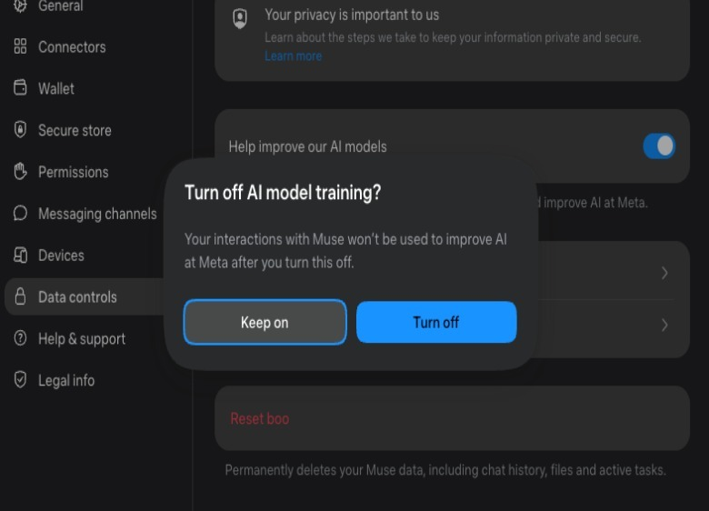
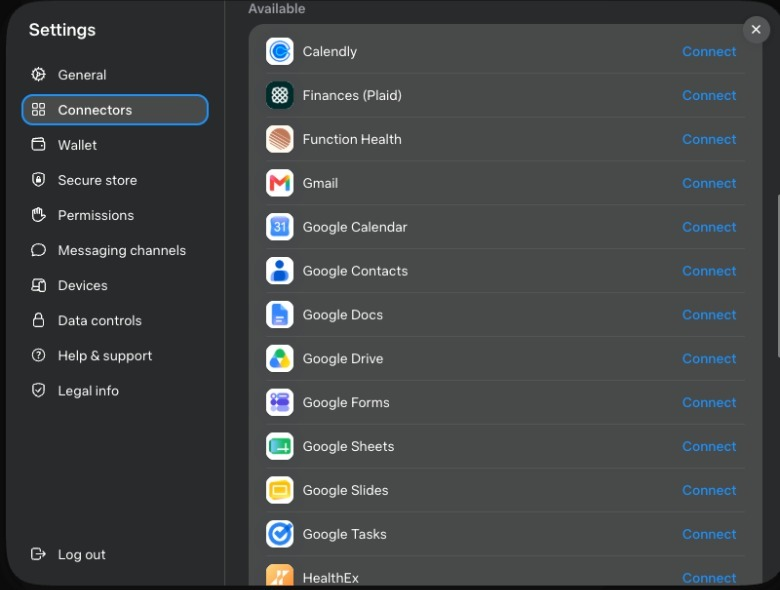
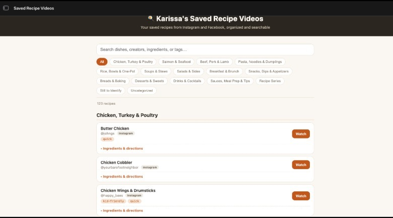

来源：https://www.engadget.com/2256577/how-to-get-started-with-meta-s-new-ai-agent-muse/
取文：2026-11-05，直接下载

## How to get started with Meta's new AI agent, Muse

Opting out of data sharing is a good first step.

By [Karissa Bell](/author/karissa-bell/)

Sept. 12, 2026 10:00 am EST

Meta

Meta just released its first consumer [AI agent, Muse](https://www.engadget.com/2253133/meta-reveals-its-ai-agent-that-can-shop-send-emails-and-plan-trips-on-your-behalf/). Like agents from other companies, the list of tasks Muse is capable of is long. The agent can browse the web, online shop, fill out forms, plan trips, send emails, schedule events and a whole lot more.

It can connect to a bunch of third-party services like Google and Spotify. And because it can, as Meta's VP of AI Products Vishal Shah told me, "build its own software," it's also able to handle more complex, multi-step tasks as well.

But one of the most interesting elements of Meta's approach is that it has emphasized making Muse more accessible than agents from other platforms. The agent was designed to require "no technical experience" at all, which the company is hoping will enable it to reach people who may not otherwise have access to the technology. And, after a few days of testing out Muse for myself, I can confirm that there is very little learning curve to get started. Here's what you need to know to put Muse to work for you.

## Getting Started

Muse is separate from the existing Meta AI app with its own [iOS](https://apps.apple.com/us/app/muse-from-meta/id6760173601) and [Android](https://play.google.com/store/apps/details?id=com.facebook.aura&hl=en_US) apps and [website](https://muse.ai/). You don't need a Facebook or Instagram account, but you will need a Meta account. On web, all I had to do to log in was enter my phone number and Muse AI already had my relevant accounts linked.

After logging in, one of the first things Muse will ask is for you to rename it. I don't know why, but Meta really wants you to name your agent. You can also change its avatar. I named mine boo and changed its avatar to a cat, but it makes no difference, really.

Before you do much else, it's worth checking out Muse's settings. The first setting I wanted to change was opting out of allowing Meta to train its models on my interactions with Muse (er, boo). You can find this by navigating to Muse's settings, scrolling down to "data controls" and deselecting "help improve our AI models."

While you're in settings, it's worth hopping over to the "permissions" tab, which will allow you to change how often your agent needs to ask for permission to do something. Meta's default is for it to "ask for some actions" that require access to the web and third-party services. The company has said that Muse's internal safeguards are meant for it to [ask permission](https://research.meta.ai/blog/security-and-safety-for-ai-agents-our-approach-with-muse) in situations where "consent matters" and for it to act on its own in more "low-risk" scenarios. But this also requires trusting that Meta's AI can distinguish what's actually "low risk." And considering that Meta has warned Muse can and will make some mistakes, you may want to switch the settings to "always ask." You can always revisit them later if it seems like there's too much friction.

## Connecting third-party apps and credit cards

While you don't need to connect Muse to other services for it to function, you'll be somewhat limited in what you can do if you don't. You can see which third-party apps it can access from the "connectors" tab in the settings menu. Again, you'll want to exercise some caution here. For example, I granted access to Spotify and OpenTable because those seem relatively low risk. It might be annoying if boo created a bunch of terrible playlists on Spotify, or made a dinner reservation at the wrong restaurant, but the damage would be pretty easily contained.

I've also heard that some people set up a dedicated Gmail account just for their agent, so it can have some email access but still remain separate from a primary inbox. You'll have to decide for yourself what you're comfortable with.

If there's something you want Muse to be able to access, but it isn't showing on Meta's list, there's a good chance you can set up a connection anyway. Meta says that Muse is able to access any service that has a public API, though you may have to do some steps manually. For example, I asked if it could connect to my Notion account, and it walked me through how to set up a connection via that app.

If you do want Muse to be able to make a purchase on your behalf, you will need to set up a link to a credit card, which you can find in the "wallet" section of settings. The good news is that this connection is facilitated by Stripe so Muse never actually gets access to your full card number. It's also meant to check-in before actually making a purchase. Still, as with other actions, Meta advises there is at least some risk. "Muse may take unexpected actions. Monitor it carefully."

## So what can you do with Muse?

Again, this really depends on what you want to accomplish and how comfortable you are giving it access to other services. But even if you only ever connect it to other Meta apps, there's still a good amount you can do.

I was feeling more cautious at first so I decided to start with a few tasks related to my Facebook and Instagram activity. Like a lot of people, I save a ton of videos and posts on Instagram, but I rarely come back to them. A lot of this content is recipe videos that I always save with the intention of actually trying, but rarely actually remember to do so. That seemed like a good job for Muse.

I began by asking boo to go through all my saves on Facebook and Instagram, pull out the recipes and organize them into something more-easily readable and searchable, including the ingredient lists and recipe steps. It came back with an organized list of recipes, grouped by type, that shows the ingredients, steps and links back to the original post. It's basically like my own Instagram-powered recipe book. It also made me a similar, searchable guide using posts I'd saved about restaurants I'd like to one day check out, organized by city.

Meta has talked about travel planning as a major use case for Muse. As it turns out, I'm thinking about planning an international trip later this year, so I asked it to help me start researching details related to a potential itinerary. I gave it some info about timing and my preferences (nonstop flights only) and it provided a few flight options from my city and set up a price tracker to monitor the cost. I expect the trip would cover multiple cities, and it made a few suggestions about how to order the route. It even suggested that I consider a multi-city ticket so I can depart from a different airport than the one I'd fly into. None of that is exactly revelatory, but I like that it will monitor things like flight prices at a regular interval.

The more you use Muse, the more it will learn about you. And you can always check out the "ideas" tab, where Muse will list out a bunch of things it might be able to assist with. Some of these are generic, like offers to comparison shop, but others are more specific to your actual interests.

Again, some degree of caution is warranted. We have more than a few examples of AI agents going somewhat rogue after receiving a seemingly benign instruction, like [booking an exercise class](https://www.bbc.com/news/articles/cn0nww2qlp7o). Meta says it has multiple levels of safeguards in place, but there's still a chance something could go wrong or your agent could interpret a request in a strange way. So it's always a good idea to double-check what it's actually doing while it's claiming to work on your behalf.

