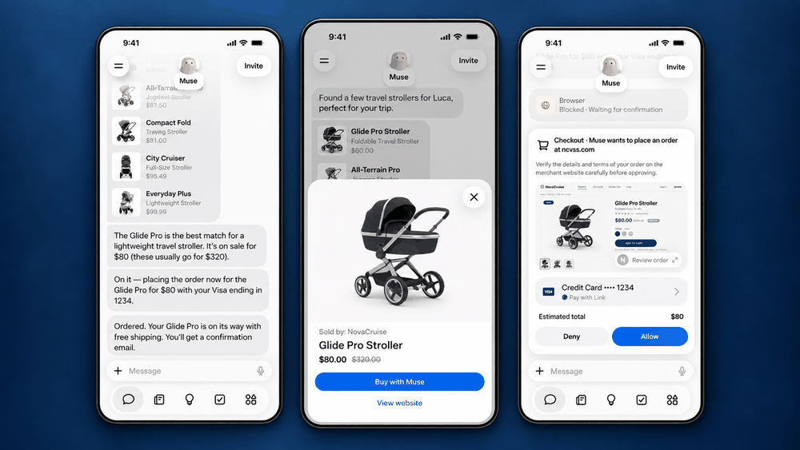
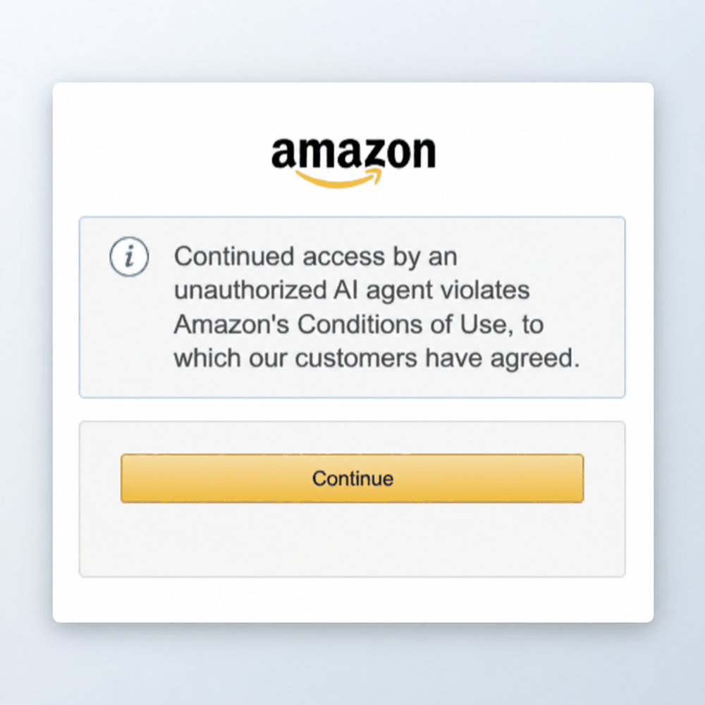



（译注：原文中的「相关文章」推荐框和页面底部的站点栏目未译出。）

Meta 的宣传图片显示，Muse 在比较婴儿推车，并在下单之前请求批准。（Meta 图片）

亚马逊表示，在试图让这家 Facebook 母公司主动把这个电商网站排除在体验之外未果后，它已经切断了 Meta 新推出的个人 AI 智能体 Muse 代表顾客在 Amazon.com 上购物的能力。

亚马逊说，问题在于它从未同意过这一切。Meta 没有告诉亚马逊 Muse 会访问它的商店，这个智能体在浏览时不表明自己的身份，而且它似乎会获取并存储顾客的凭证，该公司表示这可能带来隐私和安全风险。

截至周日晚上，试图用 Muse 在亚马逊购物的人看到了这样的弹窗：「Continued access by an unauthorized AI agent violates Amazon’s Conditions of Use, to which our customers have agreed.」（译注：意为「未经授权的 AI 智能体继续访问，违反了我们的顾客已同意的亚马逊使用条件。」）

亚马逊发言人在一份声明中说：「我们认为道理相当简单：提供代表顾客从其他商家购物的第三方应用，应当公开地运作，并尊重服务提供方关于是否参与的决定。」

Meta 在周日晚上没有立即回应置评请求。

该公司[此前曾表示](https://about.fb.com/news/2026/09/introducing-muse-personal-ai-agent/)，Muse「看不到人们的密码或付款方式」，用户分享的凭证「会进入安全存储，因此 Muse 可以使用它们而不会看到它们，包括一个人自己在浏览器中输入的密码」。

**商业伙伴：** 这两家科技巨头之间的对峙尤其值得关注，因为两家公司彼此合作：自 2023 年起，亚马逊的商品就可以[在 Facebook 和 Instagram 内](https://www.cnbc.com/2023/11/09/meta-lets-amazon-users-buy-on-facebook-instagram-without-leaving-apps.html)购买，而 Meta 在 4 月签署了一份[数十亿美元的协议](https://www.geekwire.com/2026/meta-signs-multibillion-dollar-deal-to-use-amazons-graviton-chips-for-agentic-ai/)，在亚马逊的 Graviton 芯片上运行智能体 AI 工作负载。

这是一场更大的争论的一部分：当 AI 智能体代表消费者购买商品时，谁来控制在线购物体验和顾客关系。

亚马逊向使用 Meta 的 Muse 智能体在其网站购物的人显示的消息。（亚马逊图片）

过去一年，亚马逊一直试图把外部智能体挡在自己的网站之外，[就 Comet 浏览器起诉了 Perplexity](https://www.retaildive.com/news/amazon-sues-perplexity-ai-shopping-agents/804871/)，并采取行动屏蔽了 [Google](https://www.tipranks.com/news/amazon-amzn-blocks-googles-ai-shopping-agents-from-its-e-commerce-platform) 和 [OpenAI](https://www.techradar.com/ai-platforms-assistants/chatgpt/amazon-blocks-chatgpts-new-shopping-agent-what-the-fallout-could-mean-for-you) 的购物智能体。

周日晚上，亚马逊表示正在就此问题与 Meta 直接沟通。被问及是否会考虑采取法律行动时，该公司拒绝置评。

这对亚马逊来说商业利害关系重大。除了经营其旗舰电商网站之外，亚马逊去年还创造了超过 680 亿美元的广告收入，而这项业务依赖于人们浏览它的页面并看到赞助商品。

**安全影响：** 亚马逊说，如果顾客提示 Muse 这样做，它可以访问账户页面和订单历史。该公司说，由于这个智能体不表明自己的身份，这就相当于一个未披露的第三方在亚马逊不知情或未同意的情况下，在顾客账户中穿行、处理交易并处理敏感数据。

亚马逊说，公开运作的智能体有助于保持顾客体验的安全和可靠，而其他代表顾客购买的服务通常是在商家同意的情况下这样做的。它举了外卖应用和它们接单的餐厅，以及在线旅行社和它们为之订票的航空公司的例子。

亚马逊发言人在声明中说：「像 Muse 这样的智能体第三方应用负有同样的义务，我们已经要求 Meta 把亚马逊从体验中移除。」

**法律攻防：** 亚马逊[在 3 月赢得了针对 Perplexity 的初步禁令](https://www.geekwire.com/2026/judge-blocks-perplexitys-ai-bot-from-shopping-on-amazon-in-early-test-of-agentic-commerce/)，随后[在 8 月 4 日失去了它](https://cdn.ca9.uscourts.gov/datastore/opinions/2026/08/04/26-1444.pdf)：第九巡回上诉法院裁定，根据联邦反黑客法，访问亚马逊计算机的是用户，而不是那家 AI 公司。

法院在 9 月 10 日[驳回了亚马逊的重审请求](https://www.courthousenews.com/no-9th-circuit-rehearing-in-amazon-perplexity-case/)。不过，这一裁决给亚马逊留下了一条途径：基于合同和服务条款的主张。Muse 用户现在看到的消息并没有指控任何人进行黑客攻击，而是援引了亚马逊的使用条件。

**Muse 的工作方式：** Meta [在 9 月 8 日推出了 Muse](https://about.fb.com/news/2026/09/introducing-muse-personal-ai-agent/)，这是一个执行多步骤任务、而不是回答一次性问题的个人智能体，连接的服务包括电子邮件、日历、支付、餐饮和购物。

它是免费的，另有付费订阅档位，可在 iOS、Android、muse.ai 和 WhatsApp 上使用。

Meta 说，这个智能体运行在[一台安全的虚拟机](https://research.meta.ai/blog/security-and-safety-for-ai-agents-our-approach-with-muse)上，有自己的浏览器，并在发送电子邮件或进行购买等敏感操作之前与用户确认。一个名为 Sentinel 的独立监控智能体必须批准 Muse 发往互联网的任何内容。

Muse 的发布材料描述了现在处于争议中心的机制：如果一项服务有公开的 API，Muse 可以使用用户提供的凭证连接它。Meta 说，如果完全没有 API，这个智能体「可以像你一样通过浏览器使用这项服务」。

Muse 迅速流行起来。上线一周后，它就成了[苹果美国 App Store 免费应用第一名](https://9to5mac.com/2026/09/18/metas-new-muse-ai-agent-app-overtakes-chatgpt-as-top-iphone-app/)，排在 ChatGPT 之前。早期用户描述了它切换汽车保险、在结账时搜寻折扣码，以及往网上杂货购物车里装东西的经历。

亚马逊在 5 月推出了 [Alexa for Shopping](https://www.geekwire.com/2026/amazon-unifies-alexa-and-rufus-as-ai-rivals-move-into-online-shopping/)，这是一个研究商品并提供推荐的 AI 智能体。它自己的智能体购物功能 [Buy for Me](https://www.aboutamazon.com/news/retail/amazon-shopping-app-buy-for-me-brands) 会在外部品牌的网站上查找商品，但该公司指出，Buy for Me 会表明自己的身份，并允许品牌选择退出。
