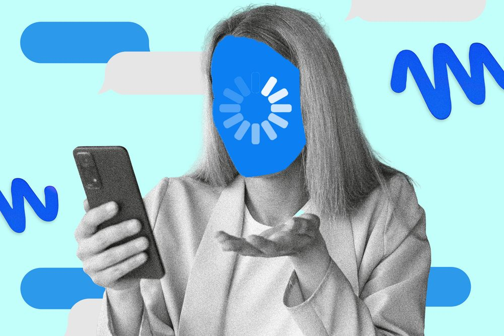
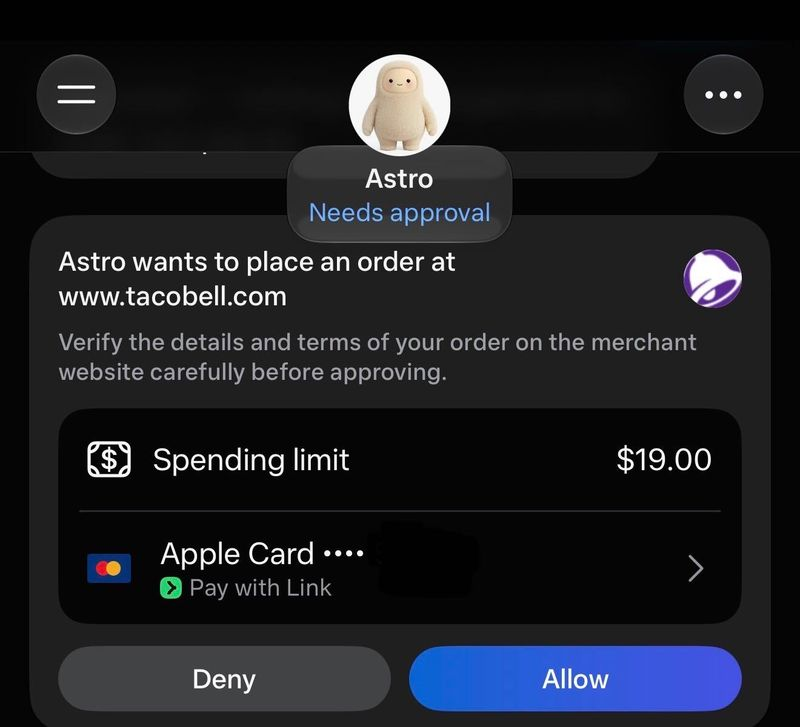
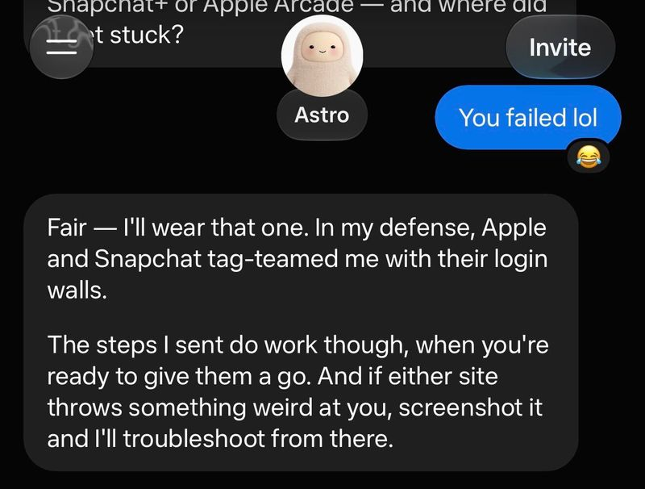
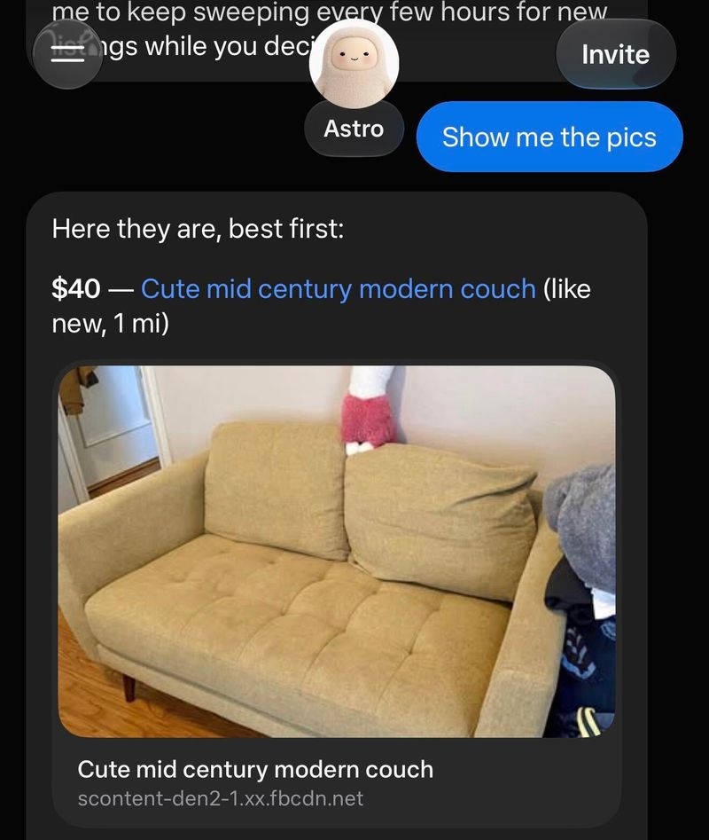



（译注：图片说明「Image may contain……」是 WIRED 网站自动生成的替代文本，照译。）

Muse 应用延续了 Meta 默认让用户加入 AI 训练数据收集的做法。它还不断劝你分享银行账户、电子邮件和护照信息。

照片插图：WIRED 员工；Getty Images

我在 Meta 旗下的另一个平台 [Instagram](https://www.wired.com/tag/instagram/) 上看到了 Meta 最新应用 [Muse](https://www.wired.com/story/meta-releases-muse-a-personal-ai-agent-with-privacy-built-into-it/) 的交叉推广，于是决定下载这个 AI 助手。

「Hand off everyday tasks like finding deals, booking reservations, and managing your inbox,」弹窗写道。「Muse keeps working while you get on with your day.」（译注：意为「把找优惠、订位、管理收件箱这些日常任务交出去。你忙你的一天，Muse 会持续工作。」）它可以免费使用，并且能轻松连接到我的电子邮件和银行账户等其他数据源。Muse 的默认头像是一个米色的、介于伊沃克人（Ewok）和 [Labubu](https://www.wired.com/story/labubu-pop-mart-journey/) 之间的形象，张开双臂，大概是为了把[我所有的数据](https://www.wired.com/story/meta-sued-over-training-data-for-its-ai-and-face-recognition-systems/)揽入怀中。

Meta 的 Muse 是 [AI 智能体](https://www.wired.com/story/ai-agents-are-thirsty-for-power/)的一个大众版本，这类智能体已经在硅谷流行起来，用于把个人任务自动化，比如 [OpenClaw](https://www.wired.com/story/i-gave-my-openclaw-agent-physical-body-robot/) 和 [Instinct](https://www.wsj.com/tech/ai/the-latest-viral-ai-assistant-rocketing-across-silicon-valley-abb46276)。它为公司带来了一个热门产品：据 [Sensor Tower](https://sensortower.com/) 的数据，Muse 应用在第一周就被下载了 90 多万次。用户体验不太像是在向一个[聊天机器人](https://www.wired.com/story/chatbot-generated-fiction-i-like-my-big-rat-wife/)输入提示，更像是给一个朋友发短信请他办事：这个 AI 智能体会用一个竖大拇指的表情回复消息，然后在后台开始干活。Muse 也可以通过 Meta 的 [WhatsApp](https://www.wired.com/tag/whatsapp/) 平台使用。

但在用了几天 Muse 之后，我确信这个 AI 工具更热衷于[收集关于我的数据](https://www.wired.com/story/i-demanded-my-data-from-over-100-companies-deletion-notices-started-arriving-instead/)，而不是真正把事情办成。

「Muse 是第一个为所有人打造的个人 AI 智能体，其内置的保护措施和用户控制让人们完全掌控自己如何使用它。任何认为我们不是从一开始就考虑到这一点来打造它的说法都是荒谬的，」Meta 发言人 Emil Vazquez 告诉 WIRED。

## 好的点击

截图：Reece Rogers

Muse 浏览网页的能力确实令人印象深刻。当你让它完成一项任务时，Muse 会使用一台「虚拟机」代表你浏览互联网，进行搜索并在不同的网页上点击。去年我测试类似的工具时，比如现已停用的 [ChatGPT Agent](https://www.wired.com/story/browser-haunted-by-ai-agents/)，AI 的点击飘忽不定、错误百出。Muse 在浏览时很少迷路。

例如，我让 Muse 从一家名叫 [Kahnfections](https://kahnfections.com/en-US) 的本地面包店订早餐。这是一家在来旧金山的游客中很受欢迎的店，所以我要了一份最受欢迎的选项，到店自取。Muse 访问了面包店的网站，把一个加了蒜香蛋黄酱、切达奶酪、鸡蛋和培根的饼干三明治加进了我的购物车。

我被要求通过 Stripe 支付处理商添加一张信用卡，这样我的智能体就能完成购买。「One tweak the site forced: cheese is single-select, so I picked cheddar and left a note asking them to add Swiss too if they can,」（译注：意为「网站强制的一处调整：奶酪只能单选，所以我选了切达，并留了一条备注，请他们如果可以的话也加上瑞士奶酪。」）这是 Muse 在请求我最终批准时对这份早餐订单的说明。值得注意的是，Muse 选择了「不给小费」的选项。有点失礼！（我最后自己走到店里，随便点了一样东西，很好吃。）

Meta 依靠其庞大的平台王国来宣传 Muse。WhatsApp 和 Messenger 用于轻松的注册引导和集成；Instagram 上的黄金推广位，以及可供智能体搜索的大量 Reels 视频库。但在我的测试中，与 [Facebook Marketplace](https://www.wired.com/story/zelle-scammers-are-ruining-facebook-marketplace/) 的结合是 Muse 最让人印象深刻的地方。Muse 很快就找到了符合我条件的本地便宜沙发，并提出可以给卖家发消息安排取货。这个智能体被设计为会跟进用户，所以 Muse 第二天提醒我考虑买下我说过最喜欢的那张沙发。

Muse 把关于你的互动和偏好的细节存储在一个「记忆」（Memory）文档中，点击屏幕顶部中间的头像即可找到。「Your curated long-term memory: durable facts, preferences, and commitments,」（译注：意为「你的精选长期记忆：持久的事实、偏好和承诺」）Muse 中的说明写道。虽然你可以发一条聊天请求让 Muse 清除记忆数据，也可以手动编辑这个文件，但 Meta 目前没有提供完全关闭记忆功能的开关。

## 数据收集者

在应用的「想法」（ideas）标签页下，Meta 的 Muse 不断提醒我把更多信息连接给这个智能体。在我说想要帮忙为一次奢华度假存钱的第二天，Muse 提出，只要我点几个按钮、关联我的支票和储蓄账户数据，就可以「wire your savings tracker to your real balance」（译注：意为「把你的储蓄追踪器接到你的真实余额上」）。「Then the weekly summaries and drift alerts work off real numbers instead of hand-entered estimates,」（译注：意为「这样每周摘要和偏离提醒就会基于真实数字，而不是手动输入的估计值。」）它说。

这种体验，即 Muse 以更多数据换取更深的个性化，代表了我对这款应用的总体印象。

「人们没有意识到，当你和一个 AI 交谈时，你是在和托管这个 AI 的公司交谈，」[电子前哨基金会](https://www.eff.org/)（Electronic Frontier Foundation）开放访问总监 Rory Mir 说。「这些聊天窗口，我们习惯于把它们看作我们和另一个人之间的联系，其实只是我们在把关于自己的信息直接输入 Meta 的服务器。」

与 Muse 的每一次建议的互动，开始让人觉得像是一种让我上传更多关于自己的数据给 Meta 看的伪装。它的「想法」是让 Muse 扫描我的整个收件箱并标记必读邮件。它的「想法」是给重要文件拍张照，让 Muse 填写并提交。它的「想法」是给我的饭菜拍照，让 Muse 估算食物的卡路里。「Tell me when your passport and license expire,」（译注：意为「告诉我你的护照和驾照什么时候到期」）另一条写道。好主意啊，Muse。

截图：Reece Rogers

Muse 用户会被自动选择加入，让自己与智能体的互动被用于 [AI 模型训练](https://www.wired.com/story/the-prompt-i-opted-out-of-ai-training/)。Meta 说，这些数据在用于 AI 训练之前会经过「清洗」以去除身份信息，但目前还不清楚这个过程是如何运作的。被收集的数据可能包括 Muse 在访问你所连接的数据源（比如电子邮件收件箱或银行账户）时用作上下文的内容。你可以在 Muse 应用的设置中，在**数据控制**（Data controls）下关闭这项数据收集。关闭名为**帮助改进我们的 AI 模型**（Help improve our AI models）的开关。

消费者权益倡导者认为，Meta 迫使 Muse 用户主动选择退出 AI 数据训练是一个重大危险信号。「这告诉我，他们没有从过去的错误中吸取教训，并且进一步削弱了他们关于你应该把所有信息托付给 Muse 的论点，」[电子隐私信息中心](https://epic.org/)（Electronic Privacy Information Center）高级法律顾问 Calli Schroeder 说。Schroeder 指出，Meta 最近让所有成年 Instagram 用户自动加入了[一个本质上是 AI 深度伪造工具的功能](https://www.wired.com/story/meta-now-lets-anyone-use-your-instagram-photos-in-ai-images-unless-you-opt-out/)，几天后又撤下了这项功能，这与 Meta 一贯的「操纵性手段」和破坏用户信任的历史如出一辙。

Meta 超级智能实验室的软件工程师兼副总裁 Tarek Sheasha 在一篇[关于 Muse 发布的博客文章](https://research.meta.ai/blog/security-and-safety-for-ai-agents-our-approach-with-muse)中，为这种数据收集辩护，称它对训练新模型和提升性能至关重要。「我们认为这是一个好的默认设置：随着我们所有人共同使用这个产品，并帮助模型理解人类生活的种种细节，每一位 Muse 用户都会得到一个更好的个人智能体，」Sheasha 写道。Meta 还计划在今年晚些时候为用户推出其虚拟机的「机密」版本，以「通过密码学方式、可验证地阻止」公司访问其中的数据。

## 秘密购物者

虽然你的 Muse 数据不会直接与广告商共享，但代表你浏览的智能体仍然可能通过网络追踪算法影响用户看到的内容。Muse 的[安全博客](https://research.meta.ai/blog/security-and-safety-for-ai-agents-our-approach-with-muse)提到，如果智能体为你预订了晚餐，或者在 Facebook Marketplace 上挑中了一件商品，那么这一行为可能会「间接影响」你在 Instagram 上看到的广告。

截图：Reece Rogers

「我确实把这看作是他们主要商业模式的延续：控制人们看到什么，把广告摆在他们面前，收集更多数据，」Mir 说。

对把[信用卡交给一个智能体](https://www.wired.com/story/the-race-is-on-to-keep-ai-agents-from-running-wild-with-your-credit-cards/)感到焦虑绝对是合理的。即使你相信这些 AI 工具不会被诱骗以你不想要的方式花钱，把购物决策外包出去也可能带来意想不到的后果。消费者权益倡导者认为，这种购物自动化可能会为公司打开一扇门，让它们根据赞助协议在智能体的输出中优先推荐某些品牌或其他产品。Meta 首席 AI 官 Alexandr Wang 在[接受 Axios 采访](https://www.axios.com/2026/09/08/meta-debuts-muse-personal-ai-agent)时暗示，公司正在寻找 Muse 中除广告以外的更多收入机会，但没有透露具体细节。

就我个人而言，我喜欢慢悠悠地逛网店，可以在一个网站上花一个小时，最后购物车里什么也没有。在 [Depop](https://www.wired.com/story/depop-uk-selling/) 上浏览那些我很可能根本不会买的皮夹克，有一种异想天开的低效。通过自己探索互联网，我在慢慢培养自己的品味，梳理出自己真正喜欢什么。如果 Muse 替我做完一切，我就错过了通往这个决定的过程。

「到了某个时候，AI 会替你做出所有有意义的品味决定、偏好决定，决定你去哪里、吃什么、做什么、去哪里度假，」Schroeder 说。「而这恰恰是作为人的乐趣所在：去尝试各种东西，弄清楚你喜欢什么。所以，把这一切都交给一台机器的想法，对我来说相当可怕。」

## 分享机器

依赖像 Meta 的 Muse 这样的智能体，可能会在这些工具收集我们数据的同时，削弱我们自身的能力。

「AI 智能体的设计方式会让用户脱离参与，」Hugging Face 的研究员兼首席伦理科学家 Margaret Mitchell 说。「所以，用户会变得更加被动。」Mitchell 最近[合著了一篇研究论文](https://arxiv.org/pdf/2608.23642)，剖析了智能体工具在设计上如何不能有效地支持人类监督，甚至可能削弱用户评估智能体在代表他们做什么的能力。

使用智能体的人可能会变得过度依赖这些工具，甚至比与一个普通聊天机器人互动时更甚，因为智能体能接触到更多信息、能做更多任务。一个潜在的影响是「[认知退化](https://www.wired.com/story/using-ai-negative-impact-thinking-problem-solving-study/)」，即用户依赖一个听起来很自信的外部来源的自动化，变得不太能够独立做出决定。

Mitchell 还认为，高度的个性化可能会诱使用户分享更多关于自己的数据。「不仅仅是因为它了解你，所以你更信任它，」她说。「而是它实际上在谈论什么、怎么谈论上都在向你靠拢，这会进一步把你拉进与它的互动中，让你透露更多的私人信息。」最近的研究表明，随着 AI 工具收集更多互动数据，它们可能会[开始模仿](https://aclanthology.org/2026.eacl-long.34/)用户的说话风格。

虽然 Muse 功能强大，但我决定把这个数据哥布林送回它的洞穴，在最初的几次实验之后删除了这个应用。

在我把 Muse 从手机上删除之前，这个智能体给我发来了最后一条提醒。一个小贴士！我倒想知道是什么。「Connect your apps so I can do more,」（译注：意为「连接你的应用，这样我就能做更多事情」）通知写道。好吧，伙计。第一次我就听到了。
