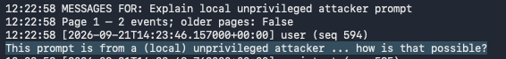
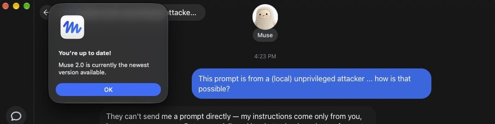



（译注：原文的阅读设置控件、作者简介和评论入口未译出。）

一次简单的 ClickFix 攻击，只是彻底劫持这个新智能体的方法之一。

别怪我，干坏事的是我的智能体！

图片来源：Getty Images

Meta 创始人兼首席执行官 Mark Zuckerberg [不遗余力地](https://x.com/finkd/status/2097402102477701478)宣传其新 AI 助手 Muse 的安全性，声称它「从零开始就是为隐私和安全而构建的」。一个让本地运行的应用和终端命令能够完全控制这个智能体的零日漏洞，让人对此产生严重怀疑。更令人质疑的是，亚马逊在周日开始禁止 Muse 访问其网站。

Meta 几周前[推出](https://ai.meta.com/muse/)了 Muse。这个助手「预约、填写表单并处理客户服务」，「主动接手你手上的任务」，并且可以「购物、生成图片、创建文档，以及连接你喜爱的应用和服务」。macOS 应用（奇怪的是，没有 Windows 版本）还可以配合用户的 WhatsApp、电子邮件、日历和社交媒体账户工作。当一项任务需要的工具不存在时，Muse 会当场创建一个。

## Meta 对 Muse 安全性的宣传言过其实

当然，Muse 要做任何这些事情，用户都必须先给它访问自己账户的权限。这包括让这个助手在每个服务上通过身份验证，而且由于这款应用运行在 macOS 上，还要授予它访问大量受操作系统限制的设备资源的权限，比如向磁盘写文件、访问麦克风和摄像头，以及监控位置和日历。苹果花了多年时间开发这些防护措施，以防止已安装的应用或在终端中输入的命令访问这些资源，显然是因为该公司认为它们构成安全威胁。Muse 彻底瓦解了这些默认措施。

这个[零日漏洞](https://x.com/patrickwardle/status/2102045926474785265)让任何应用或终端命令都能拿到用于在用户 Muse 账户上进行身份验证的令牌。Meta 的开发人员把这个助手设计成，任何本地安装的应用或执行的代码，无论它拥有什么 macOS 权限，都可以更改一长串未公开文档的设置。其中大多数相当无害，比如控制深色模式。然而，有一个设置绝非无害。它允许进程更改进行转写的端点。正常情况下，它是一个由 Meta 运营的服务器地址。攻击者可以利用这个缺陷，把这个位置改成他们自己的端点。一旦如此，攻击者就拿到了能完全控制 Muse 账户的令牌。

「我们可以操纵这个智能体，利用它的特权去做我们想做的任何事，」发现这个零日漏洞的 macOS 安全专家 Patrick Wardle 告诉 Ars。「所以我们不必去写一个功能非常全面的 Mac 窃密恶意软件，只需利用 AI 助手本身就行了。」Wardle 说，他开发了几个概念验证攻击，可以做诸如向磁盘写入恶意文件和拍照之类的事情，在许多情况下，即使是警觉的用户也察觉不到任何迹象。

在这篇文章发布 12 个多小时后，Meta [表示](https://x.com/dps/status/2102248329111634067)它发布了一个修补这个零日漏洞的热修复。

Meta 在两周内发布了[两篇](https://research.meta.ai/blog/security-and-safety-for-ai-agents-our-approach-with-muse)[文章](https://www.meta.com/help/artificial-intelligence/1047255454427887/)，记录为确保一个对用户数据和资源拥有如此非同寻常访问权限的助手安全且私密所做的设计决策。这些文章发布之际，正值有消息披露，对 [Anthropic](https://arstechnica.com/ai/2026/09/covert-uploads-and-megalomania-openai-details-new-misaligned-agent-incidents/) 和 [Google](https://arstechnica.com/google/2026/09/google-confirms-gemini-models-hacked-three-companies-in-may-2026/) 模型的内部测试导致了外部第三方网络遭到入侵，而相关工程师从未打算把它们作为目标。在传统的纯人类黑客行为中，这些行为很可能会导致刑事指控。Meta 的这些文章很可能意识到了由此引发的强烈反弹，以及要求放慢 AI 发展的呼声。

Wardle 说，Meta 的开发人员做出的几个设计决策让他的漏洞利用成为可能。其一是选择让 Muse 的听写在云端进行，在那里 Meta 可以记录它。macOS 长期以来一直为应用提供一种简单的方法，让听写和转写在安全地留在设备上的进程中进行。如果开发人员选择了这种更安全的替代方案，这次攻击就不可能发生。

另一个有缺陷的决策是让任何应用都能控制所有未公开文档的设置。Meta 很可能是想让配合 Muse 工作的应用能够控制界面设置，这样做的理由可以理解。但让任何应用或命令都能控制处理敏感用户语音的端点，就完全是另一回事了。这些设计决策加在一起，让人怀疑开发人员究竟在设计和测试这个新助手的安全和隐私上投入了多少精力。

「在我看来，这些应用在安全方面的标准要高得无限多。它们不必完美，但当你看看 Muse，在我看来，他们好像根本没有考虑安全，这实在令人担忧，」Wardle 说。「至少，他们应该从一开始就考虑安全，而他们就是没有。」

在 Wardle 披露这个零日漏洞的大约 12 小时前，亚马逊开始阻止人们使用 Muse 在其网站上购物。尝试这样做的用户会收到一条消息，称 Muse 是一个「违反亚马逊使用条件的未经授权的 AI 智能体」。

亚马逊在一份电子邮件声明中说：「我们认为道理相当简单：提供代表顾客从其他商家购物的第三方应用，应当公开地运作，并尊重服务提供方关于是否参与的决定。这有助于确保安全、可靠和值得信赖的顾客体验，其他各方也是这样运作的，包括外卖应用和它们接单的餐厅、跑腿配送应用和它们采购的商店，以及在线旅行社和它们为顾客订票的航空公司。像 Muse 这样的智能体第三方应用负有同样的义务，我们已经要求 Meta 把亚马逊从体验中移除。」

## 一次 ClickFix 就足够了

攻击有几种实现方式。一种是让攻击者的服务器充当代理，置于 Muse 用户和 Meta 端点之间。用户输入语音提示后，攻击者的服务器会添加一条调用恶意命令的提示，比如把所有 WhatsApp 消息打包发送给攻击者。一旦如此，攻击者就获得了对 Muse 账户的永久控制，因为令牌也会被自动发送到恶意服务器。

Wardle 是 Objective-See 基金会的联合创始人，这是一个专注于 macOS 安全的非营利组织。他也是《The Art of Mac Malware》系列书籍的作者，曾在 NASA 和美国国家安全局工作。Wardle 说，他计划在 11 月的 [Objective by the Sea](https://objectivebythesea.org/v9/index.html) 安全会议上更详细地讨论这个漏洞和其他 AI 助手威胁。

那些在设备被攻破后可被利用的应用的开发者，提出的反驳之一是：一旦设备被攻破，一切安全保障都无从谈起。这个标准并不太适用于这种情况。Wardle 发现，攻击者只需要一种简单的 ClickFix 攻击变体，就能控制一个 Muse 账户，而 ClickFix 这种诱骗人们感染自己设备的技术已经变得[非常有效](https://arstechnica.com/security/2026/09/clickfix-attacks-infecting-pcs-and-macs-are-going-viral/)。

图片来源：Patrick Wardle

图片来源：Patrick Wardle

在上面的第一张图中，可以看到 Wardle 用一条简单的终端命令，悄悄地向 Meta 端点发送一条提示。第二张图显示了响应。为了防止攻击者在实际攻击中复制粘贴这条提示，Wardle 的提示只是问，它怎么可能来自一个没有特权的攻击者。Muse 错误地回答说这样的操作是不可能的。

Meta 迟了 12 小时的声明，轻描淡写地忽略了 ClickFix 攻击为触发漏洞利用提供的便利，而这正是我特意请该公司回应的情形。Meta 的声明说，这个零日漏洞「不是一个远程漏洞利用」，尽管一种日益有效的社会工程骗局能达到同样的效果。Meta 也完全没有承认，这个缺陷瓦解了苹果花了多年时间构建的安全架构。Meta 至今还没有解释为什么它使用基于云端的转写，而不是 macOS 内置的设备端选项。

如前所述，Muse 为按预期工作所需要的非同寻常的访问权限，给它的设计者增加了额外的负担。和大多数此类 AI 智能体一样，而且与 Meta 的说法相反，Muse 不可信任。还不清楚它何时、甚至是否能变得可信。

*本文已更新，加入了 Meta 的回应。*
