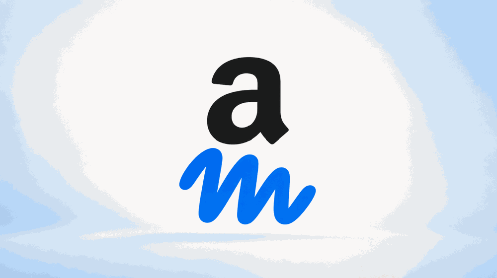



**收录说明**：GeekWire 记者 Todd Bishop 的报道，页面显示发布时间为太平洋时间 2026 年 9 月 22 日 10:39。全文翻译，原文的分享按钮和页面底部的站点栏目未译出。早期收集时直接翻译，原文未单独存档。

**内容摘要**：亚马逊周日晚上屏蔽了 Meta 的 Muse 访问其商店，业内围绕智能体代购时谁拥有顾客关系展开争论。亚马逊的使用条件要求智能体在每个请求中表明身份，这是它屏蔽 Muse 时列举的违规之一；Zuckerberg 说 Muse 会从交易中抽取很小的一部分。文章回顾了亚马逊诉 Perplexity 案：3 月获得的初步禁令在 8 月 4 日被第九巡回上诉法院撤销，9 月 10 日驳回重审请求，亚马逊随后增加了合同相关的诉讼主张。The Information 记者用 Muse 买了笔和笔记本，称过程顺畅，但直接去亚马逊仍然快得多。

**保留理由**：整理了亚马逊屏蔽 Muse 事件的时间线、相关法律背景和各方表态，可用来理解平台方对外部智能体的态度。

---

亚马逊和 Meta 在代表顾客购物的 AI 智能体问题上意见相左。（GeekWire 插图／GPT 5.6 Sol）

亚马逊周日晚上[屏蔽了 Meta 的 Muse AI 智能体](https://www.geekwire.com/2026/amazon-blocks-metas-muse-ai-assistant-in-new-standoff-over-agentic-shopping/)访问其商店，过去两天，科技行业的领袖们一直在争论这一举动引出的更大问题。

其中包括：大型平台是否会就智能体跨入彼此的地盘商定规则，智能体这样做时钱如何易手，以及到底有多少人真的希望让 AI 智能体替自己购物。

Palo Alto Networks 首席执行官 Nikesh Arora [在 X 上发帖](https://x.com/nikesharora/status/2102061935516881135)写道，这将是「一场比任何人预想的都要大的战斗」，并预测苹果、谷歌，可能还有 TikTok，都会打造自己的个人智能体。他写道，每一个购物和服务类应用都必须决定是否让外部智能体进来。

Box 首席执行官 [Aaron Levie](https://www.linkedin.com/in/boxaaron/) 周二上午在 CNBC 上说，整个行业「在这个话题上基本上才刚开始两周」。他说，智能体「将改变我们与大多数商业形态互动的方式」，而「不同的公司会以不同的方式回应」。

Elon Musk 已经在指出一个潜在的技术漏洞。这位 xAI 创始人[周一在 X 上写道](https://x.com/elonmusk/status/2102065121514209706)，如果访问是通过用户的 IP 地址和 cookie 进行的，亚马逊「将无法分辨买家是真人还是代表其行事的 AI」。

亚马逊的[使用条件](https://www.amazon.com/gp/help/customer/display.html?nodeId=GLSBYFE9MGKKQXXM)要求智能体在向其网站发出的每一个请求中都表明自己是智能体。这是亚马逊本周末屏蔽 Muse 时列举的违规行为之一。

**交易在酝酿中？** 亚马逊首席执行官 Andy Jassy 曾在财报电话会上表示，公司正在与那些希望运行商业智能体的公司进行对话。据 The Information [周一报道](https://www.theinformation.com/articles/metas-muse-tries-and-fails-disrupt-amazon)，这些谈判仍在进行中，但尚不清楚是否有任何协议即将达成。

Meta 首席执行官 Mark Zuckerberg 在 [Sources 播客](https://sources.news/p/mark-zuckerberg-meta-muse-ai-podcast-interview)上说，Muse 将「从无论什么交易中抽取很小的一部分」，这笔钱可能由用户购买的商家支付。

亚马逊的零售利润率很薄，而它去年创造了超过 680 亿美元收入的广告业务，依赖的是人们浏览它的页面，而不是智能体跳进来完成购买。

**亚马逊诉 Perplexity：** 亚马逊去年 11 月就 Comet [起诉了 Perplexity](https://www.retaildive.com/news/amazon-sues-perplexity-ai-shopping-agents/804871/)，Comet 是这家 AI 公司的浏览器，其中的一个智能体会通过顾客自己的账户在 Amazon.com 上购物。这或许预示了与 Meta 的争端将走向何方。

亚马逊在 3 月[赢得了一项阻止它的初步禁令](https://www.geekwire.com/2026/judge-blocks-perplexitys-ai-bot-from-shopping-on-amazon-in-early-test-of-agentic-commerce/)，随后在 8 月 4 日[失去了这项禁令](https://cdn.ca9.uscourts.gov/datastore/opinions/2026/08/04/26-1444.pdf)：第九巡回上诉法院认定，亚马逊不太可能赢得其反黑客主张，因为访问亚马逊计算机的是用户，而不是那家 AI 公司。法院在 9 月 10 日[驳回了亚马逊的重审请求](https://www.courthousenews.com/no-9th-circuit-rehearing-in-amazon-perplexity-case/)。

基础案件仍在进行中，而那项裁决确实给亚马逊留了一个口子。它说亚马逊仍然可以就其与顾客的合同提起诉讼，而亚马逊周一正是这样做的：[增加了一项诉讼主张](https://www.courtlistener.com/docket/71874820/amazoncom-services-llc-v-perplexity-ai-inc/)，指控 Perplexity 导致顾客违反了这份协议，也就是该公司用来屏蔽 Muse 的同一份使用条件。

**那亚马逊自己的智能体呢？** 发行 [The Aisle 通讯](https://www.readtheaisle.com/)的记者 Jason Del Rey [指出](https://www.linkedin.com/feed/update/urn:li:activity:7507905619568267265/)，这家电商巨头的 Buy for Me 智能体「做了一些亚马逊正试图阻止其他 AI 智能体做的事情」。亚马逊的回答是，Buy for Me 会表明自己的身份，并允许品牌选择退出，而它说这两件事 Muse 都没有做到。

需要说明的是，Meta 尚未就与亚马逊的争端公开回应。但投资者回应了。Meta 股价周一大涨 11%，创下一年来的最高收盘价，并在周二上午再次上涨。

**说了这么多，智能体真的是更好的购物者吗？** *The Information* 的 Martin Peers 周一[用 Muse](https://www.theinformation.com/articles/metas-muse-tries-and-fails-disrupt-amazon) 从小型零售商那里买了一支笔和一个笔记本。他发现整个过程「出人意料地顺畅」，但写道「直接去亚马逊仍然要快得多、容易得多」。
