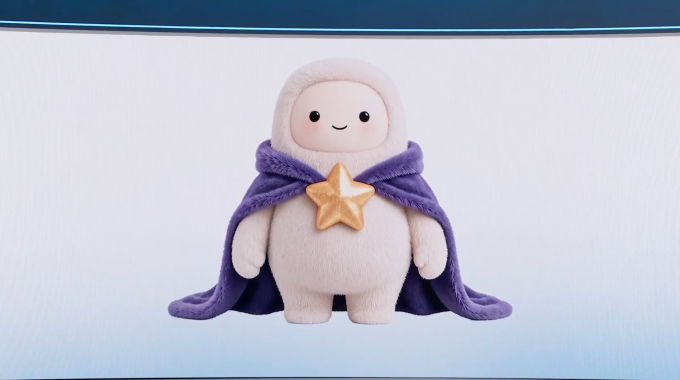
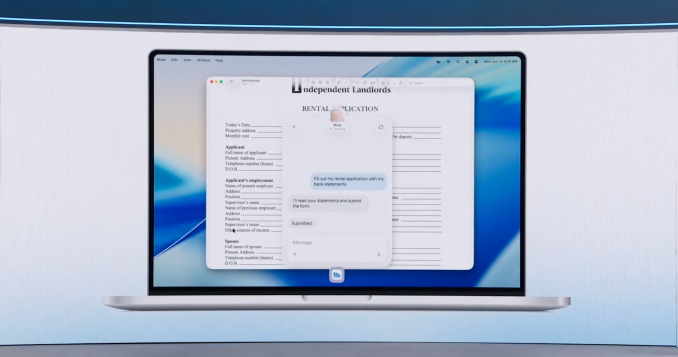



（译注：文末的作者简介、活动广告和「最受欢迎」列表未译出。）

Meta 的个人 AI 智能体 Muse 才问世几周，这家社交网络巨头就毫不耽搁地扩建这个可能是它迄今在消费级 AI 上[最大的一次押注](https://techcrunch.com/2026/09/08/meta-debuts-its-muse-ai-agent-will-consumers-trust-it/)。

首席执行官 Mark Zuckerberg 周三在门洛帕克以一场主题演讲拉开了公司年度 Connect 大会的帷幕，演讲清楚地表明了一件事：Meta 正在全力押注 Muse。

Muse 智能体（据 Zuckerberg 说，它的实体头像名叫 Jolly）旨在通过连接用户的应用和服务（包括电子邮件和日历）来处理日常任务。在 Connect 上，Zuckerberg 推出了一系列新能力和集成，让 Muse 更有用，更深入地融入用户的日常生活。只要用户愿意，Muse 将无处不在，包括在他们的 Meta AI 眼镜上。

Muse 于 9 月初上线，在用户的设备和数字账户之间交互。驱动这个智能体的是 [Muse Spark](https://about.fb.com/news/2026/09/introducing-muse-personal-ai-agent/)，这是 Meta 为智能体工作打造的多模态 AI 模型。Meta 一直宣传它比竞争对手提供的智能体更容易上手：一个从一开始就让用户能把生活中的琐碎工作自动化的 AI 助手。

「我们正在打造的东西，其愿景的核心就是 Muse，」Zuckerberg 在主题演讲开场时说，他穿着卡其裤和一件黑色 T 恤，胸前印着「BUILDING IS MY LOVE LANGUAGE」（译注：意为「打造是我的爱的语言」）。「在未来几年里，我预计 Muse 将成长为全世界数十亿人用来实现目标、改善生活的个人超级智能。」

Zuckerberg 还相信，Muse 会为它的用户赚钱，当然，最终也会为 Meta 赚钱。

「我们以让 Muse 在大量令牌（tokens）内免费的方式来支持这一点，并预期随着时间推移，我们将通过从交易中收取少量费用来获利，」他说。

以下是引起我们注意的新功能和新能力……

## **Muse 有了自己的数字头像**

**图片来源：** Meta（截图）

周三宣布的更有趣的消息之一是，Muse 用户很快就能为自己的智能体变出一个独特的数字头像，然后与它实时视频聊天。该公司说，它开发了一个新的 AI 模型 Muse Realtime Avatar 来支持这项功能。

其想法是给 Meta 以前没有面孔的 AI 软件一张脸、一副身体和一种声音，让它们显得亲切得多。这项功能在 Connect 的舞台上做了演示，确实带着一丝元宇宙的味道。用户将能够与这个头像实时对话，给它分配任务、向它提问。

## **Muse 很快将在 Meta 智能眼镜上启用**

该公司宣布，Muse 还将与 [Meta 的智能眼镜产品线](https://techcrunch.com/2026/09/23/meta-introduces-camera-free-ai-glasses/)集成。这意味着用户只需对着眼镜说话就能与他们的智能体沟通。该公司说，这个智能体通过唤醒词激活，还表示它将能够引导用户完成个性化锻炼、记录饮食、预约，并帮助他们购买看到的商品。

Meta 说，Muse 会在后台工作，完成后再回来告诉用户。

目前还不清楚这项功能具体何时上线，不过 Meta 说应该会在「未来几个月」的某个时候推出。

## **很快，你就可以让 Muse 操作你的 Mac**

**图片来源：** Meta／截图

Meta 说，它正在把 Muse 的计算机操作带到 Mac 上。该公司此前已经谈到过 [Muse 登陆 Mac](https://techcrunch.com/2026/09/18/metas-muse-hits-mac-letting-the-ai-take-actions-on-your-computer/)，周三又花了更多时间提供了一些新细节。这意味着用户将能够把任务委派给这个智能体，而且就像 OpenAI 和 Anthropic 其他流行的 AI 智能体一样，Muse 将能够操作用户桌面上的任何应用。

「你可以让它帮你经营你的小生意，或者只是替你把工作做完，」Meta 首席 AI 官 Alexandr Wang 周三在主题演讲中说。「你可以离开你的电脑，它会继续为你处理你排好的所有工作。」

## Muse 将拥有自己的电子邮件地址

由于 Muse 将一直在后台工作，它自然需要自己的电子邮件地址。Wang 宣布正在开发这项功能，并将「很快」推出，但没有给出更确切的时间表。

用户还将能够把 Muse 加入一个邮件线程，或者把邮件转发给这个智能体，让它代为处理。

## 购物合作与大量连接器

Meta 已经与 Stripe 和 Shopify 等公司敲定了合作关系，这表明该公司把 Muse 视为一个重要的购物工具。

据 Wang 说，Muse 可以以智能体方式访问整个 Shopify 商品目录，并使用 Stripe 的 Link 以及现在的 Shop Pay 在互联网上购买几乎任何东西。他还指出，Meta 也增加了对 PayPal 付款的更多支持。

该公司还宣布了与零售商的一系列新合作，包括 Best Buy、Gap、Sephora、Walmart 和 Wayfair。Muse 将能够连接这些零售应用，以及 Expedia，很快还有 Instacart。其他连接器包括 GitHub、Granola 和 Notion。

Wang 指出，公司也希望 Muse 能与小企业连接。Meta 最近开放了平台，允许开发者构建自己的「连接器」。他说，公司在不到一周的时间里就收到了超过 1,500 份申请，并补充说：「我认为，在一个新平台起飞之际开始为它进行开发，这可能是一代人一遇的机会，到目前为止的反响非常好。」
