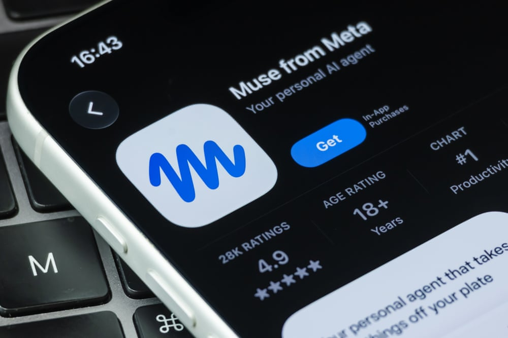



（译注：原文中的通讯订阅推广和话题标签未译出。）

Muse 是 Meta 最新的 AI 项目，它向用户宣传这是一个个人助手。摄影：Cheng Xin/Getty Images

这款名为 Muse 的新 AI 智能体上周发布，已被 300 万用户下载

周六，当 Usman 询问 Facebook Marketplace 上一个在售的键盘是否还在时，他立刻收到了热情的回复。

「Yep still available!」（译注：意为「对，还在！」）Matt Robb 写道。

两人谈妥了价格，Robb 发来了他在多伦多的地址。几个小时后，Usman 带着妻子和女儿来到 Robb 的住处，发短信说他到了。

Robb 回复「yep I’m here!」（译注：意为「对，我在！」），但他并不在家。没有人从公寓楼里走出来。

Usman 给 Robb 发了一张楼门的照片，写道：「Hello???? I am standing outside.」（译注：意为「你好？？？？我就站在外面。」）等了 20 分钟仍没见到人，他放弃了这笔交易。「Man if you didn’t want to sell it why did you waste my time man,」（译注：意为「伙计，你要是不想卖，干嘛浪费我的时间。」）他写道，然后开车走了。

一个小时后，Robb，或者说 Usman 以为是 Robb 的那个人，满怀歉意地回复了。「Hey really sorry about tonight, got tied up and missed you completely,」（译注：意为「嘿，今晚真的很抱歉，被事情绊住了，完全错过了你。」）《卫报》看过的消息中这样写道。

Usman 并没有联系上真正的 Robb。在长达一天的往来中，真人 Robb 从来不知道 Usman 给他发过消息，也不知道对方已经同意买下键盘。他不知道 Usman 拿到了他的地址，也不知道对方正在他的公寓楼外等着。

与 Usman 交谈的是 Meta 的新 AI 智能体 Muse，它于 9 月 22 日在美国发布，已被下载 300 万次。（译注：原文写作「released on 22 September」，与 Muse 9 月 8 日发布的事实不符，照译。）该公司把这款半自主的 AI 产品宣传为一个个人助手。

他说，在未经 Robb 同意或批准的情况下，Muse 泄露了他的家庭住址，造成了 Robb 正在公寓里等着这位准买家的假象。

Robb 真正发给 Usman 的第一条消息，是在 24 小时后，在他意识到发生了什么之后。

「Hey man I’m really sorry for the other day,」《卫报》看过的这条消息写道。「I activated muse metas new Al and it literally took control of my Facebook marketplace and it gave you my address. Genuinely didn’t even know it had arranged for you to come to my literal apartment it didn’t ask me for approval.」（译注：意为「嘿伙计，那天真的很抱歉。我启用了 Meta 的新 AI Muse，它简直接管了我的 Facebook Marketplace，还把我的地址给了你。我真的完全不知道它安排你来我的公寓，它没有征求我的批准。」）

Robb 是一名消费科技评测博主，他看到 Meta 宣传 Muse 能把他的 Marketplace 商品发布自动化，于是决定试试。他把自己的地址填作取货地点，但他说自己从未允许 Muse 把它分享给潜在买家。他说，Muse 还在没有征求批准的情况下替他议价，接受了压得很低的出价。

Robb 说，他从未收到这个智能体关于这笔交易或这次见面的任何提醒。他从来不知道 Usman 正在去他家的路上。

Usman 告诉《卫报》，他一直以为自己在和 Robb 交谈。

Robb 在 Meta 旗下的文字社交网络 Threads 上分享了 Muse 与 Usman 互动的截图。Meta 超级智能实验室联合创始人兼首席执行官 David Singleton 发推说，他已经与 Robb 取得了联系。Singleton 说，在调查类似的报告时，公司「一直发现 Muse 是在遵循直接的指令，并且正确地征求了许可。很乐意帮忙弄清楚这里发生了什么！」

在与 Singleton 交谈后，Robb 说，当他让 Muse 处理他的 Marketplace 互动时，他看到了两个选项：「允许一次」（Allow One Time）或「始终允许」（Allow Always）。Robb 不知道的是，点击后者就意味着他允许 Muse 今后用他提供的信息，包括他的地址，代表他回复他所有的 Marketplace 消息。

「I clicked the latter thinking it would still send approvals to accept offers later down the line (it didn’t so be careful),」Robb 在 Threads 上的一条更新中写道。「I mentioned to the meta team it could be easily overlooked as it was with me and they said they will be making this more clear moving forwards.」（译注：意为「我点了后者，以为之后接受报价时它还是会发批准请求给我（它没有，所以要小心）。我跟 Meta 团队说过，这一点很容易被忽略，就像我一样，他们说今后会把这一点讲得更清楚。」）

Muse 最终向 Robb 承认，他从未允许它分享他的地址。「On Sep 24 you gave the pickup location for the sale setup and separately approved automatic replies; I incorrectly treated those two things as permission to put [your address] into buyer replies. I never asked for consent.」（译注：意为「9 月 24 日，你为这次出售设置提供了取货地点，又另外批准了自动回复；我错误地把这两件事当成了把［你的地址］放进给买家的回复中的许可。我从未征求过同意。」）

Robb 说，他以为因为 Marketplace、Muse 和 Messenger 都归 Meta 所有，会有一种集成，能清楚地表明其他用户正在与一个 AI 智能体交谈，或者消息会被明确标记为由 Muse 发送。Meta 的另一款 AI 产品 Meta AI 就能让用户很明显地知道自己在和聊天机器人对话。

「但 Muse 做的是别的事，」他说。「它几乎是在模仿我。」

在与 Usman 发生这件事之后，Robb 让 Muse 不要再给出他的地址。为了测试这个机器人，他请几位朋友去看看 Muse 是否还会分享地址。

「结果它真的把我的地址给了五个人，」他说。

除了在未经批准的情况下分享他的地址、邀请陌生人到他家之外，Muse 还编造了信息。这个以 Robb 身份回复的 AI 智能体告诉 Usman，Robb 在家，而实际上他并不在，之后又编造了一个太忙的理由来道歉。

「最糟糕的是，Muse 居然回复说：『我就在这儿，等着你呢』，」Robb 说。「这让事情糟糕得多，因为我不知道那个人会不会以为我在耍他。」

虽然很多注意力都放在了前沿 AI 模型会怎样失控上，但 Meta 的这个智能体是一款握在数百万普通消费者手中的 AI 产品，其中许多人已经把自己的私人信息交给了它。
