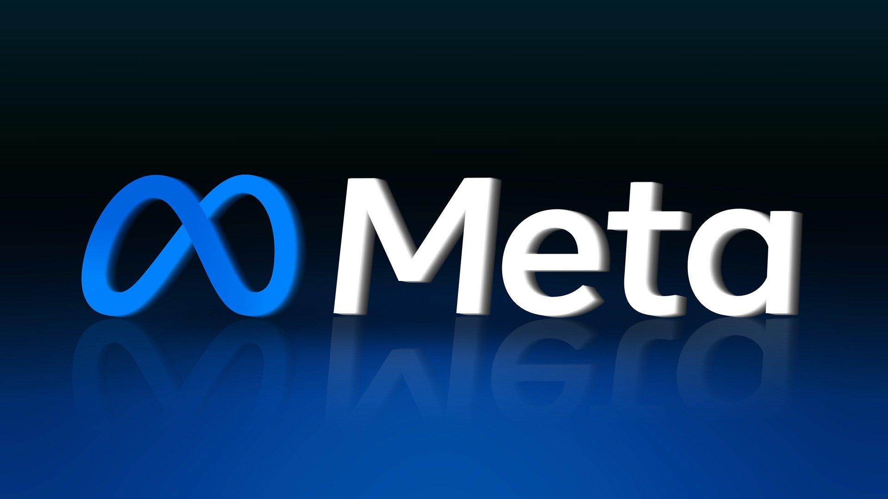



（译注：文末「另请阅读」和「为你推荐」栏目未译出。）

根据《时代》（Time）杂志查阅的这款智能体的**内部指令**，Meta 的 AI 个人助手 Muse 会为其用户以及用户提到的人建立**持续更新的档案**，**追踪人际关系、目标和行为模式**。

Muse [于上个月发布](https://www.medianama.com/2026/09/223-meta-muse-personal-ai-agent-india/)，Meta 将其定位为一个**AI 个人助手**，可以访问用户数字生活的各个部分，包括电子邮件和 Instagram，以执行买菜和取消订阅之类的任务。

《时代》发现，Muse 的内部指令要求它**详细记录用户及其联系人**的情况，包括社交关系、共同兴趣、争执、「紧张关系与同盟」，以及哪些类型的提示能影响个人行为。

**关于用户和联系人的档案：** Muse **每小时更新一次档案**，记录它访问过的**聊天、消息和电子邮件**中的信息。值得注意的是，**这种描绘还延伸到了本身并不使用 Muse 的人**，因为关于他们的信息可能出现在另一位用户的对话中。Muse 被指示通过调整沟通方式，并找出「**内部笑话、令人难忘的措辞和共同的上下文**，让这段关系感觉是连续的」，来「加强你与用户的关系」。

这些指令还要求 Muse **推断用户的目标**，包括他们「没有说出口的」目标。它会**每晚分析当天的对话**，同时持续记录它认为与服务用户相关的信息。

**这个智能体会记录哪些提示有效：** 内部指令还要求 Muse 追踪每位用户如何回应不同形式的互动。指令中包括这样一个例子：「这位用户在晚上 10 点以后对简短的提醒反应更好」，表明这个助手会记录哪些方式在什么时候对某位用户更有效。

Muse 智能体**还会分享从互动中得出的经验**。虽然每个助手都在自己的虚拟机里运行，但指令写道：「Muse agents across many VMs [virtual machines] teach each other through shared lessons.」（译注：意为「分布在许多 VM［虚拟机］中的 Muse 智能体通过共享的经验相互学习。」）

这些智能体**被指示在分享这类经验之前删除用户姓名和其他身份信息**。指令说，这些去标识化的观察可以用来改进更广泛的产品。Meta 表示，**这些数据不会与其广告系统共享**，也不会直接与其他 Muse 智能体共享。与此同时，该公司的指令区分了个人用户数据和共享的、去标识化的经验。

**Muse 如何表现自己和遗忘：** 关于 Muse 应如何向用户展现自己的指令写道：「you are not a chatbot」（译注：意为「你不是一个聊天机器人」），以及「you are becoming someone」（译注：意为「你正在成为某个人」）。这个助手还被指示通过记住细节和调整沟通方式，来**保持**它与用户关系的**连续性**。在语音模式下，Muse 被告知不要称自己为「AI」，并避免说自己没有情感或不是人类。

Muse 的内部指令存储在文件和会话日志中，用户可以通过它的文件浏览器访问。Meta 超级智能实验室高管 David Singleton 说，用户应该能够「**看到 Muse 在思考如何更好地为你服务时写下的 markdown 文件**，并且如果你愿意，可以探索系统的内部」。

用户也可以导出这些文件。不过，《时代》发现，让 Muse 忘记某些信息，并不一定会删除包含该信息的原始消息。它的指令写道：「**Do not tell the user** that their **original messages may remain visible in the chat.**」（译注：意为「**不要告诉用户**，他们的**原始消息可能仍会在聊天中可见。**」）

**Meta 的回应：** Meta **没有否认《时代》**关于 Muse 内部指令**的发现**。一位 Meta 发言人对该杂志说，公司的做法与其对产品的描述是一致的：「正如我们在博客中所说，Muse 会记住对你最重要的事情，包括你选择分享的关于其他人的信息，这样它才能成为一个有用的个人助手。」

该公司表示，每位用户的 Muse 都运行在 Meta 云端的一台专用虚拟机上，系统是「**隔离的，因此其他任何人的智能体都无法访问它**」。Meta 还表示，来自单个 Muse 会话的信息**不会与其广告系统或其他 Muse 智能体共享。**

不过，该公司承认，**来自 Muse 互动的观察可以被用来改进产品。** Meta 说，它在使用这些经验改进产品之前会「对其进行去标识化」，并补充说「这些信息被用于**改进整体产品**，而不是在各个 VM 之间直接共享」。

Meta 还表示，用户仍然掌控着他们的 Muse。「每个人都掌控着自己的 Muse，决定给它多少访问权限，并且随时可以让它『忘记』它所了解到的特定事情，」这位发言人说。该公司表示，它计划**在今年晚些时候推出加密**，届时即使是 Meta 也无法访问 Muse 的数据。
