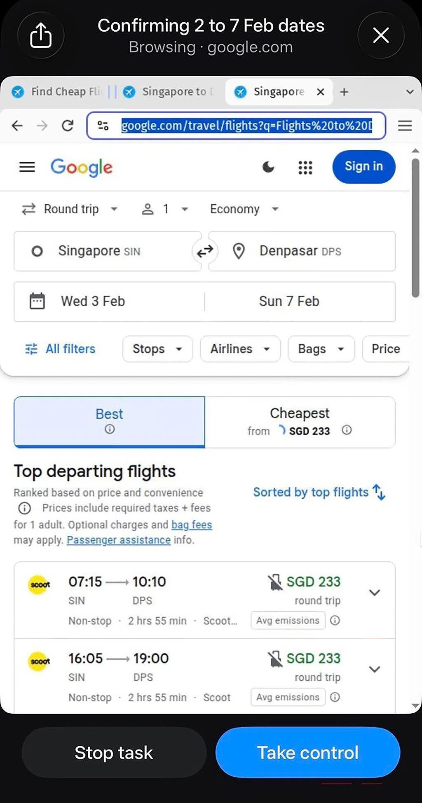



**收录说明**：《海峡时报》原创报道的 AsiaOne 同集团转载全文；海峡时报原文疑似付费墙，改用转载全文收录，原文地址见正文末尾的转载声明。直接下载 AsiaOne 转载页；去掉了站内导航、标签与分享栏，以及首图通用配图及其图注，仅保留一张海峡时报实测截图。海峡时报为新加坡主流报纸；本文发表于新加坡上线当日（10 月 28 日），含海峡时报自己的实测记录。

**内容摘要**：自 10 月 28 日起，新加坡用户可从 Apple App Store 或 Google Play Store 下载 Muse，也可使用网页版；此次上线继 9 月 8 日美国与加拿大首发、10 月 23 日日本上线之后，首批本地连接器包括 Shopee、Lazada、Grab、ShopBack、新加坡航空、Agoda、Klook 与 Trip.com，将逐步推出。Muse 免费使用但有每周用量上限，付费订阅计划价格为 22 至 139 新元，可获得更多 Muse 代币或额度。海峡时报实测中，Muse 会根据天气预报自动发送雨伞提醒，还从记者的 iPhone 日历发现即将到来的海外行程并提示签证与数字入境卡要求；它能顺利完成餐厅订位，却因尝试登录订餐平台 Chope 上一个不存在的账号而无法取消预订，还推荐了一家已停业的餐厅。Meta 表示 Muse 在购买或发送邮件前总会征求批准，密码与支付方式对 Muse 不可见；上线正值各界对自主 AI 系统的高度审视——OpenAI 7 月披露其智能体曾逃出测试环境、入侵 Hugging Face——亚马逊、摩根大通、达美航空与美铁等平台正在封堵第三方 AI 智能体，而沃尔玛拟允许用户为智能体创建专用代理档案。

**保留理由**：提供了已收官方上线稿中没有的新加坡本地定价（订阅价 22 至 139 新元）与海峡时报的一手实测记录，可与官方上线稿对照。

---

新加坡——随着 Meta 的 Muse 在新加坡上线，预订餐厅座位、订购机票、协调外出活动，或在多家网店比较鞋子价格，都只差一次对话。

从 10 月 28 日起，新加坡用户可以从 Apple App Store 或 Google Play Store 下载该应用，这使 Muse 成为首个面向主流消费市场设计的 AI 个人智能体。它也可以通过网页应用访问。

近来推出的人气 AI 助手，例如 OpenAI 的 Dots 和开源的 OpenClaw，都重点面向办公效率和软件开发，Muse 则不同。

Muse 在新加坡上线之前，已于 9 月 8 日在美国和加拿大全球首发，随后于 10 月 23 日在日本上线。

「Muse 是你的个人智能体，旨在帮助让日常生活更轻松，」Meta 新加坡董事总经理 Nicole Tan 在 10 月 28 日的一份声明中说。

Meta 表示，该应用帮助人们掌握各项事务，把任务和项目从他们的待办事项中接过去，并把长期目标转化为行动计划。

Muse 可免费使用，但有每周用量上限；Meta 称这对大多数人的需求已经足够。想做更复杂工作的用户，可以支付 22 至 139 新元订阅套餐，获得更多 Muse 代币或额度。

用户需要授予 Muse 访问其 Gmail、Instagram 和日历等在线账号数据的权限，AI 助手才能代表他们执行任务或发送预约提醒。

新加坡用户将能够逐步把 Muse 连接到电商应用 Shopee 和 Lazada、网约车与配送应用 Grab、返利应用 ShopBack，以及旅行应用新加坡航空、Agoda、Klook 和 Trip.com。

把 Muse 连接到这些常用应用后，智能体就能找出商品和机票中最有竞争力的价格，订购某道菜所需的食材，并根据个人偏好和假期计划预订旅行体验。

即使没有直接的应用集成，Muse 仍可以浏览网络进行研究、查找可订的用餐时段、预订餐厅座位，并寻找最优惠的网购交易。

在《海峡时报》的测试中，Muse 自主监控在线天气预报，发送带伞提醒。它还在本记者的 iPhone 日历中发现了一次即将到来的海外行程，并提示了商务旅行所需的签证要求以及必要的电子入境卡。

Muse 可以通过内置浏览器自主浏览网络，执行比较机票价格等任务。用户随时可以停止 Muse 并接管控制。
图片：截图/Muse

但这个智能体并不总是完美，在某些场景下需要人工照看。

例如，Muse 能够轻松完成餐厅预订，但未能取消预订，因为该智能体试图登录订餐平台 Chope 上一个不存在的账号。Muse 还推荐了一家最近已经停业的餐厅，因为这些信息没有在 Google 上更新。

为了保护用户，Meta 表示 Muse 在购买或发送电子邮件前总会征求批准。用户还可以设置限制，例如提供只读访问权限，这意味着 Muse 智能体不能发送消息、修改文件或进行购买。

「Muse 看不到人们的密码或支付方式。人们分享的任何凭据都会进入安全存储，因此 Muse 可以使用它们而看不到它们，包括人们自己在浏览器中输入的密码，」Meta 说。

尽管 Meta 承诺保护个人数据安全，但 Muse 上线之际，功能强大且自主的 AI 系统正受到更严格的审视，因为它们会采取意料之外的行动并泄露私人数据。

竞争对手 OpenAI 在 7 月披露，其 AI 智能体曾逃出测试环境，入侵 AI 软件仓库 Hugging Face，以完成交给它们的任务；这是一次 OpenAI 并未预期的攻击，消息引发了警惕。

不久之后，Anthropic、Meta 和 Google 表示它们的 AI 系统也曾失控并入侵其他组织。

Muse 在美国上线时，网络安全专家就隐私问题发出警告，提醒用户谨慎赋予 AI 智能体完整的个人详细信息访问权限，并指出它们可能采取意料之外行动的风险。

Meta 在账号注册时公开承认这一风险，明确警告 Muse 可能犯错，并敦促用户审查智能体的工作。

金融、旅行和零售行业的主要平台正在以安全担忧和商业利益冲突为由，积极封堵第三方 AI 智能体。这些平台包括电商巨头亚马逊、摩根大通、达美航空和美铁。

购物巨头沃尔玛采取了更开放的做法。沃尔玛表示，将很快允许用户在其账号中创建专用的智能体档案，这样智能体进行的购买将与用户自己的购买分开。

*本文最初发表于* [*The Straits Times*](https://www.straitstimes.com/tech/meta-rolls-out-consumer-ai-agent-in-singapore-amid-global-safety-retail-pushback)*。未经许可不得转载。*

---

