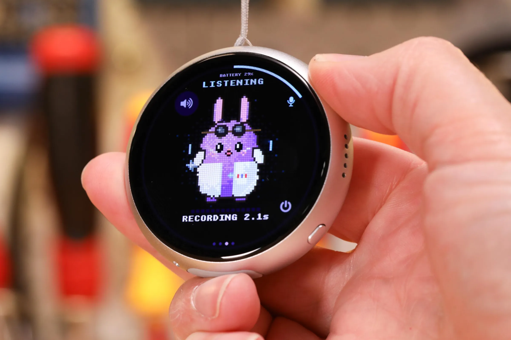
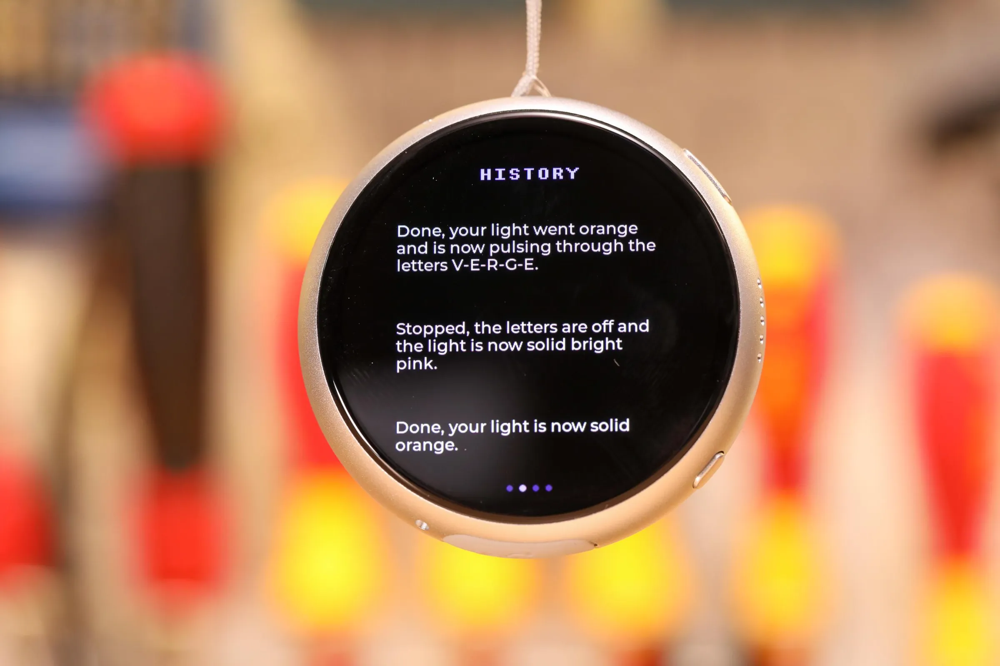
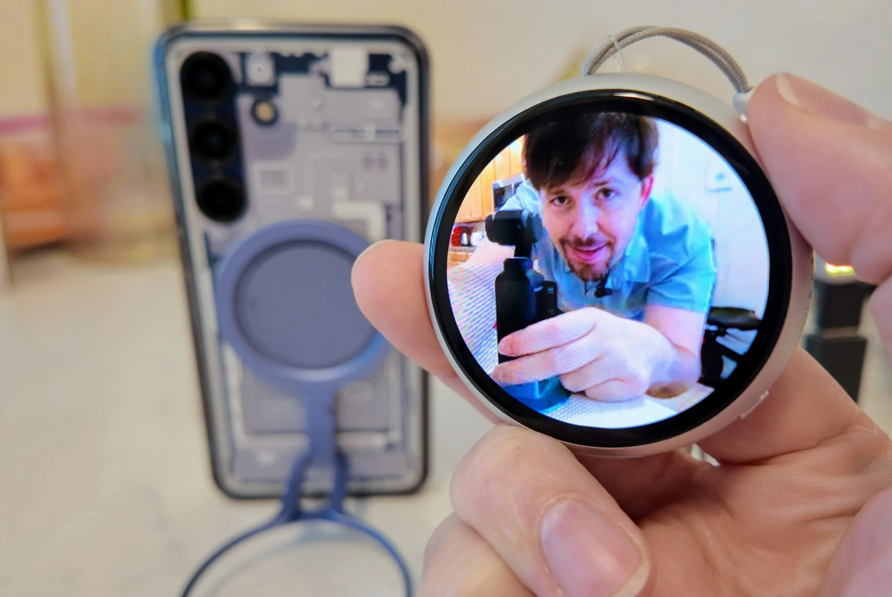
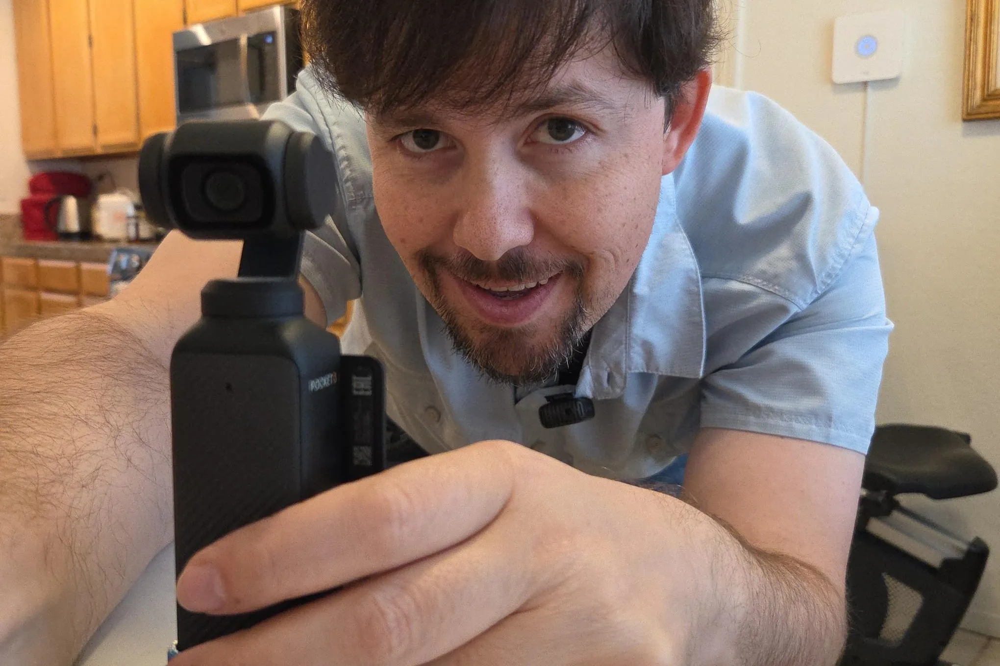
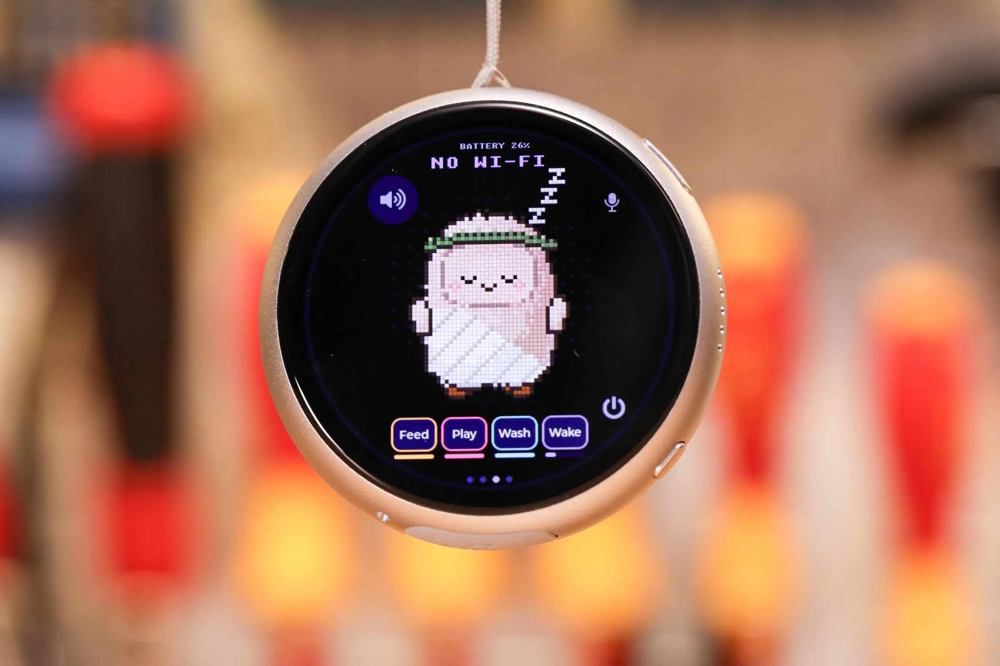



**收录说明**：直接下载。去掉了页首话题标签、作者栏与文末「Related」栏目、推荐与广告；文中的嵌入视频未在静态页面中找到地址，未收录；五张作者实拍图已本地化到 images/。原文全文存于本目录的 original.md，网站上不显示，已翻译。

**内容摘要**：作者花 50 美元买了一块 1.75 英寸触屏开发板 Waveshare ESP32-S3 1.75C，自制 Muse Charm 平替；这款开发板是 Meta 官方推荐的 Muse Gadget 搭建方案之一，使用 Meta 的开源代码与令牌直连 Muse 云端。初始安装后设备基本不可用：Muse 会把语音当作待转录的音频片段而非指令，回复缓慢且不出声，屏幕一次只显示几个词，Meta 自带版本只有一个 Jolly 形象，也不会自动发现智能家居设备。经过几轮 Claude Code 改造，作者补上了对话历史页、ElevenLabs 英式语音朗读、远程拍照快门与蓝牙低清取景，还做了多个 Meta Connect 风格的形象和带饥饿、无聊、肮脏四档状态的电子宠物小游戏，以及真正走时的三针怀表表盘（耗时 15 分钟）。作者自述没有编程经验，也不知道这些代码质量如何，并表示不信任 Meta 或 Muse 接触自己的邮箱与家庭网络，因此把设备放在访客 Wi-Fi 上；他最后认为，专用硬件的意义在于做手机做不到的事，而不是 Muse 本身。

**保留理由**：这是一手实测，记录了 Muse Gadgets 官方示例开箱即用的实际短板（转录误判、无语音回复、单形象、无智能家居发现），以及用 Claude Code 逐项补齐的过程与具体改动，是官方文档之外的真实可用性证据。

---

我们家有 Muse Charm。

马克·扎克伯格的 Meta 给 AI 配上一张软乎乎的小脸，[让它看起来可爱得要命](/column/999999/optimizer-meta-muse-ai-cute)——而这个假期季，他想卖给你[一个 Muse Charm](/tech/999750/muse-charm-meta-ai-hardware)，好让你像带拓麻歌子一样，把那个乐呵呵的 AI 小帮手随身带着。

但我不会买，因为*我们家有 Muse Charm*。它只花了 50 美元，而我觉得这段学习经历值这个价。

我的版本没有[摄像头或 5G 蜂窝无线电](/tech/999944/meta-muse-charm-ai-interact-5g-modem)，但它真的能和 Muse 对话，也有可爱的化身！它还兼作怀表和远程相机取景器，并且（理论上）能控制我的智能家居。

或者至少，在你注入大量额外的 vibe code 之后可以。

几周前，我花 50 美元从中国直邮了一个 1.75 英寸触屏电脑吊坠——具体是 [Waveshare ESP32-S3 1.75C](https://www.waveshare.com/esp32-s3-touch-amoled-1.75c.htm)。这个按键说话的 AI 开发套件不仅看起来*非常*像 Muse Charm，而且还获得 Meta 官方认可。如果你想打造[一个「Muse Gadget」（Muse 小设备）](https://gadgets.muse.ai/)，一种用 Meta 开源代码和令牌直接连接其 Muse AI 云的设备，它是该公司最先给出的建议之一。

银色金属怀表到手时，一开始感觉相当没用。安装倒是不难——我把它插到 PC 上，让 Claude 指向 Meta 的 GitHub，然后把它和 Muse 手机应用配对。但即使我把 Meta 的密钥装到设备上，Muse 起初仍以为我发给它的是*要转录*的音频片段，而不是指令。等我把这点弄清楚后，Muse 的回复仍然很慢，而且不出声。很难判断它在说什么，因为屏幕上一次只显示几个词，除非我掏出装着 Muse 应用的手机，否则没地方读完整消息。

Meta 的版本还只带一个 Jolly 形象，大多时候就坐在那儿卖萌，也不会像 Amazon Echo 或 Google Home 设备那样自动发现智能家居设备。（在我最初的安装之后，这个小设备真的*什么*有用的事都做不了。）而且，尽管 Meta AI 软件工程师 Anant Narayanan 和 Jeremy Payne 提供了一个[不错的示例应用](https://github.com/facebookincubator/muse-gadget-sdk/tree/main/android/musegadgetstest)，展示 Muse Gadgets 如何从手机摄像头串流视频，但缺少远程快门按钮，让它在拍照上没那么有用。

摄影：Sean Hollister / The Verge

但几轮 Claude Code 就把几乎所有这些窟窿补上了。我要做的只是把 Waveshare 再插回 PC，然后让 Claude 逐个重新编程我想要的东西。

当我向 Claude 抱怨我无法好好读或听 Muse 对我的请求的回复时——[其他人也](https://github.com/facebookincubator/muse-gadget-sdk/issues/121)[提到过这些问题](https://github.com/facebookincubator/muse-gadget-sdk/issues/121)——Claude 做了一个对话历史页面，我可以右滑阅读它说过的话，我还接入了一个 ElevenLabs 的英式 AI 声音，把回答朗读出来。（我和我妻子一致认为，这是 ElevenLabs 免费档里最不让人灵魂被吸干的一个声音，尽管它和 Muse 化身那种毛茸茸的气质完全不搭。）

摄影：Sean Hollister / The Verge

多亏 Claude，我现在按一个按钮就能让房间另一头的手机拍张照，并带高质量实时预览，手机前置摄像头也不再倒着显示了。Claude 还相当快地加上了通过蓝牙传输的低画质相机预览，这样我不必连家庭 Wi-Fi 也能从刁钻角度拍照。

*当我按下我这个新远程取景器上的这个按钮……*

 摄影：Sean Hollister / The Verge

*……我的手机就拍下一张照片。*

 摄影：Sean Hollister / The Verge

我让 Claude 做了一整批不同的化身，像 Meta 在 Meta Connect 上展示的那些，还加了一个类似拓麻歌子的小游戏，它们需要食物、玩耍、睡眠和洗澡。当这个游戏显得太简单、抓不住注意力时，我让它加上了四档不同的饥饿、无聊和肮脏状态。我决定零食应该弄出嘎吱作响的碎屑，让化身吃了之后更脏，而玩得太多应该让宠物累坏。我的心愿就是 Claude 的命令。

当我发现我不小心太早松开按键说话按钮、让 Muse 被几乎空白的音频噎住时，vibe coding 几分钟后就修好了，办法是只发送长度超过一秒的音频。现在我能看到的唯一明显延迟来自 Meta 自己的服务器——有时响应很快，有时相当卡。

摄影：Sean Hollister / The Verge

让 Claude 重新编程这个吊坠太容易了，于是我让它专门为本文的这个视频做了几项功能，包括一个真正走时的三针怀表表盘。（这花了它 15 分钟；现在当我说这硬件看起来像怀表时，你就明白我的意思了！）它甚至还找到、下载、剪辑并加载了扎克伯格介绍 Muse Charm 的视频片段，并装了一个视频播放器，好让我在 Waveshare 上播放这些片段。

我想让你明白我没有编程经验，所以我完全不知道这些代码好不好。它可能有致命缺陷。我也不信任 Meta 或其 Muse agent 接触我的邮箱或家庭网络，尤其是在听说[它如何泄露了一位评测者的家庭住址](/ai-artificial-intelligence/1001886/meta-muse-ai-facebook-marketplace-security-concerns)之后。（为保险起见，我从一开始就把它放在访客 Wi-Fi 上。）

这意味着我并不*真正*知道，对于那些*确实*会编程、也*确实*愿意多冒一点险的人来说，Muse Charm 到底有多大用处。但在差点把一块笨重的小银吊坠摔了好几次之后——这块吊坠的 Muse 功能并不比我的手机多（没有额外代码的话还少得多）——我觉得 Muse 本身并不是买一块专用计算怀表的理由。

拥有一件专用硬件的理由，是去做那些你口袋里已有的手机*做不到*的事，比如把整个小设备编程成你想让它做的任何样子。这让我好奇：真正的 Muse Charm 会不会也这样可自由编程，还是说会买它的人不如直接买一块开发套件？我想等它发货时就知道了。
