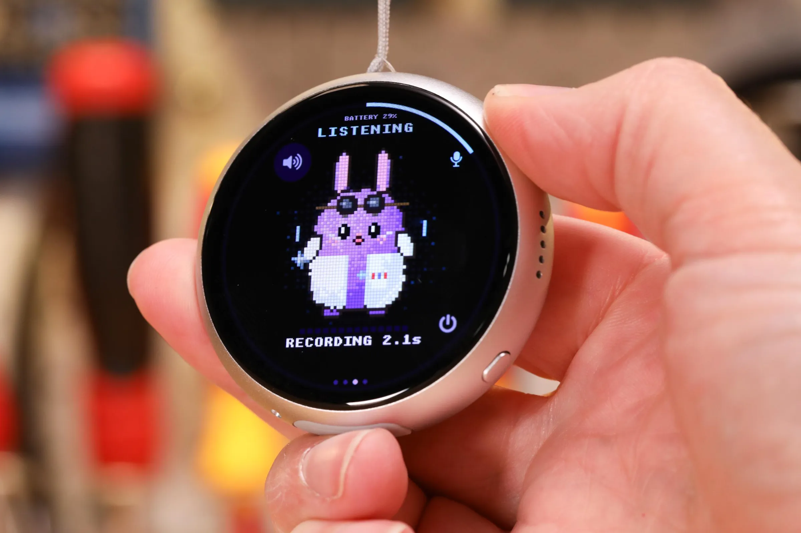
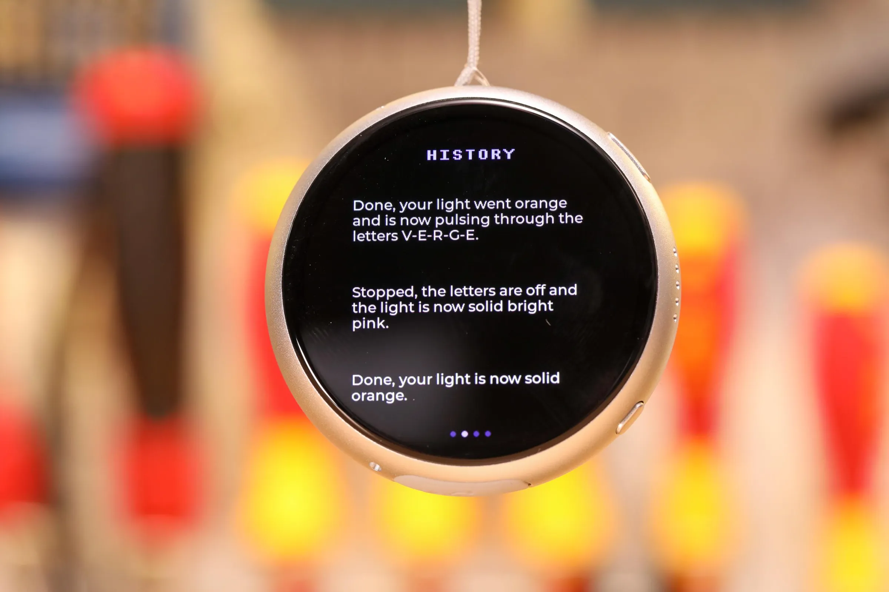
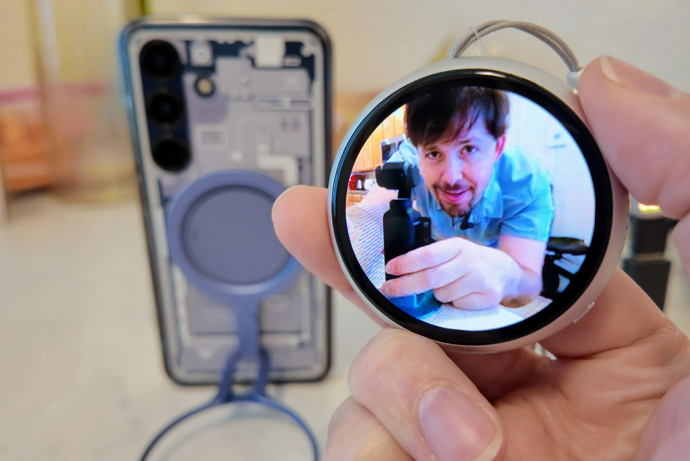
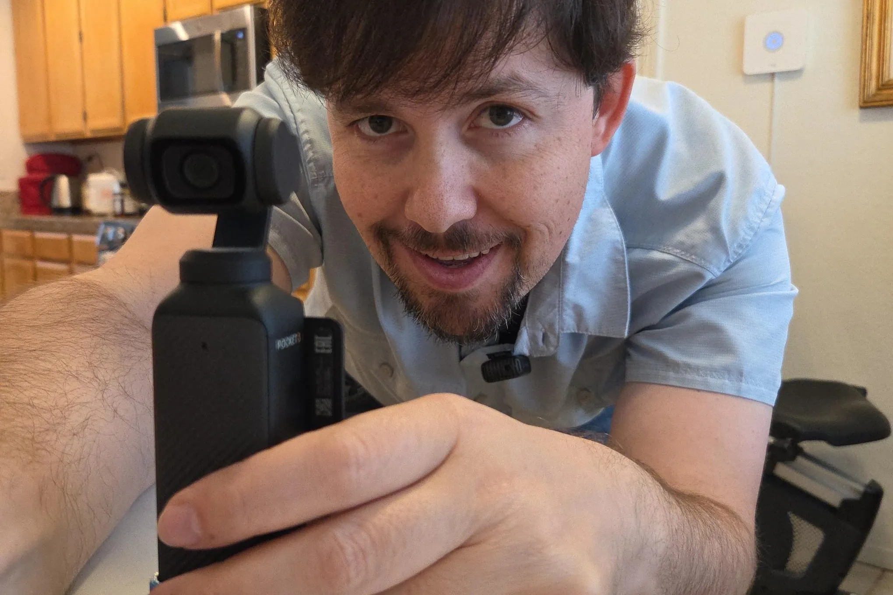
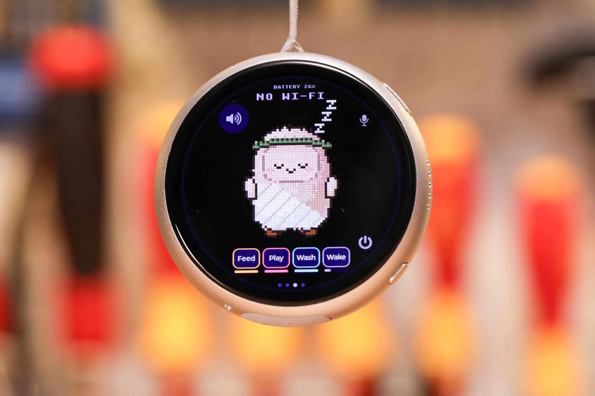

来源：https://www.theverge.com/gadgets/1013375/muse-charm-gadgets-preview-waveshare-esp32-claude-vibe-code
取文：2026-11-08，直接下载

We have Muse Charm at home.

Mark Zuckerberg’s Meta [made AI look so stinking cute](/column/999999/optimizer-meta-muse-ai-cute) by giving it a squishy little face — and this holiday season, he wants to sell you [a Muse Charm](/tech/999750/muse-charm-meta-ai-hardware) so you can carry your jolly AI helper around like a Tamagotchi.

But I won’t be buying one, because *we have Muse Charm at home*. It cost just $50, and I’ve decided the learning experience was worth it.

My version doesn’t [sport cameras or a 5G cellular radio](/tech/999944/meta-muse-charm-ai-interact-5g-modem), but it really talks to Muse and has cute avatars, too! It doubles as a pocket watch and a remote camera viewfinder, and it can (theoretically) control my smart home.

Or at least it can if you inject a lot of extra vibe code.

Weeks ago, I paid $50 to get a 1.75-inch touchscreen computer pendant drop-shipped from China — specifically the [Waveshare ESP32-S3 1.75C](https://www.waveshare.com/esp32-s3-touch-amoled-1.75c.htm). Not only does the push-to-talk AI devkit look a *lot* like the Muse Charm, but it’s officially sanctioned by Meta. It’s one of the company’s first suggestions if you want to build [a “Muse Gadget,”](https://gadgets.muse.ai/) a device that uses Meta’s open-source code and tokens to directly connect to its Muse AI cloud.

When the silver metal pocket watch arrived, it felt pretty useless to start. Setup was easy enough — I just plugged it into my PC and pointed Claude at Meta’s GitHub, then paired it to the Muse phone app. But even after I put Meta’s keys on the device, Muse originally thought I was sending it audio clips *to transcribe* rather than commands. After I cleared that up, Muse’s responses were still slow, and it didn’t answer me out loud. It was hard to tell what it was saying since it only showed a few words onscreen at a time, with no place to read full messages unless I whipped out my phone with its own Muse app.

Meta’s build also only came with a single Jolly avatar that mostly just sat there and looked cute, and it wouldn’t automatically discover smart home gadgets like Amazon Echo or Google Home devices do. (This gadget really didn’t do *anything* useful after my initial install.) And though Meta AI software engineers Anant Narayanan and Jeremy Payne include [a neat sample app](https://github.com/facebookincubator/muse-gadget-sdk/tree/main/android/musegadgetstest) showing how Muse Gadgets can stream video from your phone camera, the lack of a remote shutter button made it not so useful for taking photos.

Photo by Sean Hollister / The Verge

But a few sessions of Claude Code filled in almost all those holes. All I had to do was plug the Waveshare back into my PC, then ask Claude to reprogram each thing I wanted.

When I complained to Claude that I couldn’t properly read or hear Muse’s replies to my asks, [issues that others](https://github.com/facebookincubator/muse-gadget-sdk/issues/121) have [mentioned as well](https://github.com/facebookincubator/muse-gadget-sdk/issues/121), Claude built a conversation history page so I can swipe right to read what it said, and I plugged in a British AI voice from ElevenLabs that speaks its answers out loud. (The voice was the least soul-sucking of the ones in ElevenLabs’ free tier, my wife and I agree, even if it doesn’t match the Muse avatars’ cuddly vibe at all.)

Photo by Sean Hollister / The Verge

Thanks to Claude, I can now press a button to make my phone take a picture from across the room with a high-quality live preview, and my phone’s front-facing camera no longer displays upside down. Claude made fairly short work of adding a low-quality camera preview over Bluetooth, too, so I don’t need to be on home Wi-Fi to get photos from creative angles.

*When I hit this button on my new remote viewfinder…*

 Photo by Sean Hollister / The Verge

*…my phone takes a photo.*

 Photo by Sean Hollister / The Verge

I asked Claude to make a whole batch of different avatars like the ones Meta showed off during Meta Connect, and to add a Tamagotchi-like minigame where they need food, play, sleep, and a bath. When the game seemed too simple to capture any attention, I had it add four different levels of hunger, boredom, and dirt. I decided treats should make a crunchy mess and get avatars dirtier when they eat them, and that too much play should tire out a pet. My wish was Claude’s command.

When I noticed I was accidentally letting go of the push-to-talk button too soon and making Muse choke on almost-empty audio, vibe coding fixed it minutes later by sending only audio over one second in length. The only obvious lag I’m seeing now is from Meta’s own servers — sometimes they’re responsive, sometimes they lag quite a bit.

Photo by Sean Hollister / The Verge

It was so easy to let Claude reprogram the pendant that I asked it to build a few features specifically for this video in this story, including a working pocket watch face with three hands that actually tells the time. (That took it 15 minutes; now, when I say the hardware looks like a pocket watch, you can see what I mean!) It even found, downloaded, trimmed, and loaded video clips of Zuck introducing the Muse Charm and installed a video player so I could play those clips on the Waveshare.

I want you to understand I have no coding experience, and so I have no idea if any of this code is good. It might be fatally flawed. Nor do I trust Meta or its Muse agent with my email or my home network, particularly after hearing [how it leaked one reviewer’s home address](/ai-artificial-intelligence/1001886/meta-muse-ai-facebook-marketplace-security-concerns). (I put it on guest Wi-Fi from the get-go as a precaution.)

That means I don’t *really* know how useful a Muse Charm may or may not be for those who *do* know how to code and *are* willing to take a bigger leap of faith. But after nearly dropping a bulky little silver pendant a couple of times, one with no more Muse functionality than my phone (and quite a bit less without additional code), I’m thinking Muse itself isn’t the reason to buy a dedicated compute pocket watch.

The reason to have a dedicated piece of hardware is to do things you *can’t* do on the phone that’s already in your pocket, like coding the entire gadget to do whatever you want. Which makes me wonder: Will the actual Muse Charm be this freely programmable, or would the kind of people who’d buy one be better off with a development kit? I guess we’ll see when it ships.
