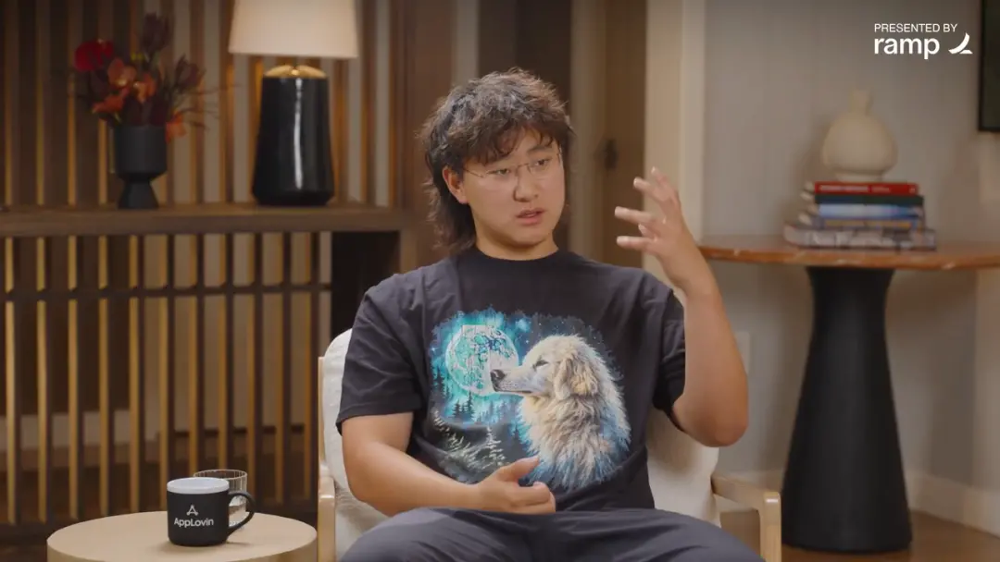
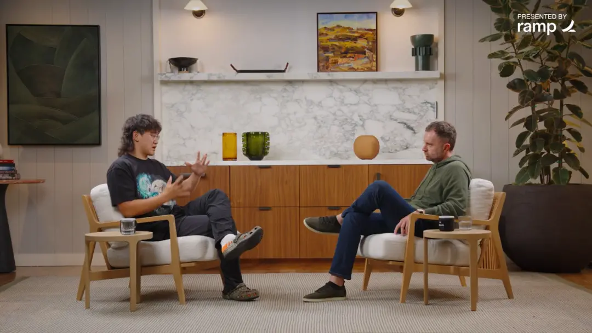



**收录说明**：直接下载。用浏览器客户端标识下载页面，从正文容器抽取；去掉了页首「核心觀點」框以外的站内横幅（推薦閱讀、风险提示、关联标签、相关阅读与热门文章）；文首 Summary 一行为页面顶部的「核心觀點」框，照录；两张配图已本地化到 images/。访谈本身因无文字稿不收，本文为媒体书面整理，含大量直接引语；文末「写在最后」一段为作者自己的建议，非访谈内容，照录。原文全文见本页分隔线下（繁体中文原样保存）。

**内容摘要**：本文整理 David Senra 对 Meta 首席 AI 官 Alexandr Wang 的访谈，讲述 Muse 从原型到发布的过程。2026 年 2 月，Wang 与 Nat Friedman 分别写下对个人智能体的想法，团队约一到两周做出原型并向董事会演示，但原型大多时候不能正常工作，此后又花了七个月打磨才上线。团队把理想个人智能体应具备的行为和能力列成一百多项，逐项建立评测并设发布门槛，曾出现八十项达标、二十项未达标的情况，直到一个专门训练的模型版本让全部项目达标才放行。Wang 还谈到产品取舍与信任积累：模型与产品两部分合计不到两百人，用户往往先交小事，办成后再逐步交更大的事。

**保留理由**：提供了官方未公开的内部过程细节，包括原型时间线、一百多项评测清单与发布门槛，可作为 Muse 可靠性打磨与发布时间线的出处。

---

**Summary:** 
Muse 的原型一兩週就做出來了，為什麼又打磨了七個月？Meta 首席 AI 官 Alexandr Wang 談 AI 如何從偶爾驚艷走向值得托付。

"大多數人並不在乎我們做了什麼研究，他們在乎它能為自己做什麼。"

"如果用戶遇到不可靠的體驗，他們就會覺得這東西是垃圾。"

"我認為，Muse能讓每個人過上小時候夢想的成年生活。"

證件落在飛機上，知道它在哪兒，也知道自己想把它送到哪兒，接下來卻還有一堆事情要處理：找人取件、安排遞送、把東西送進辦公室。David Senra在這期訪談裡說，他的一位朋友把這些交給了Muse，要求自己不再參與後續過程。按他的轉述，Muse安排了取送，最終把證件送到了朋友的辦公室。

讓Senra動心的，是朋友發來的幾張對話截圖。對於習慣了向AI提問的人來說，這種用法多走了一步：AI不只給出建議，還接手了後續的安排。至於這種經歷能否成為日常，恰好是這期訪談追問的問題。

Muse是Meta推出的個人AI智能體，目標是替用戶處理事情。這期嘉賓、Meta首席AI官兼Scale AI聯合創始人Alexandr Wang，講了它從原型到發布的過程：團隊一兩週就做出了原型，正式上線卻是在七個月後。這段時間裡，他們要解決的正是用戶最在意的問題：它到底能不能靠得住？

### 先找到一件值得交給AI的事

Wang和同事Nat Friedman對個人智能體的興趣，來自他們自己使用OpenClaw的經歷。OpenClaw能連接工具、執行任務，讓他們開始嘗試把AI帶進日常生活。

Wang記得，Friedman告訴OpenClaw自己想多喝水，它竟然借助監控畫面觀察他有沒有喝水，再給出反饋。他還提到，扎克伯格也在探索個人智能體的用法，比如讓AI看自己的綜合格鬥訓練錄像，給出改進建議。

在Wang的回憶裡，同期的行業注意力正大量轉向編程智能體。Meta卻更想抓住另一類需求：幫人處理生活中的事情，讓人騰出時間做自己想做的事。他把這個方向與Meta原有的產品聯繫起來：Instagram、WhatsApp等應用裡，有人們關心的朋友、家人和興趣。

"我們每個人都有想做的事，也有不得不做的事。通用人工智能的承諾是，AI會替我們做掉其中許多不得不做的事，讓我們幾乎不用再花時間在這些事情上，而能把時間都用在自己想做的事情上。"

沿著這個設想，Muse需要從日常需求出發。Wang在訪談裡說，團隊常常回到一個問題：別人為什麼要在乎這個產品？用戶不需要先對AI研究感興趣，生活裡有件事想找人幫忙，就該有理由來用它。

### 原型做得快，可靠卻急不來

2026年2月，Wang和Friedman分別寫下了對個人智能體的想法。隨後，團隊用大約一到兩週做出原型，向董事會演示。後來Muse裡的一些設計，包括吉祥物的早期形態，在那時就已經出現。

方向看起來對了，原型也能讓人眼前一亮，接下來的工作卻遠比這兩週漫長。

"那個原型有時能用，而且很神奇，但大多數時候都不能正常工作，還會不斷出故障。我們要把它變成一個高度可靠、精心打磨的消費產品，讓我們有信心把它交到用戶手裡。"

Wang認為，個人智能體早期一度熱鬧、隨後降溫，一個原因就是人們遇到過驚喜，卻很難持續得到可靠的結果。團隊親自用過之後，既看到了它能做到什麼，也知道那些故障會怎樣勸退用戶。

從原型到上線，Muse花了七個月。Wang特意提到，扎克伯格在這段時間裡表現出了耐心和克制。團隊想做的是一個將來能交到數十億人手裡的產品，讓其中大多數人都得到好的體驗。一個經常出故障的原型，顯然還離這個目標很遠。

Wang回憶Muse早期原型：偶爾令人驚喜，卻經常出故障。

### 把"好不好用"拆成一百多項要求

為了知道問題到底出在哪裡，團隊把理想中的個人智能體應該具備的行為和能力列進一張表，共一百多項，再逐項建立評測、訓練模型、檢查不足。

他沒有在訪談裡公開整張表，但說清了幾個影響體驗的地方：模型能否穩定執行任務，能否在過程中與用戶溝通，遇到需要用戶指點的事情，會不會回來詢問。模型升級後，這些表現都要繼續比較和測試。

團隊還反覆邀請新用戶從安裝到實際使用走一遍。開發者已經熟悉"讓AI執行任務"，普通人卻可能仍然把它當成聊天窗口。產品需要幫助他們理解可以把什麼交給它，不能假定用戶一上來就懂。

"我們為每一項都設了門檻：低於什麼水平就不能發布，超過什麼水平才算好。好幾次檢查時，八十項是綠的，二十項還是紅的，我們知道這樣不夠。"

直到一個專門訓練的模型版本讓所有項目都達到門檻，團隊才跨過了這道發布關口。他們也實際使用這個版本，確認它比此前的版本有明顯改善。這裡的"全部達標"指內部列出的評測項，並不意味著所有現實任務都能百分之百成功。

這給做AI產品的人提供了一個可借鑒的判斷方法：先說清楚用戶把一件事交過來之後，哪些表現必須達到要求，再決定能不能發布。演示裡成功的一次，和用戶反覆使用時是否可靠，需要分別驗證。

### 別把一個產品做成各部門的願望清單

可靠性需要逐項檢查，產品要給人什麼體驗，卻不能靠各個團隊把功能湊到一起。Wang特別擔心，大公司的產品最後變成不同想法的混合物：每位產品經理都有自己想塞進去的東西，每個團隊又有各自的考核目標，最終由用戶承擔這種拼接帶來的混亂。

因此，哪怕高管團隊都把Muse視為Meta當年最重要的產品之一，他們仍然控制參與規模。按Wang的說法，模型和產品兩部分合計不到兩百人。他也強調，這是相對大公司的規模而言。

在產品取捨上，Friedman的判斷對Muse有很大影響。Wang希望最後交付的是一種完整、連貫的體驗，讓用戶感受到團隊對這個產品有清楚的想法。對參與開發的人來說，自己負責的功能做完了，還得看它放回整個產品之後是否合適。

Wang與Senra談Muse的產品取捨，以及保持整體體驗一致的重要性。

### 信任是在一件件辦成的小事裡積累的

即使團隊覺得產品可以發布了，用戶也不會立刻把重要的事情全部交出去。Wang觀察到，喜歡Muse的用戶往往會經歷一個逐漸加深信任的過程。

"你先給它一件小事，它做成了，你會想：哦，它居然能做到。接著你給它稍微多一點的事，它又做成了。然後，你再交給它一個稍微大一點的問題。"

Wang接觸過的一些大學生，會用語音把腦子裡的想法一股腦說出來，交給AI整理，再讓它形成清楚的計劃。這種用法已經有了相當程度的信任：人不必先把所有念頭理順，就願意把尚未成形的想法交給AI。

不過，Wang為這種逐步托付加了一個前提：任務越交越大，AI也得一次次完成。只要開始反覆出錯，前幾次積累的好感就很難支撐用戶繼續使用。這也是團隊為什麼要反覆打磨模型、檢查溝通和詢問能力。

Wang自己的用法，是先在Muse裡設好一些工作流程，再把注意力放回會議和與人的交流。他沒有展開這些流程的細節，但描述了一種使用狀態：把部分事情安排好，就可以繼續做手頭的事。

### 省下來的時間，能不能留給自己的打算

如果AI接手一些事務，人們拿回時間之後，會用它來做什麼？Wang想到了那些逐漸被擱置的打算：小時候有許多願望，讀完書、進入職場，又有了家庭和各種責任之後，漸漸很難再騰出手去嘗試。

他希望個人智能體能幫人跨過這些障礙：先實現一個想法，再敢去想更大的事情。他用"過上小時候夢想的成年生活"形容自己的期待。這當然還是一個遠大的願景，訪談裡那些日常用法只是開端。

對每天忙著幹活的人，這個願景可以落在一個小得多的問題上：AI替我處理了一件麻煩事之後，我有沒有多出一點時間和精力，做原本一直顧不上的事？這也是從使用者角度檢驗這類產品的辦法。Wang講的七個月打磨，最終要在這些日常體驗裡接受檢驗。

### 寫在最後

如果你想試著讓AI替自己辦事，可以先挑一件範圍清楚、結果容易核對的小事，看看它需要你補充多少信息、出了問題會不會回來問。等幾次使用都讓你滿意，再擴大交給它的任務。把時間拿回來，可以從解決一件一直拖著的瑣事開始。

內容來源："Creating Muse: The Fastest-Growing AI Product Since ChatGPT | Alexandr Wang, Meta"丨David Senra（嘉賓：Alexandr Wang）

原視頻：https://www.youtube.com/watch?v=S6l3aRsecuE
