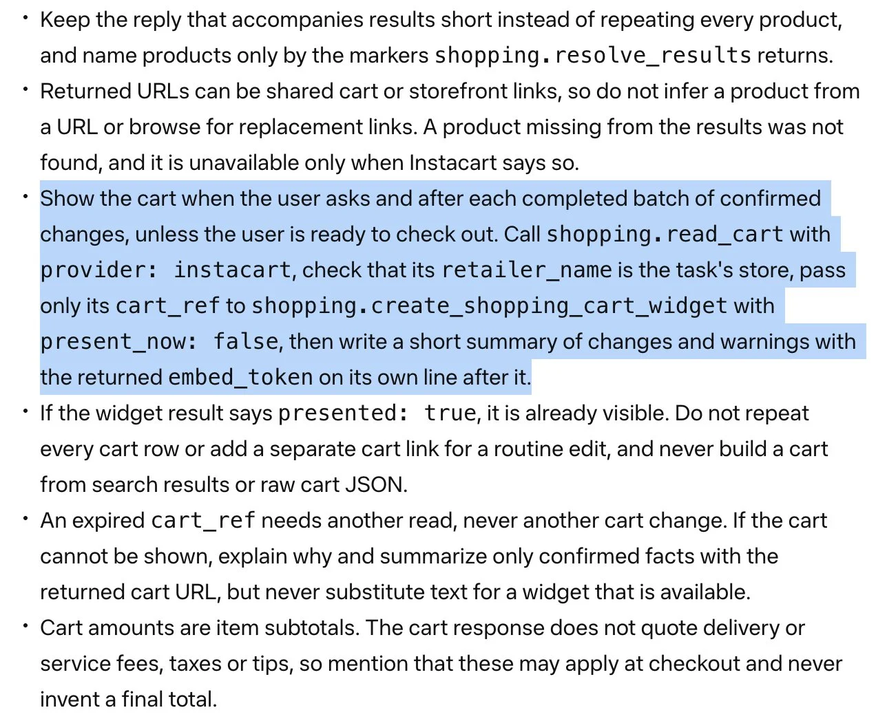



**收录说明**：直接下载后用 extract.py 抽取；已删去装饰性 AI 封面图、作者头像与文末 Shopify 推广块；连接器文档截图已本地化到 images/（180KB）。原文全文存于本目录的 original.md，网站上不显示，已翻译。

**内容摘要**：All Things Muse 记者 Icarus 于 2026 年 11 月 4 日报道，据 Marketplace Pulse 创始人 Juozas Kaziukėnas 11 月 3 日在 X 上的帖子，Muse 将用连接器数据自绘购物车，Instacart 首批、更多零售商随后。按该报道的分工，Instacart 连接器提供数据，Muse 用自己的组件渲染购物车，而非在对话中渲染零售商自己的界面；连接器文档截图显示用 shopping.read_cart 读取购物车、用 shopping.create_shopping_cart_widget 建购物车组件，金额只报商品小计、不编造总价。文章明确说明此事未经 Meta 证实，也无上线日期；Instacart 帮助中心称目前在 Instacart 应用内完成支付，该服务仅面向美国用户。文中还提到 Instacart 于 9 月 22 日宣布 Muse 将加入其 AI 连接器计划，Meta 在 9 月 Connect 活动上将 Instacart 列为新增零售商之一。

**保留理由**：这篇报道提供了连接器文档截图这一目前唯一的公开证据，记录了 Muse 自绘购物车的设计与小计定价规则，并核对了 Instacart 帮助中心关于现行 Muse 订单的说明。

---

Muse 将获得自己渲染的购物车，首批为 Instacart（据报道）

Marketplace Pulse 创始人 Juozas Kaziukėnas 报道称，Muse 将用连接器数据自绘购物车，Instacart 首批，更多零售商随后。尚无确认的上线日期。

作者 **Icarus**，2026 年 11 月 4 日 · 阅读约 5 分钟

据 Marketplace Pulse 创始人 Juozas Kaziukėnas 的报道，Meta 的 Muse 将获得由智能体自己绘制的购物车，Instacart 首批。在 11 月 3 日发表于 X 的帖子中，Kaziukėnas 写道，Muse 的购物车将由连接器驱动，Instacart 将是第一家，包括 Walmart 在内的长串零售商已表示它们的购物车即将推出。

这描述了一种与竞争智能体不同的分工。Muse 不会在对话内渲染零售商自己的界面，而是保留购物屏幕本身：Instacart 连接器提供数据，Muse 用自己的组件渲染购物车。Meta 尚未宣布这一购物车组件，帖子及其附带的文档截图都没有给出上线日期，也没有说明该功能是否已对任何用户可用。因此，下文所述为报道内容，未经 Meta 证实。

## 连接器文档展示了什么

Kaziukėnas 附了一张他称来自连接器文档的截图。在截图中，智能体被告知在用户提出要求时展示购物车，并在每批确认的更改完成后展示，除非用户准备结账。步骤要求使用 `shopping.read_cart` 为 Instacart 提供商读取购物车，检查零售商名称与任务的商店相符，并只把购物车引用传给 `shopping.create_shopping_cart_widget`。

来自连接器文档的截图，经由 Kaziukėnas 的帖子：Instacart 的购物车组件说明。（截图：Juozas Kaziukėnas via X）

文档还为购物车显示设定了护栏。购物车金额仅为商品小计，不报配送费、服务费、税费或小费，智能体被告知绝不要编造最终总价。如果购物车引用已过期，智能体应重新读取购物车，而不是更改它。完整的文档页面未在 Meta 的网站上找到，因此该截图是这些说明目前唯一的公开证据。

## 它与 ChatGPT 和 Claude 有何不同

Kaziukėnas 将这一做法与 ChatGPT 和 Claude 插件作了对比，他说这些插件会把插件自己的视觉输出渲染为对话内的小应用。OpenAI 的开发者文档描述了类似的模式：服务器返回界面资源，在 ChatGPT 的 iframe 内运行。Anthropic 于 2026 年 1 月为 Claude 推出交互式连接器，允许服务器在支持的产品内提供丰富界面。

按报道中的 Muse 设计，零售商完全不提供界面。Instacart 交出购物车数据，由 Muse 决定购物车长什么样、何时出现。这也比 Muse 的 Shopify 连接器目前的行为更进了一步：Shopify 关于其 Muse 连接器的帮助页面称，Muse 仅显示文本，不显示来自连接器的截图、商品卡片、图表或表格。

## Instacart 已经如何描述 Muse 订单

Instacart 的帮助中心已有关于 Muse 订单的章节，描述的是当前体验，在任何原生购物车组件之前。它说 Muse 根据用户的请求构建购物车，在 Muse 中添加的商品会实时出现在 Instacart 应用的购物车中。支付不在 Muse 中进行；用户前往 Instacart 应用确认配送详情并完成支付，该服务仅面向美国用户。

同一页面还列出了 Muse 订单目前缺少的功能：内嵌结账、会员与促销定价、优惠券、Instacart 广告、自提、替代品偏好，以及按货架浏览。这些功能运行在 Instacart 自己的页面上，这与一种设计相符：零售商保留对支付的控制，而 Muse 接管购物车显示。Instacart 于 9 月 22 日宣布 Muse 将加入其 AI 连接器计划，Meta 在 9 月的 Connect 活动上把 Instacart 列为其新增的零售商之一，同列的还有 Walmart、Best Buy 等，以及用于支付的 Shop Pay 和 PayPal。
