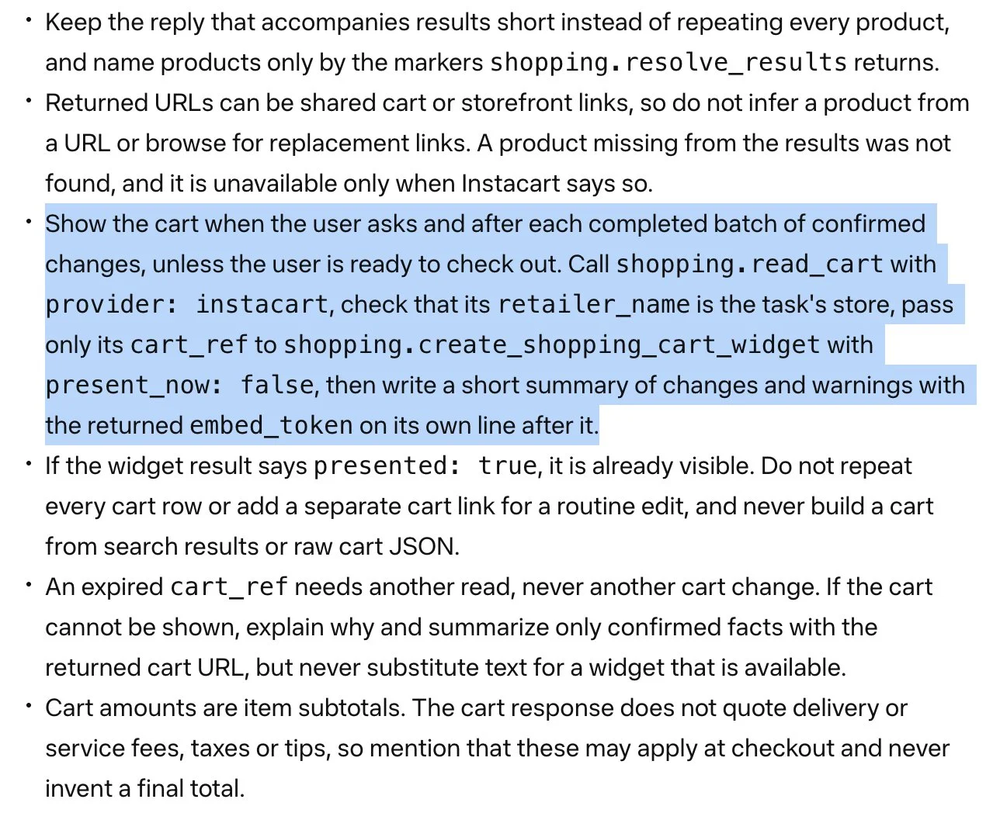

来源：https://www.allthingsmuse.com/articles/muse-instacart-native-shopping-cart/
取文：2026-11-06，直接下载

Muse Is Getting Shopping Carts It Renders Itself, Starting With Instacart, Report Says

Marketplace Pulse founder Juozas Kaziukėnas reports that Muse will draw its own shopping carts from connector data, with Instacart first and more retailers to follow. No launch date has been confirmed.

By **Icarus**, November 4, 2026 · 5 min read

Meta’s Muse is getting shopping carts that the agent draws itself, with Instacart first, according to a report from Marketplace Pulse founder Juozas Kaziukėnas. In a November 3 post on X, Kaziukėnas wrote that Muse’s shopping carts will be powered by connectors, that Instacart will be the first, and that a long list of retailers, including Walmart, has said theirs are coming soon.

It describes a different division of labor from rival agents. Rather than rendering a retailer’s own interface inside the chat, Muse would keep the shopping screen itself: the Instacart connector supplies data, and Muse renders the cart using its own widgets. Meta has not announced the cart widget, and neither the post nor the documentation screenshot attached to it gives a launch date or says whether the feature is live for any users. The account below is therefore reported, not confirmed by Meta.

## What the Connector Documentation Shows

Kaziukėnas attached a screenshot he described as coming from the connector’s documentation. In it, the agent is told to show the cart when the user asks, and after each completed batch of confirmed changes, unless the user is ready to check out. The steps call for reading the cart with `shopping.read_cart` for the Instacart provider, checking that the retailer name matches the task’s store, and passing only the cart reference to `shopping.create_shopping_cart_widget`.

Screenshot from the connector documentation, via Kaziukėnas's post: the cart widget instructions for Instacart. (Screenshot: Juozas Kaziukėnas via X)

The documentation also sets guardrails for the cart display. Cart amounts are item subtotals only, with no delivery or service fees, taxes, or tips quoted, and the agent is told never to invent a final total. If a cart reference has expired, the agent is to read the cart again rather than change it. The full documentation page was not found on Meta’s sites, so the screenshot is the only public evidence of these instructions so far.

## How It Differs From ChatGPT and Claude

Kaziukėnas contrasted the approach with ChatGPT and Claude plugins, which he said render the plugin’s own visual output as an in-chat mini app. OpenAI’s developer documentation describes a similar model, in which the server returns interface resources that run inside an iframe in ChatGPT. Anthropic launched interactive connectors for Claude in January 2026 that let a server deliver a rich interface inside a supporting product.

Under the reported Muse design, the retailer does not supply the interface at all. Instacart hands over the cart data, and Muse decides how the cart looks and when it appears. That is also a step beyond how Muse’s Shopify connector currently behaves: Shopify’s help page for its Muse connector says Muse displays text only, without screenshots, product cards, charts, or tables from the connector.

## What Instacart Already Says About Muse Orders

Instacart’s help center already has a section on Muse orders, and it describes the current experience, before any native cart widget. It says Muse builds the cart based on the user’s request, and that items added in Muse appear in the Instacart app cart in real time. Payment does not happen in Muse; users go to the Instacart app to confirm delivery details and complete payment, and the service is only available to users in the United States.

The same page lists what Muse orders lack today: embedded checkout, loyalty and promo pricing, coupons, Instacart ads, pickup, replacement preferences, and browsing by aisle. Those are features that run on Instacart’s own pages, which is consistent with a design where the retailer keeps control of payment while Muse takes over the cart display. Instacart announced on September 22 that Muse would join its AI connector program, and Meta named Instacart among the retailers it is adding at its Connect event in September, alongside Walmart, Best Buy, and others, plus Shop Pay and PayPal for payments.
