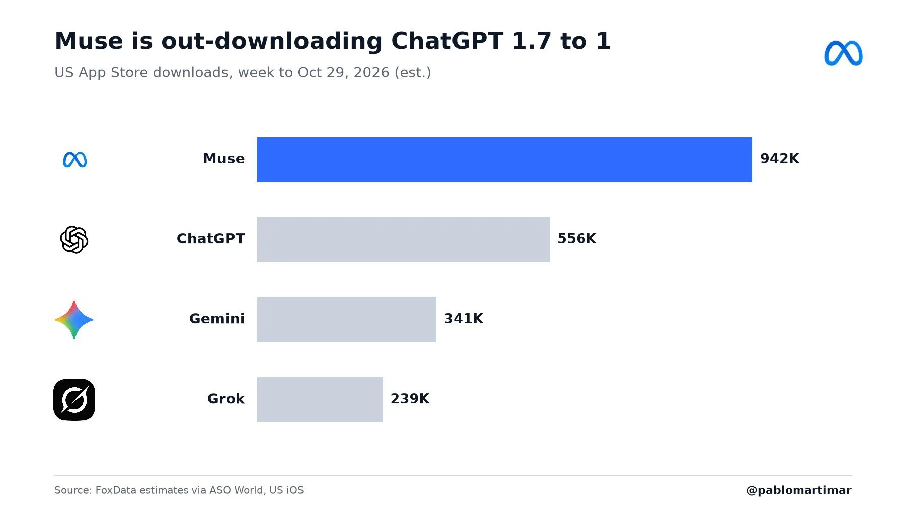



**收录说明**：直接下载后用 extract.py 抽取；删去页首标签、作者头像、首图插画与文末「Earlier coverage」站内推荐；文中一张下载量对比图表已本地化到 images/（37KB）。数据为 FoxData 第三方预估、经 ASO World 印证，非 Meta 官方口径，文中已注明。原文全文存于本目录的 original.md，网站上不显示，已翻译。

**内容摘要**：11 月 4 日，Meta AI 负责人 Alexandr Wang 转发 Pablo Marti 的图表：截至 10 月 29 日当周，美国 App Store 预估下载量 Muse 为 942,000 次、ChatGPT 为 556,000 次，约 1.7:1，Gemini 341,000 次、Grok 239,000 次，Wang 本人未附加文字。上述数字为 FoxData 的第三方预估，经 ASO World 的文章印证（941,563 次对 556,033 次），并非 Meta 官方公布的数据。该对比仅限苹果美国商店：同一周美国 Google Play 仍是 ChatGPT 领先（509,758 次）；同一图表还显示 Muse 在日本 Productivity 类排名第一、领先 ChatGPT。背景数字：Muse 于 9 月 8 日在美国上线，首日约 60,789 次下载，10 月 17 日达到迄今峰值 175,705 次；Meta 第三季度财报电话会称美加已有超 1000 万人开通 Muse agent，Sensor Tower 估计上线首 40 天美国下载量为 1020 万次；Sensor Tower 留存数据显示 Muse 次日回访率接近 ChatGPT 的两倍，但到第 14 天回落至第二。

**保留理由**：本篇提供了 Muse 与 ChatGPT 下载量的首个第三方周度对比数据点（约 1.7:1，截至 10 月 29 日当周），并同时给出 Google Play 的反向格局与留存数据，补充了财报电话会 1000 万用户口径之外的第三方市场表现。

---

## 上周 Muse 在美国 App Store 下载量以 1.7 比 1 超过 ChatGPT，预估数据显示

Meta AI 负责人 Alexandr Wang 转发了一张图表，显示截至 10 月 29 日当周 Muse 在美国 App Store 的预估下载量为 942,000 次，ChatGPT 为 556,000 次，Gemini 和 Grok 更靠后。这些数字是第三方预估，不是 Meta 自己的统计。

Meta AI 负责人 Alexandr Wang 于 11 月 4 日[转发了一项新的下载量对比](https://x.com/alexandr_wang/status/2118039956346306850)，该对比显示 Muse 在苹果美国 App Store 上明显领先 ChatGPT。Wang 引用转发了 [Pablo Marti 的一张图表](https://x.com/pablomartimar/status/2118001325367562358)，图表显示截至 10 月 29 日当周 Muse 在美国 App Store 的预估下载量为 942,000 次，ChatGPT 为 556,000 次，比例约为 1.7 比 1。Gemini 以 341,000 次紧随其后，Grok 为 239,000 次。Wang 本人未附加文字。图表标题为「Muse is out-downloading ChatGPT 1.7 to 1」。

截至 2026 年 10 月 29 日当周美国 App Store 预估下载量：Muse 942K、ChatGPT 556K、Gemini 341K、Grok 239K。（图表：Pablo Marti via X；数据来源：FoxData 预估，经由 ASO World）

该对比只覆盖一周，即 Muse 于 9 月 8 日在美国上线八周之后。同一张图表显示 Muse 在日本 Productivity 类别排名第一，领先 ChatGPT，延续了已遍及其四个市场的登顶走势。

## 第二个来源印证了相同数字

应用商店分析文章 [ASO World](https://marketingtrending.asoworld.com/en/news/muse-from-meta-out-downloaded-chatgpt-on-the-us-app-store-the-ai-assistant-scoreboard-october-2026/)使用 FoxData 的预估报道了同一周：Muse 为 941,563 次下载，ChatGPT 为 556,033 次，Muse 在美国 App Store 免费 Productivity 应用中排名第一。两个几乎相同的总数来自一篇引用同一家预估公司的独立文章，这使该对比比单条社交帖子更有分量。

这些预估仍有局限。它们是第三方预估，不是 Meta 公布的数字，而且只覆盖苹果美国 App Store。在美国 Google Play 上，情况不同：ASO World 报道 ChatGPT 仍以当周 509,758 次下载领先，Gemini 在两个商店都排第三。1.7 比 1 的标题只覆盖苹果美国商店，而非全部应用下载。

FoxData 的每日数据为该周补充了细节。据 ASO World，Muse 的美国上线日 9 月 8 日吸引了约 60,789 次下载，其美国迄今峰值出现在 10 月 17 日，为 175,705 次，六周内增长约 2.9 倍。

## 下载领先的背景

这些周度数字承接了 Muse 上线以来的一连串下载里程碑。在 Meta 第三季度财报电话会上，首席执行官 Mark Zuckerberg 表示，在上线约六周内，美国和加拿大已有超过 1000 万人设置了 Muse 智能体；Sensor Tower 估计该应用在美国上线头 40 天的下载量为 1020 万次。此前的报道显示，Muse 在其全部四个市场——美国、加拿大、日本和新加坡——的 iPhone 免费榜上都排在 ChatGPT 之上，而[财报电话会报道](/articles/muse-10m-users-earnings-call/)把购物、而非聊天，置于人们实际使用该智能体的核心。

不过，下载量衡量的是好奇心而非习惯。[此前报道的 Sensor Tower 留存数据](/articles/muse-retention-wins-day-one-fades-by-day-14/)显示，Muse 在安装次日的用户回访率接近 ChatGPT 的两倍，但到第 14 天回落至第二。新的周度预估无法说明上周下载 Muse 的人本周是否仍在使用它，而 Meta 自己公开的数字仍是财报电话会上的 1000 万用户。
