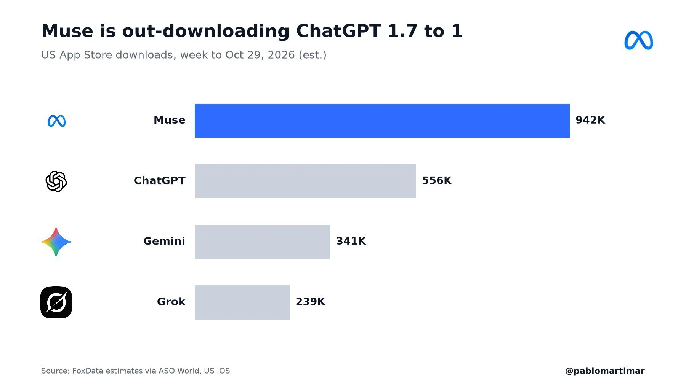

来源：https://www.allthingsmuse.com/articles/muse-out-downloads-chatgpt-week-october-29/
取文：2026-11-07，直接下载

## Muse Out-Downloaded ChatGPT 1.7 to 1 on the US App Store Last Week, Estimates Show

Meta AI chief Alexandr Wang amplified a chart showing Muse at an estimated 942,000 US App Store downloads in the week to October 29, against 556,000 for ChatGPT, with Gemini and Grok further back. The figures are third-party estimates, not Meta's own count.

Meta AI chief Alexandr Wang [amplified a new download comparison](https://x.com/alexandr_wang/status/2118039956346306850) on November 4 that puts Muse well ahead of ChatGPT on Apple’s US App Store. Wang quote-posted a [chart from Pablo Marti](https://x.com/pablomartimar/status/2118001325367562358) showing Muse at an estimated 942,000 US App Store downloads in the week to October 29, against 556,000 for ChatGPT, a ratio of about 1.7 to 1. Gemini followed at 341,000 and Grok at 239,000. Wang added no text of his own. The chart’s title reads “Muse is out-downloading ChatGPT 1.7 to 1.”

Estimated US App Store downloads for the week to October 29, 2026: Muse 942K, ChatGPT 556K, Gemini 341K, Grok 239K. (Chart: Pablo Marti via X; source: FoxData estimates via ASO World)

The comparison covers a single week, eight weeks after Muse launched in the United States on September 8. The same chart puts Muse at No. 1 in Productivity in Japan, ahead of ChatGPT, extending a chart-topping run that has already carried across all four of Muse’s markets.

## A Second Source Backs the Same Figures

App-store analytics writeup [ASO World](https://marketingtrending.asoworld.com/en/news/muse-from-meta-out-downloaded-chatgpt-on-the-us-app-store-the-ai-assistant-scoreboard-october-2026/) reports the same week using FoxData estimates: 941,563 downloads for Muse against 556,033 for ChatGPT, with Muse at No. 1 among free Productivity apps on the US App Store. The near-identical totals, from a separate writeup citing the same estimates firm, give the comparison more weight than a single social post would carry on its own.

The estimates still have limits. They are third-party estimates, not figures Meta has published, and they cover Apple’s US App Store only. On Google Play in the United States, the picture is different: ASO World reports ChatGPT still leading there at 509,758 downloads for the week, with Gemini third on both stores. The 1.7-to-1 headline covers Apple’s US store only, not all app downloads.

FoxData’s daily figures add detail to the week. Muse’s US launch day, September 8, drew about 60,789 downloads, and its US peak so far came on October 17 at 175,705, a climb of roughly 2.9 times in six weeks, according to ASO World.

## The Download Lead in Context

The weekly figures follow a run of download milestones from Muse’s launch. On Meta’s third-quarter earnings call, chief executive Mark Zuckerberg said more than 10 million people in the United States and Canada had set up Muse agents within about six weeks of launch, and Sensor Tower estimated 10.2 million US downloads in the app’s first 40 days. Earlier coverage showed Muse ranking above ChatGPT on the iPhone free chart in all four of its markets, the United States, Canada, Japan, and Singapore, and [the earnings-call story](/articles/muse-10m-users-earnings-call/) put shopping, not chat, at the center of how people actually use the agent.

Downloads, though, measure curiosity rather than habit. [Sensor Tower retention data reported earlier](/articles/muse-retention-wins-day-one-fades-by-day-14/) showed Muse bringing users back the day after install at nearly twice ChatGPT’s rate, then fading to second by day 14. The new weekly estimates say nothing about whether the people downloading Muse last week are still using it this week, and Meta’s own public number remains the 10-million-user figure from the earnings call.
