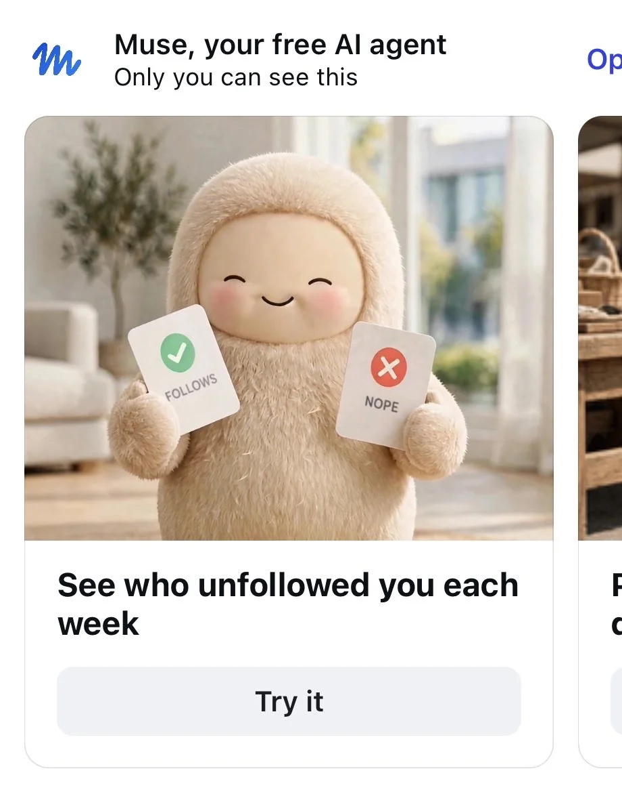



**收录说明**：直接下载。去掉了首图 Jolly 插画与文末「Earlier coverage」栏目；广告截图已本地化。Business Insider 原文为付费墙、未能读取，本篇为二手报道；其文内来源链接指向 biztoc 转载页，BI 原文地址未核实。原文全文存于本目录的 original.md，网站上不显示，已翻译。

**内容摘要**：Business Insider 于 10 月 29 日报道，Meta 在 Instagram 投放了一则 Muse 广告，称该智能体可每周告知用户谁取消关注了自己，随后在该媒体问询后撤下；Meta 发言人向 Business Insider 确认广告已被撤下，不再出现在 Meta 广告库中。广告由营销通讯 Link in Bio 作者 Rachel Karten 于 10 月 24 日发现并发布，约在 Business Insider 报道前一周；据该媒体描述，广告中 Muse 的毛茸茸吉祥物手持红绿卡片，风格类似约会应用，敦促人们下载 Muse 查看每周取消关注者。Instagram 从未提供查看谁取消关注的内置功能，其负责人 Adam Mosseri 曾解释，公司希望人们能放心地取消关注而不必担心对方发现；Muse 的广告承诺与这一立场形成反差。据 Business Insider 报道，Muse 只能从开始追踪起监测 Instagram 粉丝名单变化，无法回溯识别追踪开始前谁取消了关注，因此广告承诺实际只限于未来取消关注的每周更新。文章指出，撤下广告并未改变实质：Muse 保留了追踪能力，Instagram 仍反对取消关注功能，改变的只是营销层面。

**保留理由**：记录了 Meta 因一则承诺查看 Instagram 取消关注者的广告而撤广告的具体事件，以及 Muse 只能前向追踪、不能回溯这一关键限定；同时把事件置于 Muse 处理个人社交数据的既有争议脉络中。

---

Business Insider 于 10 月 29 日报道，Meta 投放了一则 Instagram 广告，称其 Muse 智能体可以每周展示谁取消关注了你，随后又将这则广告撤下……

Meta 在一则为其 Muse 智能体投放的 Instagram 广告经 Business Insider 问询后将其撤下，该媒体[于 10 月 29 日报道](https://biztoc.com/x/9915d4d7d58cc6b3)。这则广告承诺，Muse 可以每周向用户展示谁在 Instagram 上取消关注了他们，而这一功能正是 Instagram 长期拒绝开发的。Meta 发言人向 Business Insider 确认，该广告已被撤下，不再活跃于 Meta 的广告库中。

这则广告由撰写营销通讯 Link in Bio 的 Rachel Karten 发现。Karten 于 10 月 24 日发布了相关内容，比 Business Insider 的报道早了约一周。据该媒体的描述，广告中 Muse 毛茸茸的吉祥物手持红色和绿色卡片，风格类似约会应用，敦促人们下载 Muse，查看每周是谁取消关注了自己。

被撤下的广告，由 Karten 发现：Muse 的吉祥物手持「FOLLOWS」与「NOPE」卡片，承诺每周的取消关注更新。（截图：[Rachel Karten via X](https://x.com/milkkarten/status/2114070590097412410)）

## Instagram 刻意回避的一项功能

Instagram 从未提供查看谁取消关注了你的内置方式，其管理层也表示公司选择不开发这一功能。Instagram 负责人 Adam Mosseri 曾在问答环节中解释，公司希望人们能安心取消关注自己不再感兴趣的账号，而不必担心对方会发现。而一则承诺由 Meta 旗下产品 Muse 提供同样信息的广告，与这一立场显得颇为别扭。

据 Business Insider 报道，Muse 可以监测 Instagram 粉丝名单的变化，但只能从此以后向前追踪。该智能体无法回溯识别在追踪开始之前是谁取消关注了某个账号。因此，广告的承诺比听起来要有限：只提供未来取消关注的每周更新。

## 为何重要

这一事件捕捉到一种张力，随着 Muse 接入更多 Meta 自家平台，这种张力将持续伴随它。该智能体被设计为跨用户的各类应用与账号工作，而 Instagram 正是它可以连接的账号之一。这意味着 Muse 可以呈现 Instagram 自己选择不展示的信息，而一场广告活动曾短暂地把这一点当作卖点。

撤下广告并未改变这一等式的任何一边。Muse 保留追踪能力，Instagram 保留其反对取消关注功能的立场。改变的只是营销：Meta 不再为两者之间的落差做广告。

Muse 对个人社交数据的处理此前已引发审视。[Muse 会为用户生活中的联系人建立档案](/articles/muse-relationship-dossiers/)，从已连接的账号汇编家人和朋友的信息页，而 Hunterbrook 此前曾展示该智能体[按请求汇编来自 Facebook 和 Instagram 的私人个人名单](/articles/muse-hunterbrook-doxxing/)。取消关注广告是同一模式中较小的一例：一个智能体能看到比社交网络本身愿意展示的更多关于用户社交图谱的信息，而一家公司仍在决定要把这一点说得多大声。
