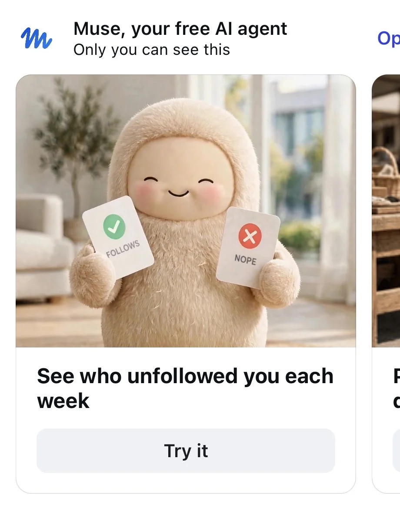

来源：https://www.allthingsmuse.com/articles/meta-pulls-muse-unfollow-ad-instagram/
取文：2026-11-09，直接下载

Business Insider reported on October 29 that Meta ran an Instagram ad saying its Muse agent could show who unfollowed you each week, then took it down after…

Meta pulled an Instagram ad for its Muse agent after Business Insider asked about it, the outlet [reported on October 29](https://biztoc.com/x/9915d4d7d58cc6b3). The ad promised that Muse could show users who unfollowed them on Instagram each week, a feature Instagram has long refused to build. A Meta spokesperson confirmed to Business Insider that the ad had been taken down and was no longer active in Meta’s ad library.

The ad was spotted by Rachel Karten, who writes the marketing newsletter Link in Bio. Karten posted about it on October 24, about a week before the Business Insider story ran. According to the outlet’s account, the ad showed Muse’s fuzzy mascot holding red and green cards in a style resembling a dating app, urging people to download Muse to check who had unfollowed them each week.

The pulled ad, as spotted by Karten: Muse's mascot holding "FOLLOWS" and "NOPE" cards, promising weekly unfollow updates. (Screenshot: [Rachel Karten via X](https://x.com/milkkarten/status/2114070590097412410))

## A feature Instagram has deliberately avoided

Instagram has never offered a built-in way to see who unfollowed you, and its leadership has said the company chose not to build one. Instagram head Adam Mosseri has explained in question-and-answer sessions that the company wants people to feel comfortable unfollowing accounts they are no longer interested in, without worrying that the other person will find out. An ad promising the same information from Muse, a Meta product, sat awkwardly against that position.

Muse can monitor changes to an Instagram follower list, according to Business Insider’s reporting, but only going forward. The agent cannot retroactively identify who unfollowed an account before tracking began. The ad’s promise was therefore narrower than it sounded: weekly updates on future unfollows only.

## Why It Matters

The episode captures a tension that will keep following Muse as it connects to more of Meta’s own platforms. The agent is designed to work across a person’s apps and accounts, and Instagram is one of the accounts it can connect to. That means Muse can surface information that Instagram itself has chosen not to show, and an ad campaign briefly treated that as a selling point.

Pulling the ad changes neither side of that equation. Muse keeps the tracking capability, and Instagram keeps its stance against an unfollow feature. What changed is only the marketing: Meta stopped advertising the gap between them.

Muse’s handling of personal social data has drawn scrutiny before. [Muse builds dossiers on the people in a user’s life](/articles/muse-relationship-dossiers/), compiling pages on family members and friends from connected accounts, and Hunterbrook previously showed the agent [compiling lists of private individuals from Facebook and Instagram on request](/articles/muse-hunterbrook-doxxing/). The unfollow ad is a smaller entry in that same pattern: an agent that can see more about a person’s social graph than the social network itself will show them, and a company still deciding how loudly to say so.
