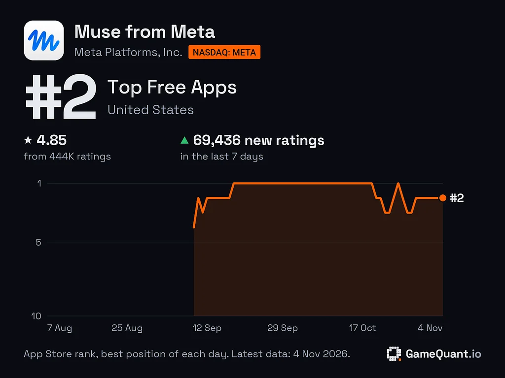



**收录说明**：直接下载。去掉了首图 Jolly 插画与文末「Earlier coverage」栏目；GameQuant 榜单图已本地化。GameQuant 的 Medium 原文直接下载失败、Wayback 无快照，故收本篇转述。原文全文存于本目录的 original.md，网站上不显示，已翻译。

**内容摘要**：GameQuant Research 于 11 月 5 日公布的日排名数据显示，Muse 自 9 月 18 日至 10 月 19 日连续 32 天位居美国 App Store 免费应用榜第一。Muse 于 9 月 9 日（上线次日）首次上榜即排第 4，9 天后登顶；10 月 19 日连冠结束后仍居前列，10 月 25 日重回第一，11 月 1 日排第 2，ChatGPT 排第 3；11 月 1 日当天 Muse 在日本、新加坡和加拿大仍排第一。截至 11 月 1 日，Muse 在美国已有 415,933 条评分，其中 73,302 条来自此前 7 天，平均每天逾 1 万条，是该公司追踪的 Productivity 应用中第二高的周评分增速。GameQuant 估计 Muse 9 月在美国的下载量在 390 万至 1800 万次之间，区间很宽，Meta 未公布自己的下载总量；Meta 在 10 月 21 日财报电话会上称，上线 6 周内已有逾 1000 万美国与加拿大用户设置了 Muse。截至 10 月 29 日的一周，Muse 在美国 App Store 的下载量为 942,000 次，ChatGPT 为 556,000 次，据 ASO World 报道的 FoxData 估计。

**保留理由**：提供了 GameQuant 的逐日榜单数据与评分、下载量估计，把 Muse 上线后的热度从单日新闻扩展为 32 天连冠及此后与 ChatGPT 交替领先的持续轨迹，并附有美国以外三国的榜单位置。

---

GameQuant 的每日 App Store 数据显示，Muse 从 9 月 18 日到 10 月 19 日每天都位居美国免费应用榜首位，随后与……交替占据榜首。

根据 [GameQuant Research](https://medium.com/@gamequantio/metas-muse-held-1-on-the-us-app-store-for-32-days-here-is-what-the-chart-shows-bf060b130b1f) 11 月 5 日发布的每日排名数据，Muse 从 9 月 18 日到 10 月 19 日连续 32 天位居美国 App Store 免费应用榜第一。这款助手于 9 月 9 日（上线次日）首次出现在榜单上，位列第 4，并在九天后升至第一。

Muse 的每日 App Store 排名，2026 年 8 月至 11 月：9 月中旬攀升至第 1，连续 32 天保持，10 月下旬降至第 2。（图表：GameQuant Research via Medium）

这一连冠于 10 月 19 日结束，但 Muse 仍保持在榜首附近。GameQuant 的数据显示，此后数周它与 ChatGPT 在榜首交替，10 月 25 日重回第 1，11 月 1 日位列第 2，ChatGPT 位列第 3。在美国以外，它仍处于领先。11 月 1 日，Muse 在日本、新加坡和加拿大排名第一。

## 评分持续涌入

如果评分能说明问题，那么排名背后的安装量仍在快速增长。GameQuant 报告称，截至 11 月 1 日，Muse 在美国已有 415,933 条评分，其中 73,302 条来自此前七天，平均每天超过 10,000 条。这是该公司追踪的所有 Productivity 应用中第二高的周评分速度。

只有一小部分用户会留下评分，因此这一速度表明其用户群仍在快速增长。

## 数字说明了什么

GameQuant 估计，Muse 9 月在美国的下载量在 390 万至 1800 万次之间。该公司明确指出这一区间很宽，而 Meta 未公布自己的下载总量。

榜单排名反映安装量。收入与活跃用户数是另外的指标。Meta 自己的数字来自其 10 月 21 日的财报电话会：在美国和加拿大，已有超过 1000 万人在上线六周内设置了 Muse。榜单数据提供了另一种证据。上线时的激增很常见，但在免费应用榜首位保持一个月、随后仍留在前两名，是一款在新闻周期过去后仍被人们持续安装的应用的模式。

同样的模式也体现在下载量上。根据 [ASO World 报道的 FoxData 估计](https://marketingtrending.asoworld.com/en/news/muse-from-meta-out-downloaded-chatgpt-on-the-us-app-store-the-ai-assistant-scoreboard-october-2026/)，在截至 10 月 29 日的一周，Muse 从美国 App Store 被下载 942,000 次，而 ChatGPT 为 556,000 次。
