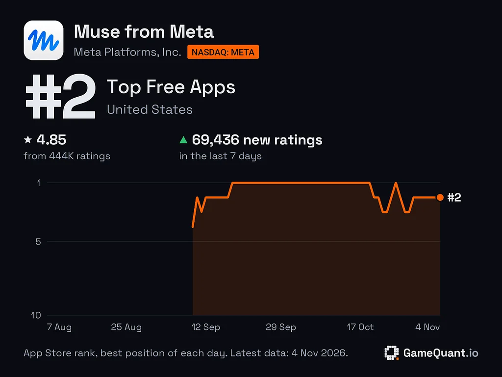

来源：https://www.allthingsmuse.com/articles/muse-32-days-top-us-app-store/
取文：2026-11-09，直接下载

Daily App Store data from GameQuant shows Muse topped the US free-apps chart every day from September 18 to October 19, then kept trading the top spot with…

Muse held the No. 1 spot on the US App Store’s Top Free Apps chart for 32 consecutive days, from September 18 to October 19, according to daily rank data published November 5 by [GameQuant Research](https://medium.com/@gamequantio/metas-muse-held-1-on-the-us-app-store-for-32-days-here-is-what-the-chart-shows-bf060b130b1f). The assistant first appeared on the chart at No. 4 on September 9, the day after launch, and reached No. 1 nine days later.

Muse's daily App Store rank, August to November 2026: the climb to No. 1 in mid-September, the 32-day hold, and the late-October dip to No. 2. (Chart: GameQuant Research via Medium)

The streak ended October 19, but Muse stayed near the top. GameQuant’s data shows it trading places at the top with ChatGPT in the weeks after, returning to No. 1 on October 25 and standing at No. 2 on November 1, with ChatGPT at No. 3. Outside the United States it was still leading. On November 1, Muse was No. 1 in Japan, Singapore, and Canada.

## The Ratings Keep Coming

The installs behind the ranking are still coming fast, if the ratings are any guide. Muse had 415,933 ratings in the US on November 1, GameQuant reports, and 73,302 of them arrived in the seven days before that, more than 10,000 a day. That was the second-highest weekly ratings pace of any Productivity app the firm follows.

Only a small share of users ever leave a rating, so the pace points to a user base still growing quickly.

## What the Numbers Say

GameQuant estimates Muse was downloaded between 3.9 million and 18 million times in the United States in September. The firm is explicit that the range is wide, and Meta has not reported its own download total.

Chart positions track installs. Revenue and active-user counts are separate measures. Meta’s own figure, from its October 21 earnings call, is that more than 10 million people in the United States and Canada had set up Muse within six weeks of launch. The chart data adds a different kind of evidence. A launch spike is common, but holding the top of the free-apps chart for a month, then staying in the top two after it, is the pattern of an app people keep installing after the news cycle moves on.

The same pattern shows up in download counts. In the week to October 29, Muse was downloaded 942,000 times from the US App Store against 556,000 for ChatGPT, according to [FoxData estimates reported by ASO World](https://marketingtrending.asoworld.com/en/news/muse-from-meta-out-downloaded-chatgpt-on-the-us-app-store-the-ai-assistant-scoreboard-october-2026/).
