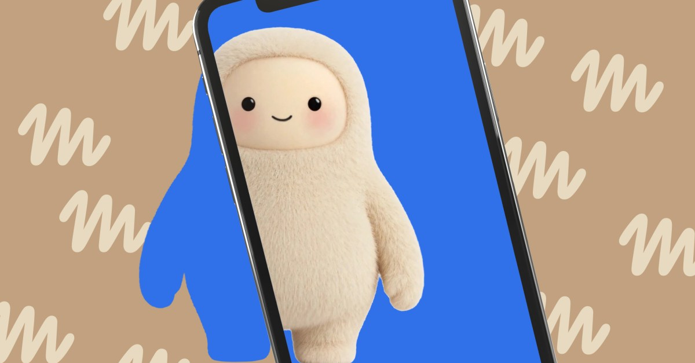
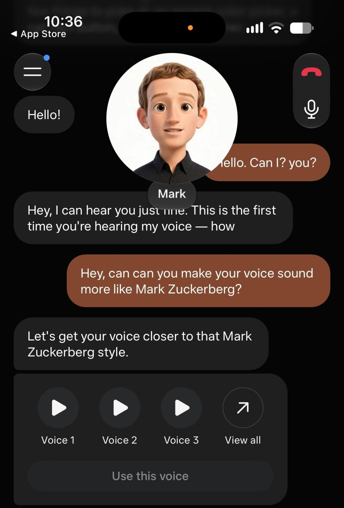



**收录说明**：直接下载。原文地址经检索未果后由浏览器任务在 theverge.com 站内搜索定位；Daily Guardian 的同题转载（2026-11-05T14:19:26-05:00）与原文逐段一致，可作旁证。正文首图与 iOS 截图已下载到本目录的 images/；文末「Follow topics」及相关推荐栏目已去掉；站内相对链接已改为绝对地址。原文全文存于本目录的 original.md，网站上不显示，已翻译。

**内容摘要**：作者在 iOS 应用上试用了 Muse 的实时语音对话：化身位于对话顶部，随说话内容摆动；可直接要求智能体换一种语气，或在化身设置中浏览多种声音选项。语音回应迅速，偶尔会在查信息时停顿；化身动画效果不错，但作者自己的化身略显诡异——他把化身设成扎克伯格的形象以提醒自己在用 Meta 的服务，却无法让声音听起来像扎克伯格。语音与表情化身即日起在美国应用内上线，AI 眼镜版即将推出，年底前发布的 Muse Charm 也将支持。

**保留理由**：一手 iOS 上手实测，是官方公告之外唯一亲自试用过语音模式的媒体记录，补充了回应速度、停顿与化身观感等官方稿没有的细节。

---

## Muse 现在有了语音模式

Muse AI 智能体现在有了声音，以及会在与你聊天时动起来的「表情」化身。

图：The Verge

Meta 现在允许你与 Muse AI 智能体进行实时语音对话，首席执行官 Mark Zuckerberg [今天宣布](https://www.threads.com/@zuck/post/DfXrs6RGonx)。

这项功能已经推送给我，我在写这篇文章时在 iOS 应用上试用了一下。当你与 Muse 智能体聊天时，对话顶部的化身会随着它所说的话同步动起来。你也可以直接告诉智能体你想要什么样的语气，让它自己决定，或者在化身设置中浏览一堆选项来更换声音。

在我短暂的测试中，我的 Muse 智能体通过语音回应很快，不过它在查信息或替我检查某些东西时偶尔会停顿（就像文字聊天查询时那样）。它说出来的动画效果也不错，不过对我这个特定的化身来说，有点诡异。我把 Muse 智能体的化身设成 Mark Zuckerberg 的样子，以此不断提醒自己我正在与 Meta 的服务聊天（我拒绝[被一个 Jolly 迷住！](https://www.theverge.com/column/999999/optimizer-meta-muse-ai-cute)），而看着数字版的 Zuckerberg 仿制品真的和我说话，感觉相当奇怪。我也没法让我的 Muse 智能体的声音听起来完全像 Mark Zuckerberg。

截图：Muse

Muse 的语音模式和表情化身现在正在美国向应用用户推送，[Meta 表示](https://about.fb.com/news/2026/11/introducing-muse-ai-voice-expressive-avatars/)。它们将「很快」登陆 Meta 的 AI 眼镜，也将支持其[即将推出的 Muse Charm 设备](https://www.theverge.com/tech/999750/muse-charm-meta-ai-hardware)，该设备预计今年出货。
