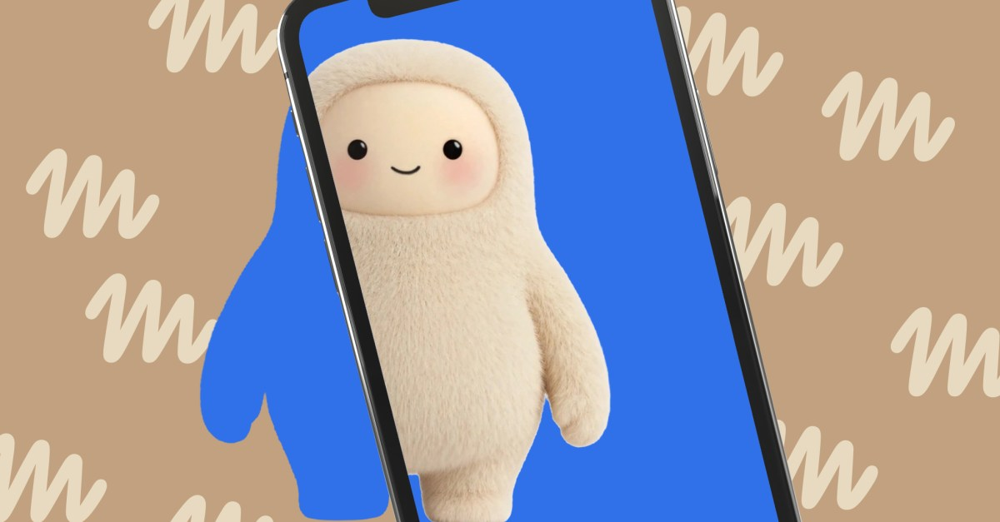
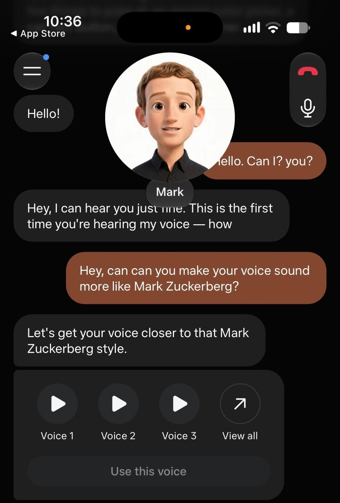

来源：https://www.theverge.com/tech/1028015/meta-muse-ai-voice-mode-expressive-avatar
取文：2026-11-05，直接下载

## Muse has a voice mode now

Muse AI agent now has voices and ‘expressive’ avatars that animate while chatting with you.

Image: The Verge

Meta now lets you have voice conversations with your Muse AI agent in real time, CEO Mark Zuckerberg [announced today](https://www.threads.com/@zuck/post/DfXrs6RGonx).

The feature has been rolled out to me, and I gave it a spin on the iOS app while writing this article. As you chat with your Muse agent, the avatar at the top of your conversation animates in time with the words that it’s saying. You can also change the tone of the voice by just asking your agent about what you want and letting it decide or by browsing through a bunch of options in the avatar settings.

In my brief tests, my Muse agent responds quickly over voice, though it occasionally pauses while it’s looking up information or checking something for me (like it would with a text chat query). It also animates what it’s saying well, though for my particular avatar, it’s been a little uncanny. I set my Muse agent’s avatar to look like Mark Zuckerberg as a constant reminder that I’m chatting with a Meta service (I refuse to be [charmed by a Jolly!](https://www.theverge.com/column/999999/optimizer-meta-muse-ai-cute)), and seeing the digital Zuckerberg facsimile actually talk with me is quite weird. I also can’t get my Muse agent’s voice to sound exactly like Mark Zuckerberg.

Screenshot: Muse

Muse’s voice mode and expressive avatars are rolling out now in the US for the app, [Meta says](https://about.fb.com/news/2026/11/introducing-muse-ai-voice-expressive-avatars/). They’re coming “soon” for Meta’s AI glasses and will also be available for its [forthcoming Muse Charm gadget](https://www.theverge.com/tech/999750/muse-charm-meta-ai-hardware), which is supposed to ship this year.
