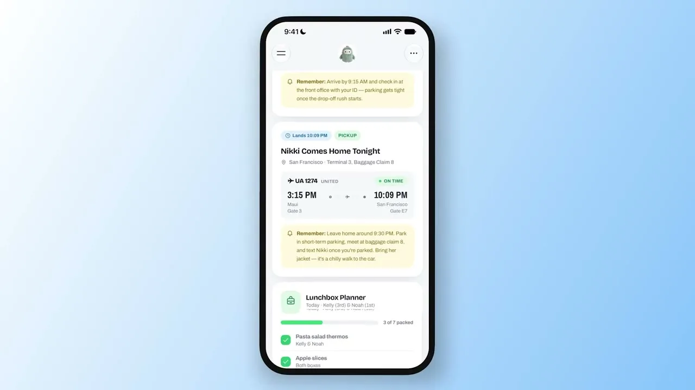



**收录说明**：直接下载。去掉了首图 Jolly 插画与文末「The announcement」栏目；两段演示视频以占位行保存（视频地址为 allthingsmuse 站内转存的 Meta 演示视频），家庭仪表盘截图已本地化到 images/。原文全文存于本目录的 original.md，网站上不显示，已翻译。

**内容摘要**：Meta 在 Muse 应用内上线 Spaces，并发布三段演示视频，展示从聊天中的一句话描述到完成仪表盘的过程。约 90 秒的主演示由产品设计师 Alex Cornell 演示：家庭仪表盘汇总当日活动、接送与日历，并有午餐盒计划，画面中一班从毛伊岛飞往旧金山的 UA 1274 航班于晚上 10:09 落地，提醒约晚上 9:30 出发，午餐盒清单显示 7 个中已装 3 个；Jolly Mall 则把保存的 Instagram 帖子做成 1995 年秋季邮购目录风格的购物目录，其中一对 Haand 餐盘标价 79.98 美元。另一段 Threads 演示展示花园笔记本：用户要求记录散步时发现的植物，Muse 生成题为“What’s growing out there?”的野外笔记，包含 5 条发现、5 个物种与 5 个地点；扎克伯格则在 X 上说自己做了烧烤游戏、活动追踪器和家庭控制仪表盘。文章还提到，Spaces 上线前一天 Muse 语音已在美国全面推出，分享功能尚未上线，Spaces 目前仅为个人使用；TechCrunch 转述称，扎克伯格在 Meta 10 月财报电话会上说，Muse 在美国与加拿大的用户已达 1000 万，距推出不到两个月。

**保留理由**：逐段拆解了 Spaces 上线演示的具体内容与操作循环，并记录了扎克伯格自用实例与 1000 万用户这一官方口径，可作为 Spaces 首发形态与规模的出处。

---

Meta 的发布视频展示了一个家庭仪表盘、一个复古购物目录，以及一个可按要求自行重排的侧边栏。以下是 Spaces 能做什么、扎克伯格用它做了什么，以及还有什么即将到来。

Meta 今天在 Muse 应用中推出 Spaces，发布同时带来三段演示视频，展示该功能从第一条聊天消息到完成仪表盘的运作过程。视频展示了一个追踪学校接送与午餐盒的家庭仪表盘、一个 1995 年邮购小册子风格的购物目录，以及一个按要求自行重排的侧边栏。它们共同展示了 Space 在实际使用中的样子。

Spaces 是 Muse 内的自定义体验，始于聊天中的一段描述。告诉 Muse 你想要什么——追踪器、计划表或项目看板——它就会构建出第一个版本。这个 Space 随后存在于应用中，位于侧边栏或主标签页，并随着使用不断变化。从今天起，凡是提供 Muse 的地方都可以使用。

[视频：Meta Spaces 演示视频：Alex Cornell 演示家庭仪表盘、Jolly Mall 与周末模式](https://www.allthingsmuse.com/muse-spaces-demo-video.mp4)

Muse 产品设计的 Alex Cornell 讲解了 Spaces：一个家庭仪表盘、一个名为 Jolly Mall 的复古购物目录，以及一个可按要求切换到周末模式的侧边栏。（视频：Meta via X）

## 90 秒演示详解

Muse 账号用一条简短帖子介绍了这段演示：「Spaces 来了。描述一个计划表、一个追踪器、一个游戏，任何你需要的东西，Muse 都会直接把它构建到应用里。把它固定到你的标签页，随时回来，它已经是最新的。」

最长的一段演示由 Muse 账号发布在 X 上，长约 90 秒，跟随 Muse 产品设计的 Alex Cornell 在手机上构建 Spaces。第一个是为名为 Marlo 的用户打造的家庭仪表盘。它汇总了当天的活动、学校接送、日历事项，以及一个追踪哪些孩子已装好午餐的午餐盒计划器。视频中的一帧显示，该仪表盘追踪着一班从毛伊岛飞往旧金山的 UA 1274 航班，晚上 10:09 落地，并提醒约晚上 9:30 从家出发，午餐盒清单显示 7 个中已装 3 个。

视频中的第二个 Space 是 Jolly Mall，它把保存的 Instagram 帖子变成一个 1995 年秋季邮购小册子风格的购物目录，还配有「Mall in the Sky」的刊头。其中一页展示了一对 Haand Diner Mug（手工上釉瓷器），标价 79.98 美元，带有立即购买按钮。随后 Cornell 要求增加一个电影之夜区块，仪表盘便添加了一个，《荒野机器人》（The Wild Robot）被排在周五晚上。

在演示的最后部分，Cornell 输入「请切换到周末模式」，侧边栏便自行重排：聊天、动态、家庭仪表盘、记忆库和苏格兰旅行计划器移到顶部，其余一切归入 Spaces 区块。反过来同样有效：工作日版本把每周计划器放在前面，到周六则换成周末计划。

Meta 演示中的家庭仪表盘在一个视图中追踪回家的航班、学校接送和午餐盒清单。（图片：Meta via X）

## 从一次散步诞生的花园笔记本

发布于 Threads 的 Meta 第二段演示从另一个起点展示了同样的构建流程。一位用户要求创建一个关于散步时发现的植物的 space，包含照片、名称和每种植物的发现地点。Muse 回应「正在构建花园监控器……」，并生成一本题为「外面长着什么？」的野外笔记，包含五条发现、五个物种和五个地点，包括海岸活栎、郊狼灌、西方剑蕨和加州七叶树。随后用户要求增加一个区块，放置尚未识别的植物，界面便添加了一个「未知」筛选标签。演示以一排示例 Space 图标结束：花园笔记本、宠物护理、每周膳食、跑步记录、演唱会追踪器和游戏。

Meta 自己的发布视频展示了同一循环的较短版本。一位用户要求为一次旅行预订周四的开球时间，Muse 便搜索酒店附近的高尔夫球场，找到可预约时段，并把预订添加到苏格兰旅行计划器 space 中。

[视频：Meta Spaces 演示视频（Threads 发布）](https://www.allthingsmuse.com/muse-spaces-thread-video.mp4)

Meta 为 Spaces 制作的动画片头展示 Jolly 用积木搭建一个 space。（视频：Meta via X）

## Space 如何构建

每段演示都展示了同样的四步循环。它从主聊天开始，用平实的描述说明这个 Space 应该做什么，Muse 构建出第一个版本。随后用户通过在聊天中提出改动来完善它——增加区块、改变外观或调整运作方式。最后，Space 有了归宿：固定到侧边栏、移入主标签页、隐藏到需要时再显示，或安排在特定时间出现。

已连接的应用让 Space 保持更新。Meta 称，当 Spaces 与人们已使用的应用关联后，会在后台自行更新，因此新的演唱会日期、价格变化和储蓄进度无需询问就会出现。学校仪表盘会在学校邮件中找到活动并添加到日历。购物中心则把礼物创意、来自 Instagram 收藏的心愿单，以及 Marketplace 的商品列表和买家消息汇集到一个视图中。

## 扎克伯格自己的 Spaces

马克·扎克伯格周五在 X 上发帖谈到这个功能，写道：「最近在 Muse 里玩 spaces——告诉 Muse 你需要什么，它就会构建出来。我做了个烧烤游戏、一个活动追踪器和一个家居控制仪表盘。期待看到你们构建的东西。」他的三个例子处在 Meta 所宣传范围中偏玩乐的一端，也与演示中的模式一致：一个游戏、一个追踪器，以及一个把实时信息汇集到一个视图的仪表盘。

TechCrunch 把 Spaces 描述为围绕特定话题构建的独立会话，位于你与 Muse 智能体交互的侧边栏中。TechCrunch 还提到受众规模：扎克伯格在 Meta 10 月的财报电话会上说，Muse 智能体在美国和加拿大有 1000 万用户，距这些智能体首次亮相还不到两个月。

## 随之而来的，与仍将到来的

Spaces 上线的前一天，[Muse Voice 已在美国全面推出](/articles/muse-voice-video-chat-us-rollout/)，新增了与 Muse 虚拟形象的视频聊天和电话通话。Meta 的博客还表示，其模型的专用版本正陆续推送到 Muse，这些版本使用来自 [Muse Wonder](/articles/muse-specialized-wonder-models/) 的经验训练。

分享是 Meta 唯一尚未推出的部分。Spaces 从一开始就是个人的，公司称正在探索让人们与他人分享的方式。在该功能落地之前，一个 Space 只是应用中的一个私人角落，通过描述一个想法来构建，并在对话中不断完善。
