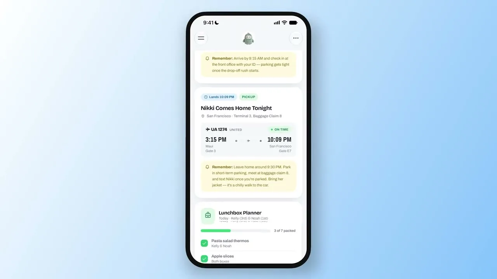

来源：https://www.allthingsmuse.com/articles/muse-spaces-in-depth/
取文：2026-11-08，直接下载

Meta's launch videos walk through a family dashboard, a retro shopping catalog, and a sidebar that rearranges itself on request. Here's what Spaces can do, what Zuckerberg built with them, and what is still to come.

Meta launched Spaces in the Muse app today, and the launch came with three demo videos that show the feature working, from a first chat message to a finished dashboard. The videos show a family dashboard that tracks school pickups and lunchboxes, a shopping catalog styled like a 1995 mail-order booklet, and a sidebar that rearranges itself when asked. Together they show what a Space actually looks like in use.

Spaces are custom experiences inside Muse that start with a description in chat. Tell Muse what you want, a tracker, a planner, or a project board, and it builds the first version. The Space then lives in the app, in the sidebar or the main tabs, and keeps changing as it gets used. They are available everywhere Muse is available starting today.

[视频：Meta Spaces 演示视频：Alex Cornell 演示家庭仪表盘、Jolly Mall 与周末模式](https://www.allthingsmuse.com/muse-spaces-demo-video.mp4)

Alex Cornell from Muse Product Design walks through Spaces: a Family Dashboard, a retro shopping catalog called Jolly Mall, and a sidebar that switches to weekend mode on request. (Video: Meta via X)

## Inside the 90-Second Walkthrough

The Muse account introduced the demo with a short post: “Spaces are here. Describe a planner, a tracker, a game, whatever you need, and Muse builds it right into the app. Pin it to your tabs, come back anytime, and it’ll already be up to date.”

The longest demo, posted by the Muse account on X, runs about 90 seconds and follows Alex Cornell from Muse Product Design as he builds Spaces on a phone. The first is a Family Dashboard for a user named Marlo. It pulls together the day’s events, school pickups, calendar items, and a Lunchbox Planner that tracks which kids have their lunches packed. A still from the video shows the dashboard tracking a flight, UA 1274 from Maui to San Francisco, landing at 10:09 PM, with a reminder to leave home around 9:30 PM and a lunchbox checklist that reads 3 of 7 packed.

The second Space in the video is Jolly Mall, which turns saved Instagram posts into a shopping catalog styled after a Fall ’95 mail-order booklet, complete with a “Mall in the Sky” masthead. One page shows a Haand Diner Mug Pair, handmade glazed porcelain, listed at $79.98 with a buy-now button. Cornell then asks for a section for movie night, and the dashboard adds one, with The Wild Robot lined up for Friday night.

In the last part of the demo, Cornell types “Weekend mode please,” and the sidebar reorganizes itself: Chat, Feed, Family Dashboard, Memory Bank, and Scotland Trip Planner move to the top, and everything else drops into the Spaces section. The same trick works in reverse: the weekday version keeps a weekly planner up front during the workweek, swapped for weekend plans on Saturday.

The Family Dashboard in Meta's demo tracks a flight home, a school pickup, and a lunchbox checklist in one view. (Image: Meta via X)

## A Garden Notebook Built from a Walk

A second Meta walkthrough, posted on Threads, shows the same build flow from a different starting point. A user asks for a space about the plants found on walks, with a photo, a name, and where each one was found. Muse responds with “Building Garden Monitor…” and produces a field notebook titled “What’s growing out there?” with five finds, five species, and five places, including Coast live oak, Coyote brush, Western sword fern, and California buckeye. The user then asks for a section for the plants not yet identified, and the interface adds an “Unknowns” filter tab. The demo ends with a row of example Space icons: a garden notebook, pet care, weekly meals, a run log, a concert tracker, and games.

Meta’s own announcement video shows a shorter version of the same loop. A user asks to book a tee time on Thursday for a trip, and Muse searches golf courses near the hotel, finds available times, and adds the booking to a Scotland Trip Planner space.

[视频：Meta Spaces 演示视频（Threads 发布）](https://www.allthingsmuse.com/muse-spaces-thread-video.mp4)

Meta's animated intro for Spaces shows Jolly assembling a space from building blocks. (Video: Meta via X)

## How a Space Gets Built

The demos show the same four-step loop every time. It starts in Main chat with a plain description of what the Space should do, and Muse builds the first version. The user then refines it by asking for changes in chat, adding a section, changing the look, or adjusting how it works. Finally, the Space gets a home: pinned to the sidebar, moved into the main tabs, hidden until needed, or scheduled to appear at certain times.

Connected apps keep a Space current. Meta says Spaces update in the background on their own when linked to the apps a person already uses, so new concert dates, price changes, and savings progress show up without asking. A school dashboard finds events in school emails and adds them to the calendar. The shopping hub pulls gift ideas, wishlists from Instagram saves, and Marketplace listings and buyer messages into one view.

## Zuckerberg’s Own Spaces

Mark Zuckerberg posted about the feature on X on Friday, writing, “Playing around with spaces in Muse lately — tell Muse what you need and it builds it. I’ve made a BBQ game, an event tracker, and a home control dashboard. Excited to see what you build.” His three examples sit at the playful end of the range Meta is pitching, and they match the pattern in the demos: a game, a tracker, and a dashboard that pulls live information into one view.

TechCrunch described Spaces as breakout conversations built around a particular topic, living in the sidebar where you interact with your Muse agent. TechCrunch also noted the size of the audience: Zuckerberg said on Meta’s October earnings call that Muse agents had 10 million users in the US and Canada, less than two months after the agents debuted.

## What Comes With It, and What Is Still to Come

Spaces arrived a day after [Muse Voice rolled out across the US](/articles/muse-voice-video-chat-us-rollout/), which added video chats and phone calls with a Muse avatar. Meta’s blog also says specialized versions of its models are rolling out to Muse, trained with learnings from [Muse Wonder](/articles/muse-specialized-wonder-models/).

Sharing is the one part Meta has not shipped. Spaces are personal from the start, and the company says it is exploring ways to let people share them with others. Until that lands, a Space is a private corner of the app, built by describing an idea and refined in conversation.
