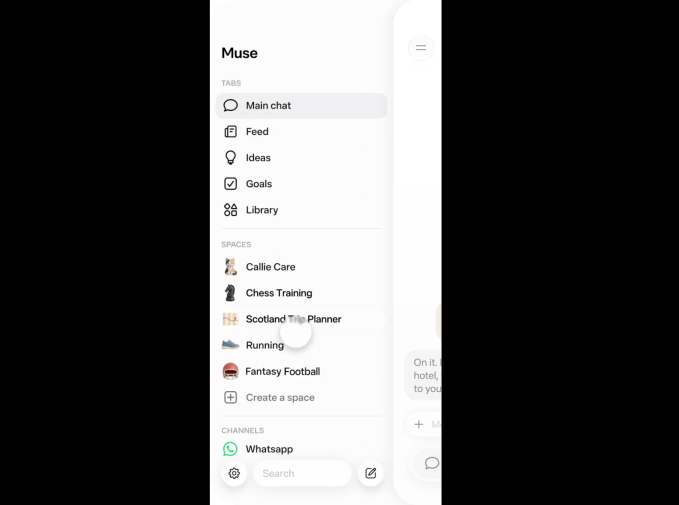



**收录说明**：直接下载后用 extract.py 抽取；已删去文末 Topics、推广、作者简介与 Most Popular 等页面杂项；文中一张 Meta 截图已本地化到 images/（22KB）。原文全文存于本目录的 original.md，网站上不显示，已翻译。

**内容摘要**：TechCrunch 报道 Meta 推出 Spaces，记者将其理解为围绕特定主题的分支对话，Meta 则称之为“custom experiences”；点击侧边栏中的空间即可打开相应对话，由 Muse 朝特定目标推进。文中引述 Meta 的说法：“Describe an idea in chat, and Muse builds a space for you, whether that’s a tracker, a planner or a project board”，以及连接应用后空间在后台自动更新的说法。文中引述 Zuckerberg 当日在 X 上的帖子，称他做了 BBQ 游戏、活动追踪与家庭控制面板。文中提到 10 月财报电话会上称 Muse 在美国与加拿大已有 1000 万用户，并指出这是该周内 Muse 的第二个新功能，前一天推出了 Muse Voice；文末将 Muse 与 dots、Grok Bot 对比。

**保留理由**：这篇媒体报道记录了 Spaces 上线当日媒体的理解与 Zuckerberg 的公开表态，并给出了 1000 万用户这一数据在财报电话会上的出处，可与官方稿对照。

---

Meta 最近推出了[其 Muse 智能体](https://techcrunch.com/2026/09/23/everything-new-coming-to-metas-ai-agent-muse/)——新一代毛茸茸的智能体小帮手。现在，该公司推出了 Spaces，一种与它们沟通和协作的新方式。

据我所知，Spaces 基本上就是围绕特定主题展开的分支对话——尽管 Meta 称它们为「定制体验」。它们位于你与 Muse 智能体交互界面的侧边栏中。点击某个空间会打开对话，Muse 在其中代你朝某个特定目标推进。

例如，如果你想规划一次度假，可以打开一个专注于该特定项目的新空间；每当你想与 Muse 一起处理它时，点击打开那个标签即可。或者，如果你正专注于为即将到来的家庭聚会收集食谱，你会为那个特定项目打开一个新空间。Meta 给出的其他例子还有节日礼物追踪器、婚礼策划器，或用于 DIY 项目的空间。

「在对话中描述一个想法，Muse 就会为你构建一个空间，无论是追踪器、规划器还是项目板，」Meta 说。

**图片来源：**Meta

Meta 说，空间还可以轻松地与第三方应用和信息集成。

「连接你使用的应用，你的空间会在后台自行保持最新，因此新的演唱会日期、价格变化或储蓄进度无需你询问就会出现，」该公司说。

周五，Meta 创始人兼首席执行官 Mark Zuckerberg 在 X 上[发帖](https://x.com/finkd/status/2118765774034579808)谈到这一新功能：「最近一直在 Muse 里玩空间——告诉 Muse 你需要什么，它就会构建出来。我做了一个烧烤游戏、一个活动追踪器和一个家庭控制面板。期待看到你们构建的东西。」

Muse 智能体——以及包裹它们的毛茸茸头像——在过去几个月里受到了相对热烈的欢迎。在 10 月的财报电话会上，[Zuckerberg 说](https://fortune.com/2026/10/22/mark-zuckerberg-meta-muse-stripe-credit-limit-shopping/)其智能体在美国和加拿大拥有 1000 万用户——此时距这些智能体首次亮相还不到两个月。

该公司显然正忙于围绕这些智能体构建用户体验。Spaces 实际上是 Meta 在过去一周内推出的第二个 Muse 新功能。周四，该公司还[宣布了 Muse Voice](https://techcrunch.com/2026/11/05/meta-says-us-users-can-now-video-chat-with-their-muse-ai-avatar/)，允许用户与其智能体视频聊天并用语音下达指令。

该公司正在与其他可爱毛茸茸的 AI 智能体竞争——包括 [OpenAI 的 dots](https://techcrunch.com/2026/09/29/openai-launches-dots-its-bubbly-agentic-avatar/) 和 SpaceXAI 的 [Grokbot](https://techcrunch.com/2026/10/01/musks-ai-chatbot-grok-reportedly-encouraged-trump-to-capture-venezuelas-president/)，它们也以类似卡通形象的角色首次亮相。
