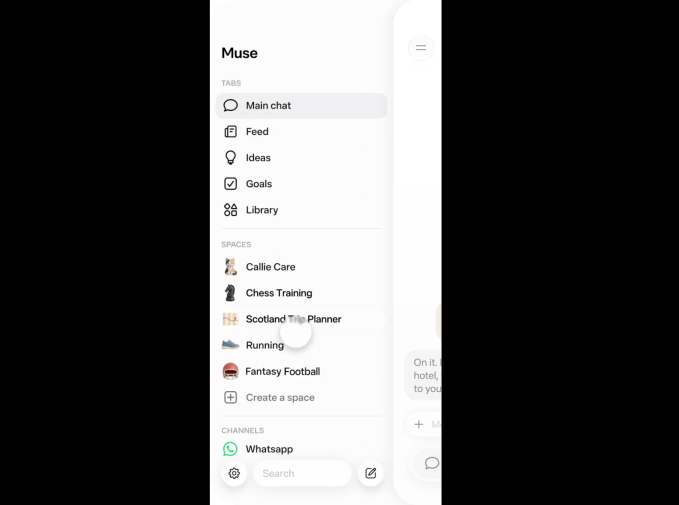

来源：https://techcrunch.com/2026/11/06/meta-introduces-spaces-a-new-way-to-collaborate-with-your-muse-agent/
取文：2026-11-06，直接下载

Meta recently launched [its Muse agents](https://techcrunch.com/2026/09/23/everything-new-coming-to-metas-ai-agent-muse/) — a new generation of cuddly agentic helpers. Now, the company has launched Spaces, a new way to communicate and collaborate with them.

As far as I can tell, Spaces are basically breakout conversations that revolve around a particular topic — although Meta refers to them as “custom experiences.” They live in the sidebar of the interface where you interact with your Muse agent. Clicking on the Space brings up the conversation, where Muse works toward a particular goal on your behalf.

For instance, if you wanted to plan a vacation, you could open a new Space focused on that particular project, and whenever you want to work on it with Muse, you would click to open that particular tab. Or, if you’re focused on collecting recipes for an upcoming family event, you’d open a new Space for that particular project. Other examples Meta gives are a holiday gift tracker, a wedding planner, or a space for DIY projects.

“Describe an idea in chat, and Muse builds a space for you, whether that’s a tracker, a planner or a project board,” Meta says.

**Image Credits:**Meta

Spaces can also be easily integrated with third-party apps and information, Meta says.

“Connect the apps you use, and your spaces keep themselves up to date in the background, so new concert dates, price changes, or savings progress show up without you having to ask,” the company says.

On Friday, Mark Zuckerberg, Meta’s founder and CEO, [posted](https://x.com/finkd/status/2118765774034579808) about the new feature on X: “Playing around with spaces in Muse lately — tell Muse what you need and it builds it. I’ve made a BBQ game, an event tracker, and a home control dashboard. Excited to see what you build.”

Muse agents — and the cuddly avatars that enclose them — have been greeted with a relatively warm reception over the past few months. During its earnings call in October, [Zuckerberg said that](https://fortune.com/2026/10/22/mark-zuckerberg-meta-muse-stripe-credit-limit-shopping/) its agents had 10 million users in the U.S. and Canada — less than two months after the agents debuted.

The company is obviously busy building out the user experience around the agents. Spaces is actually the second new Muse feature that Meta has debuted over the last week. On Thursday, the company also [announced Muse Voice](https://techcrunch.com/2026/11/05/meta-says-us-users-can-now-video-chat-with-their-muse-ai-avatar/), which allows users to video chat with their agent and give it commands verbally.

The company is in competition with other cute and cuddly AI agents — including [OpenAI’s dots](https://techcrunch.com/2026/09/29/openai-launches-dots-its-bubbly-agentic-avatar/) and SpaceXAI’s [Grokbot](https://techcrunch.com/2026/10/01/musks-ai-chatbot-grok-reportedly-encouraged-trump-to-capture-venezuelas-president/), which were debuted with similarly cartoonish personas.
