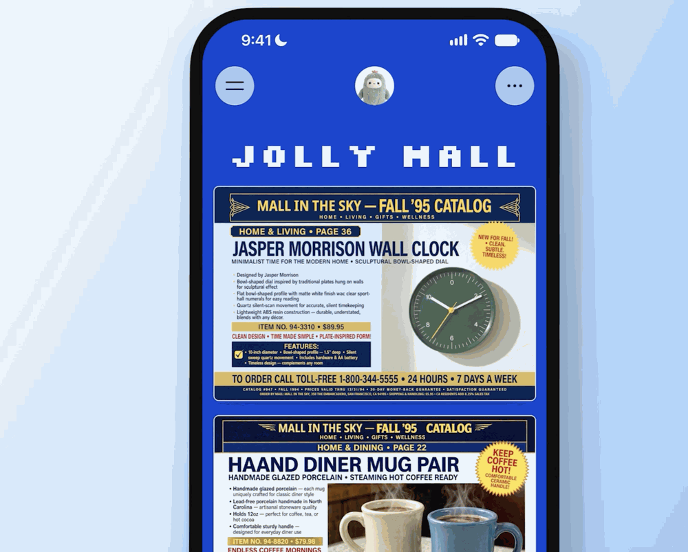



**收录说明**：原站禁止直接下载，改由浏览器读取全文（模型抽取，关键句已用检索索引中的转载对照核对）；首图（手机上显示复古目录风格 JOLLY MALL 空间示例）已下载本地化到 images/（PNG 1.47MB 已压至 86KB）。原文全文存于本目录的 original.md，网站上不显示，已翻译。

**内容摘要**：The Verge 报道 Meta 在 Muse 中推出 Spaces：用户用文字描述即可创建空间，Muse 可为其搭建购物中心、学校看板、音乐追踪、问答游戏等可在应用内直接互动的体验。连接 Gmail、Google Calendar、OpenTable、Notion 等外部应用后，Muse 会持续从中拉取信息，在后台更新空间里的价格、日期等信息，用户还可在空间内打勾、添加备注、编辑内容。空间可固定到侧边栏、移入主标签或按时间排布，文中引述 Meta 的举例：“For example, keep your weekly planner up front during the workweek, then swap it for your weekend plans on Saturday”。文中还提到 Meta 正把 Muse Wonder 模型的 Active Memory 与 Active Focus 能力带入 Muse 应用与 Meta AI 聊天机器人；Spaces 向全部 Muse 用户推送，分享协作功能正在探索中。

**保留理由**：这篇媒体报道从第三方角度复述了 Spaces 的创建方式、外部应用联动与排布方式，并记录了 Active Memory 与 Active Focus 随同推送的消息，可与官方稿对照。

---

Meta 的 Muse AI 可以为你此刻需要的 app 版本创建定制的「spaces」

你可以直接在 Muse 内创建购物中心、学校看板或音乐追踪器之类的东西。

Meta 现在将允许你在 Muse 内构建定制的、类似 app 的体验。这项名为「spaces」（空间）的新功能让其 AI 助手能够搭建购物中心、学校看板、音乐追踪器、问答游戏等，你可以直接在 Muse 应用内与它们互动。

Meta 表示，你可以通过描述来创建一个新空间。如果你把外部应用连接到 Muse——例如 Gmail、Google Calendar、OpenTable、Notion 以及其他与 Muse 协作的应用——AI 助手将持续从中拉取信息，使其能够在后台更新你空间中的价格、日期和其他信息。你还可以通过勾选事项、添加备注和进行编辑来与空间内的元素互动。

你也可以更改空间在 Muse 应用中的位置，Meta 允许你把它们留在侧边栏、移入主标签页，或安排你看到它们的时间。Meta 表示：「例如，在工作日把每周计划放在前面，到了周六再把它换成周末计划。」

Meta 还宣布，正在把其 Muse Wonder AI 模型的新「Active Memory」（主动记忆）和「Active Focus」（主动聚焦）能力引入 Muse 应用及其 Meta AI 聊天机器人。这将让 Muse 能够理解过往信息在对话中何时变得相关，并使其更擅长朝着目标推进。

Meta 正在向所有 Muse 用户推出 spaces。公司还在研究与其他用户分享你的空间并与之协作的方式。
