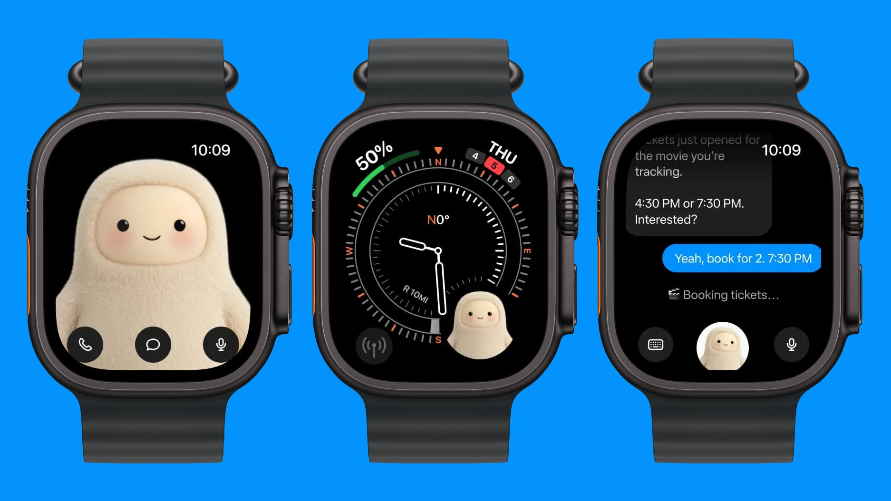



**收录说明**：直接下载。去掉了首图 Jolly 插画与文末「Earlier coverage」栏目；手表截图已本地化。原文全文存于本目录的 original.md，网站上不显示，已翻译。

**内容摘要**：Muse 的 iOS 应用当天更新，新增 Apple Watch 伴侣应用；Meta 首席 AI 官 Alexandr Wang 表示，该智能体也已登陆 Android WearOS 手表。手表上可发消息、语音听写或打电话，Muse 表盘复杂功能可一键打开，Muse 形象处于应用显眼位置；App Store 15.0 版发布说明写道：“Add Muse to your wrist with the new Apple Watch Companion app.”。Wang 在 X 上宣布：“Muse is now available on Apple watch and Android WearOS.”，Muse 官方账号随后发帖称：“Works around the clock, and now on your wrist.”。Meta 分享的截图显示手表版用于订电影票等场景：Muse 告知用户正在关注的影片已开票，提供 4:30 或 7:30 两个场次，用户确认后开始为 7:30 预订两张票。手表是 Muse 设备扩展的最新一步：10 月登陆 iPad，上周在美国推出语音与视频聊天；目前 Muse 已进入美国、加拿大、日本、新加坡和墨西哥 5 个市场。

**保留理由**：在 Apple Watch 报道之外补上了 Wear OS 同步上线、Wang 与官方账号的 X 表态、15.0 版发布说明原文，以及手表订票实例与 5 个可用市场的清单。

---

Meta 的个人 AI 智能体现在来到了你的手腕上：Muse iOS 应用更新新增了 Apple Watch 伴侣应用，Wear OS 也获得了同样的支持，支持文字、听写和语音通话。

Meta 的 Muse 现在来到你的手腕上。iOS 版 Muse 应用[今日更新](https://www.macrumors.com/2026/11/09/meta-muse-apple-watch/)，新增 Apple Watch 伴侣应用，Meta 首席 AI 官 Alexandr Wang 表示，该智能体也已登陆 Android WearOS 手表。

在手表上，你可以给 Muse 发文字、口述消息，或给它打电话。一个 Muse 表盘复杂功能把该智能体放到表盘上，一点即达，而 Muse 角色在应用中也处于显眼位置。[15.0 版的 App Store 发布说明](https://appleinsider.com/articles/26/11/09/metas-muse-ai-now-has-an-apple-watch-app-which-you-shouldnt-install)说得直白：「用新的 Apple Watch 伴侣应用把 Muse 戴到你的手腕上。」

[Wang 在 X 上宣布了这次上线](https://x.com/alexandr_wang/status/2119918987543032038)：「Muse 现已在 Apple Watch 和 Android WearOS 上提供。」[Muse 官方账号几分钟后跟进](https://x.com/muse/status/2119919277692383330)：「全天候运作，现在也在你的手腕上。」

Meta 分享的截图展示了手表版的用途。Muse 以全屏出现，带有通话、聊天和麦克风按钮；作为指南针表盘上的一个小型复杂功能；以及在一段聊天中，它告诉佩戴者其正在关注的电影刚刚开票，提供下午 4:30 或 7:30 两个场次，并在用户确认后开始为 7:30 预订两张票。

Apple Watch 上的 Muse：角色全屏显示并带有通话、聊天和麦克风按钮；带 Muse 复杂功能的指南针表盘；以及 Muse 预订电影票的聊天界面。（图片：MacRumors）

## 熟悉的设计

手表应用的外观呼应了 [Muse Charm](/articles/what-is-the-muse-charm/)，这是 Meta 于 9 月宣布的口袋伴侣设备。两者都把奶油色的 Muse 角色放在一块小屏幕的中央，而手表版延续了同样的三种触达智能体的方式：通话、聊天或麦克风。

手腕是 Muse 跨设备扩展的最新一站。[Muse 于 10 月登陆 iPad](/articles/muse-ipad-app-launch/)，上周 Meta [在美国推出了语音与视频聊天](/articles/muse-voice-video-chat-us-rollout/)。该智能体已在五个市场提供：美国、加拿大、日本、新加坡和墨西哥。
