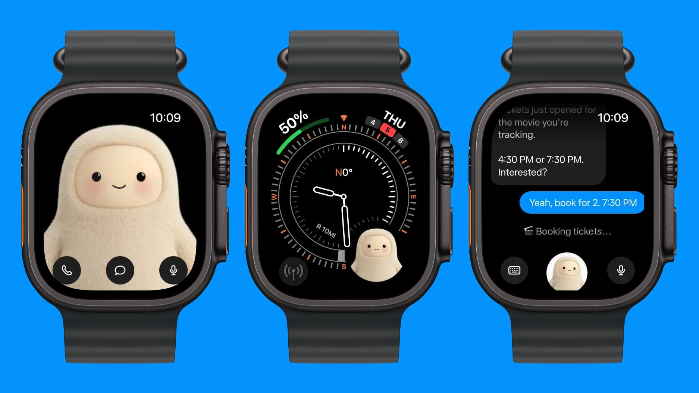

来源：https://www.allthingsmuse.com/articles/muse-apple-watch-wear-os/
取文：2026-11-09，直接下载

Meta's personal AI agent is now on your wrist: the Muse iOS app update adds an Apple Watch companion, and Wear OS gets one too, with text, dictation, and voice calls.

Meta’s Muse is now on your wrist. The Muse app for iOS [updated today](https://www.macrumors.com/2026/11/09/meta-muse-apple-watch/) to add an Apple Watch companion, and Meta chief AI officer Alexandr Wang said the agent is also available on Android WearOS watches.

On the watch, you can text Muse, dictate a message, or call it. A Muse complication puts the agent on the watch face for one-tap access, and the Muse character sits front and center in the app. The [App Store release notes for version 15.0](https://appleinsider.com/articles/26/11/09/metas-muse-ai-now-has-an-apple-watch-app-which-you-shouldnt-install) put it plainly: “Add Muse to your wrist with the new Apple Watch Companion app.”

[Wang announced the launch on X](https://x.com/alexandr_wang/status/2119918987543032038): “Muse is now available on Apple watch and Android WearOS.” [The official Muse account followed minutes later](https://x.com/muse/status/2119919277692383330): “Works around the clock, and now on your wrist.”

The screenshots Meta shared show what the wrist version is for. Muse appears full-screen with call, chat, and microphone buttons; as a small complication on a compass watch face; and in a chat where it tells the wearer movie tickets just opened for a film they’re tracking, offers 4:30 or 7:30 PM, and starts booking two tickets for 7:30 once the user confirms.

Muse on Apple Watch: the character full-screen with call, chat, and microphone buttons; a compass face with a Muse complication; and a chat where Muse books movie tickets. (Image: MacRumors)

## A Familiar Design

The watch app’s look echoes the [Muse Charm](/articles/what-is-the-muse-charm/), the pocket companion device Meta announced in September. Both put the cream-colored Muse character at the center of a small screen, and the watch version carries over the same three ways to reach the agent: call, chat, or microphone.

The wrist is the latest stop in Muse’s spread across devices. [Muse came to the iPad in October](/articles/muse-ipad-app-launch/), and last week Meta [rolled out voice and video chats in the US](/articles/muse-voice-video-chat-us-rollout/). The agent is available in five markets: the US, Canada, Japan, Singapore, and Mexico.
