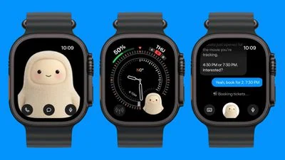



**收录说明**：直接下载。去掉了文末的 Related Roundup、Tag、Buyer's Guide 与论坛评论链接；配图已本地化。原文全文存于本目录的 original.md，网站上不显示，已翻译。

**内容摘要**：2026 年 11 月 9 日，Meta 更新 iOS 版 Muse 应用，新增 Apple Watch 支持，用户可从手表上使用这一主动式 AI 智能体。手表应用把 Muse 形象放在表上，可发消息、语音听写或打电话，还有 Muse 表盘复杂功能可快速打开。Muse 是 Meta 的个人 AI 智能体，可替用户完成任务，既有独立应用，也内置于 Instagram、Facebook 等 Meta 应用；Meta 设计的雪人形象颇受欢迎，在 Apple Watch 上处于显眼位置。手表应用的设计与 Meta 于 9 月发布的配套设备 Muse Charm 相似。

**保留理由**：提供了 Muse 登陆 Apple Watch 这一新平台的具体上线信息与交互方式（发消息、听写、通话、表盘复杂功能），是设备扩展的记录。

---

Meta 今日更新了 iOS 版 Muse 应用，新增 Apple Watch 支持，这意味着 Muse 用户可以从手表上访问这一主动式 AI 智能体。

该应用将 Muse 角色加入手表，并提供给它发文字、向它口述文字或给它打电话的选项。还有一个 Muse 表盘复杂功能可快速访问。

Muse 是 Meta 的个人 AI 智能体，可以替用户完成任务。它既有独立应用，也内置于 Instagram、Facebook 和其他 Meta 应用。Meta 为代表 Muse 而设计的类雪人角色已经流行起来，它在 Apple Watch 上处于显眼位置。

手表应用的设计与 Meta [于 9 月宣布作为伴侣设备](https://www.macrumors.com/2026/09/24/meta-did-a-one-more-thing-and-its-an-ai-tamagotchi/)的 Muse Charm 相似。
