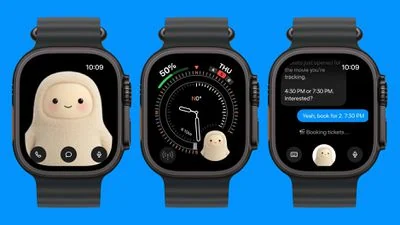

来源：https://www.macrumors.com/2026/11/09/meta-muse-apple-watch/
取文：2026-11-09，直接下载

Meta today updated the Muse app for iOS to add Apple Watch support, which means Muse users can access the proactive AI agent from the watch.

  
The app adds the Muse character to the watch with an option to text it, dictate text to it, or call it. There's also a Muse complication for quick access.

Muse is Meta's personal AI agent that can complete tasks for users. It is available as a standalone app and is also built into Instagram, Facebook, and other Meta apps. The yeti-like character Meta designed to represent Muse has become popular, and it is front and center on the Apple Watch.

The watch app design is similar to the Muse Charm Meta [announced as a companion device](https://www.macrumors.com/2026/09/24/meta-did-a-one-more-thing-and-its-an-ai-tamagotchi/) in September.
