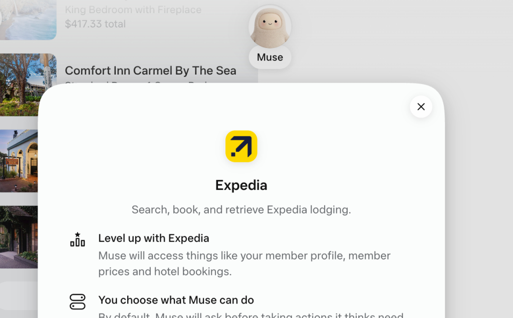

来源：https://skift.com/2026/11/09/expedia-goes-live-on-muse-but-its-ai-wins-are-inside-its-own-apps/
取文：2026-11-11，直接下载

 

Photo Credit: Expedia's Muse integration is live Skift/Screenshot

## Skift Take

Expedia's Muse connection is live: CEO Ariane Gorin noted it may even have happened during the OTA's earnings call this week. So Skift took it for a spin to see what it can and cannot do.

Meta’s Muse agent can now book Expedia hotels, about six weeks after the companies announced the integration. But there are limits.

While discussing third-quarter results last Wednesday, Expedia Group CEO Ariane Gorin teased the release, saying the connection was going live in the U.S., “potentially while we’re on this call today.”

In a follow-up, Expedia confirmed to Skift what the integration can and can’t do: It covers natural-language search and booking, but not cancellations or rebooking.

"Travelers can describe their destination, dates, and hotel preferences in their own words, and Muse can surface relevant hotel options from Expedia," a spokesperson said. "Because Expedia is the merchant of record, changes can be made through Expedia’s customer support, just like when a booking is made directly with us."

Muse offered more detail when Skift ran a limited test. In a chat, the agent explained that the integration can book only

（以下内容无法获取）
