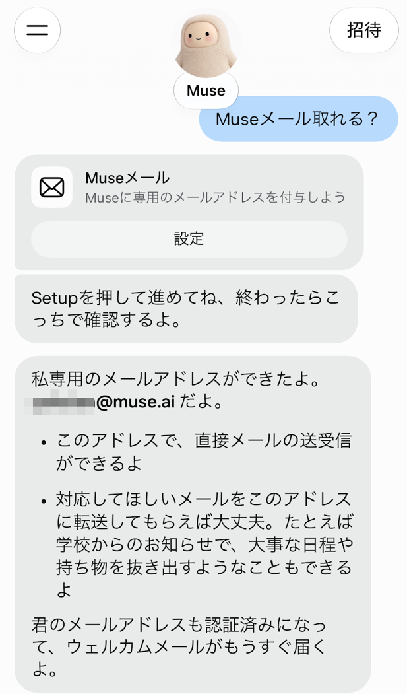
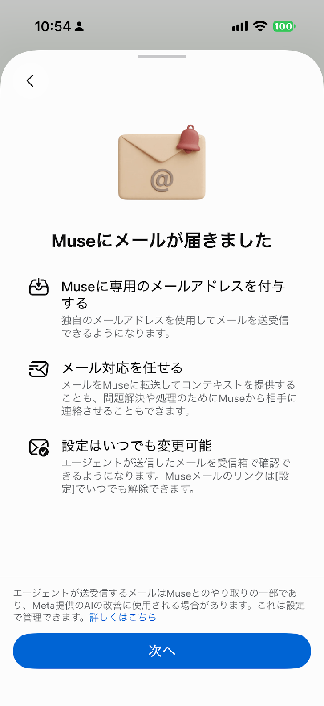



**收录说明**：直接下载全文。两张截图（聊天中取得地址、设置页）无替代文本，已看图转录并本地化。文末注明制作阶段使用了生成式 AI 服务、文责归编辑部。日本可用一事依据用户报告，Meta 未就日本发布正式公告。原文全文存于本目录的 original.md，网站上不显示，已翻译。

**内容摘要**：Meta 的个人 AI 智能体 Muse 自 11 月 11 日（日本时间）起可拥有专属邮箱地址 @muse.ai，日本用户到 12 日已陆续报告成功取得。美国和加拿大同日正式宣布开始提供，日本同期也能使用；初期面向付费用户，今后将扩展到包括免费用户在内的所有人。开通方式是在聊天中询问能否取得邮箱地址，或在设置画面的「连接器」中选择「Muse 邮件」，再确定 @muse.ai 前的字符串与发件人姓名。用另一邮箱完成验证后，可从该已验证邮箱向 Muse 发送指令。用途包括让 Muse 代发预约邮件、把日程相关邮件转发到该邮箱以记入日历，以及把长文邮件交给 Muse 摘要。

**保留理由**：本篇提供了此前已收资料没有的信息：Muse Mail 在日本已可用并有用户实际取得的报告，以及具体的开通步骤与从已验证邮箱发送指令等用法，补上了美加推出报道之外的日本落地情况。

---

AI「Muse」专属邮箱地址开始，「在日本领到了」的报告接连出现　邮件的收发也能交给它

美国 Meta 的个人 AI 智能体「Muse」自 11 月 11 日（日本时间）起，可以拥有专属的电子邮箱地址（@muse.ai）。在日本，到 12 日也已接连出现「领到了 Muse 的邮箱地址」的报告。

用户可以让 Muse 用自己的邮箱地址向店铺等发送预约邮件，也可以把与日程相关的邮件转发到 Muse 的邮箱地址，让它把日程写入日历。

在美国和加拿大，11 日正式宣布开始提供，而同一时期日本似乎也可以使用了。起初面向付费用户，今后将向包括免费用户在内的所有人开放。

在聊天中问 Muse「能领邮箱地址吗？」之类，或从设置画面的「连接器」中选择「Muse 邮件」，即可进行设置。

确定邮箱地址（「@muse.ai」前面的字符串）和发件人姓名（如「○○的代理 AI 智能体」）后即可使用。如果用另一个地址完成邮件验证，也可以从已验证的邮箱地址向 Muse 发送指令。

用户可以在聊天画面请求 Muse 发送邮件，例如让它向餐厅等发送预约邮件。也可以把与日程相关的邮件转发到 Muse 的邮箱地址，让它把日程写入日历，或者把长邮件发给 Muse 请它摘要。

本文在制作阶段使用了 ChatGPT 等生成式 AI 服务，文责归编辑部。
