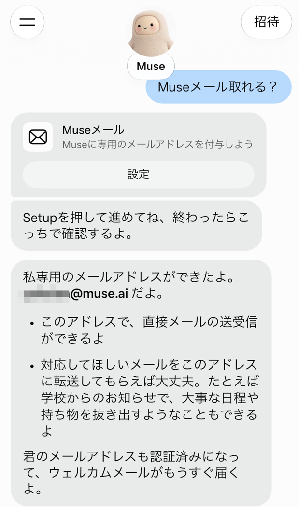
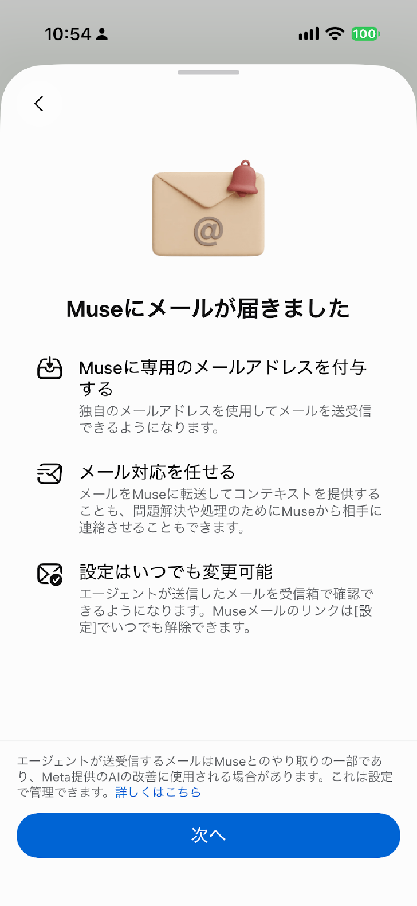

来源：https://www.itmedia.co.jp/aiplus/article/2611/12/2000003136/
取文：2026-11-15，直接下载

AI「Muse」専用メアド開始、「日本で取れた」報告続々　メール送受信も任せられる

米MetaのパーソナルAIエージェント「Muse」に11月11日（日本時間）から、専用のメールアドレス（@muse.ai）を持たせられるようになった。日本でも12日までに、「Museのメールアドレスが取れた」との報告が相次いでいる。

ユーザーは、Museのメアドから店舗などに予約メールを送らせたり、予定関連のメールをMuseのメアドに転送してカレンダーに予定を入れさせたりできるようになる。

米国とカナダでの提供開始は11日、正式にアナウンスされたが、同時期に日本でも利用できるようになったようだ。当初は有料ユーザーが対象で、今後、無料ユーザーを含む全員が使えるようになるという。

Museにチャットで「メールアドレス取れる？」などとたずねたり、設定画面の「コネクター」から「Museメール」を選ぶと設定が可能。

メールアドレス（「@muse.ai」の前の文字列）と差出人名（「○○の代理AIエージェント」など）を決めると利用できる。別のアドレスでメール認証すれば、認証したメールアドレスからMuseに指令を送ることも可能だ。

ユーザーは、チャット画面でMuseにメール送信を依頼でき、レストランなどに予約メールを送らせる、などの使い方が可能。予定関連のメールをMuseのメアドに転送してカレンダーに予定を入れさせたり、長文メールをMuseに送り、要約してもらう、といったこともできるようになる。

本記事は制作段階でChatGPT等の生成系AIサービスを利用していますが、文責は編集部に帰属します。
